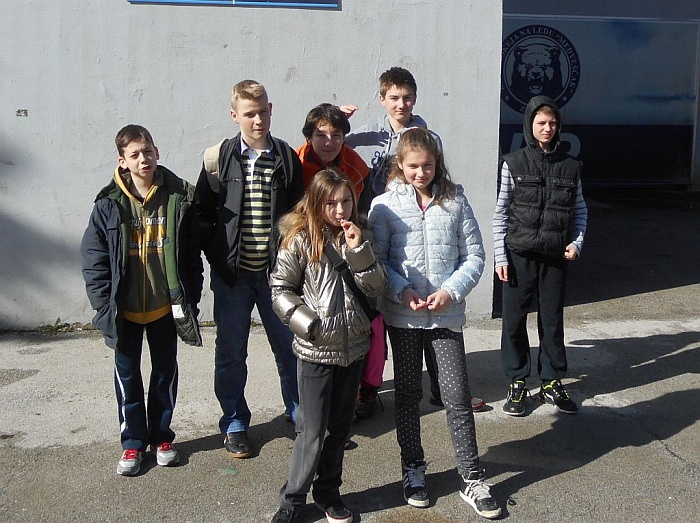
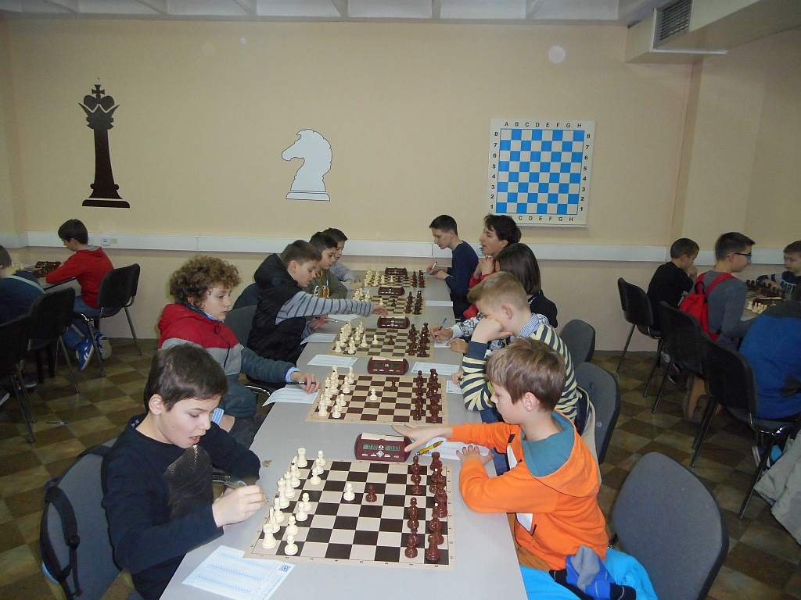
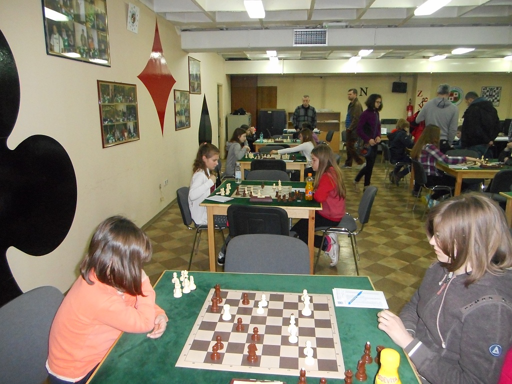
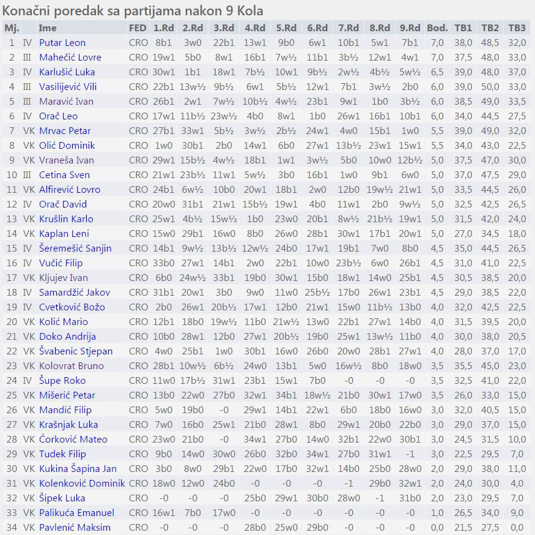
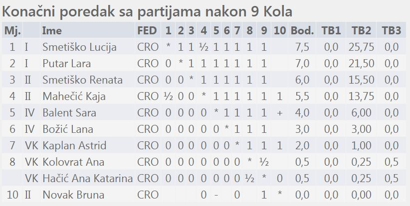

Danas je završeno Pojedinačno prvenstvo Grada Zagreba za kadete i kadetkinje do 13 godina. Igralo se u Domu sportova, tri nedjelje po tri partije s tempom igre 30+30. Nastupilo je sedam članova ŠK Odra, dečki iz prve kadetske ekipe te Katarina i Ana, koje su nastupile u starijoj konkurenciji. Njih će dvije tek sljedeće godine nastupiti u ovoj konkurenciji, a ovo im je bio dodatni trening. Ana je počela ozbiljno pokazivati zanimanje za varijante i mislim da će sljedeće godine biti veliko pojačanje za ekipu osnovne škole (ove je godine izostala iz zdravstvenih razloga). Katarina pokazuje veliku volju i vjerujem da će se ubrzo riješiti početničkih pogrešaka i grubih previda. Luka i Antonio  izostali su s ovog natjecanja na kojem su mogli steći dodatno iskustvo, Luka zbog bolesti, dok je Antonio dao prednost nogometu.  
Dečki su bili dosta dobri. Istina, Ivanu je ove godine izmakla medalja za pola boda (nije uspio pobijediti u posljednjem kolu), Vraneša je popustio u posljednjem krugu, ali je upao među prvih deset, Bruno je napokon shvatio da mora biti borbeniji jer po svojoj igri zaslužuje mnogo bolji rezultat, Kljujev se trudi više od ostalih, ali mu nedostaje iskustva (više partija) da bi pokazao svoju pravu snagu, a za Božu vjerujem da mu je napokon jasno da će morati početi više učiti.  
Svima čestitke na nastupu i ostvarenim rezultatima!  
   
