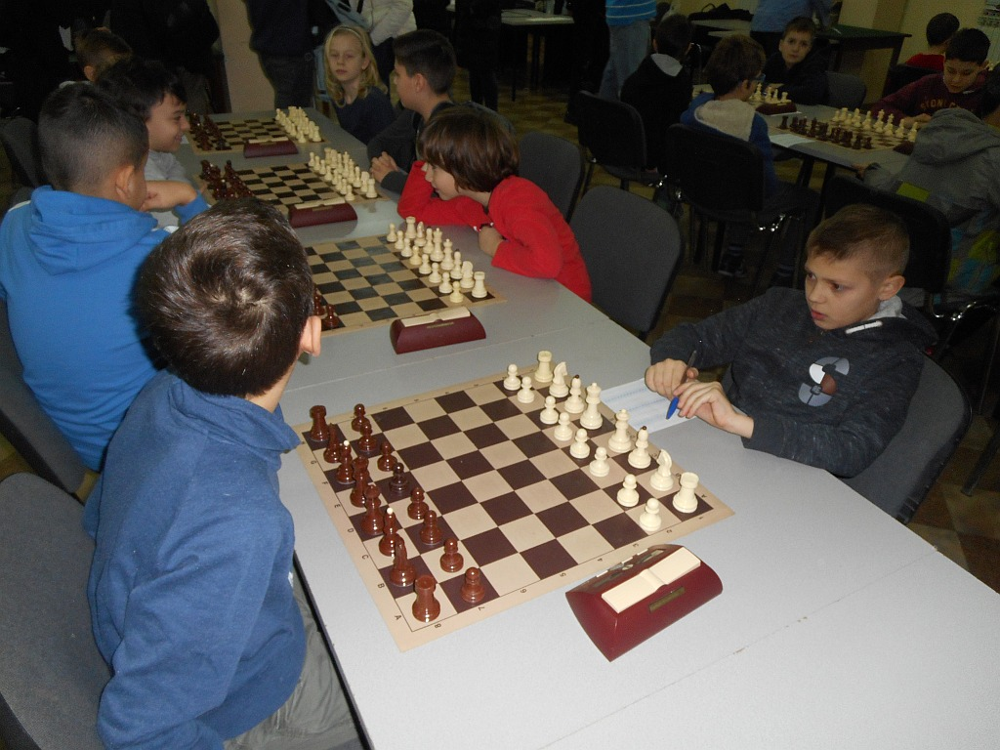
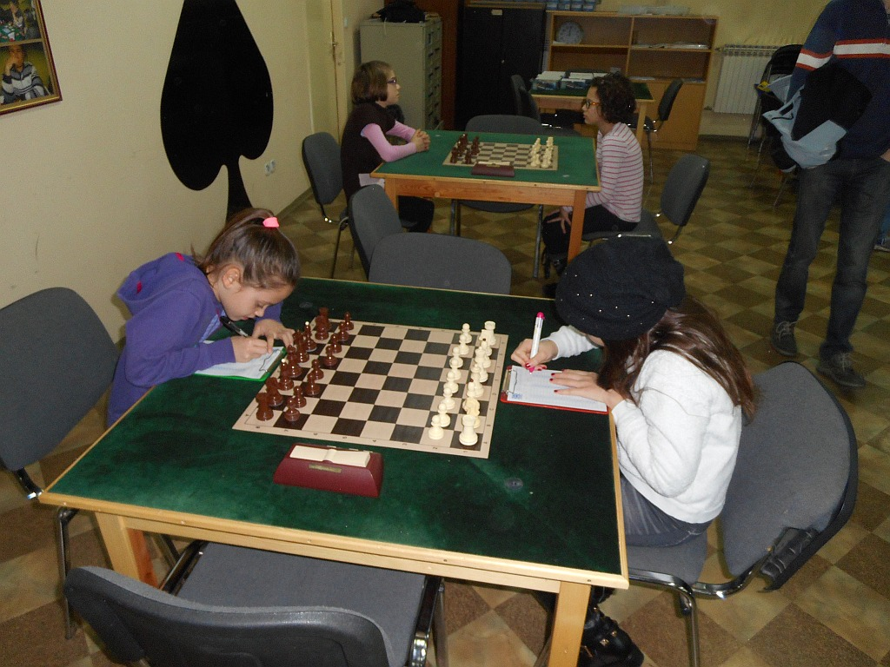
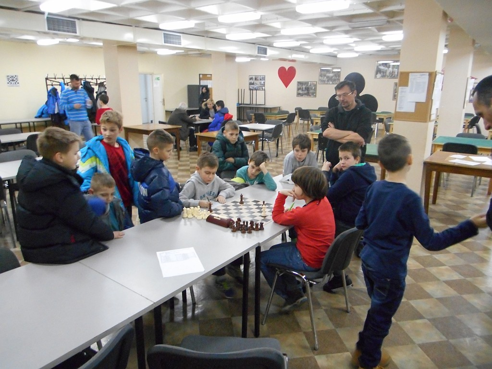
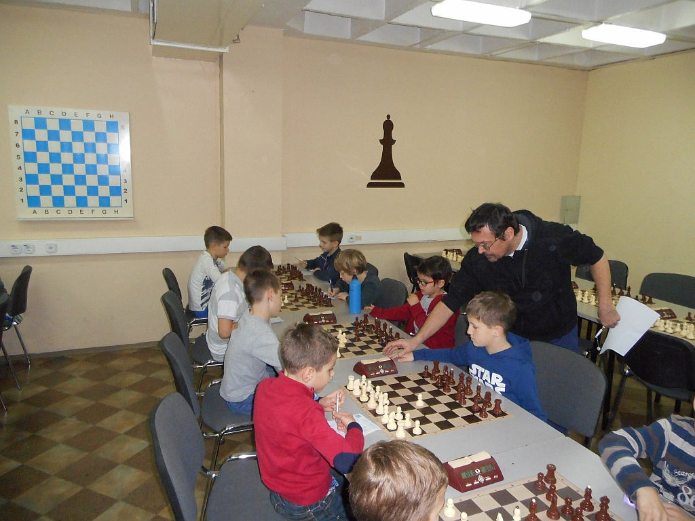
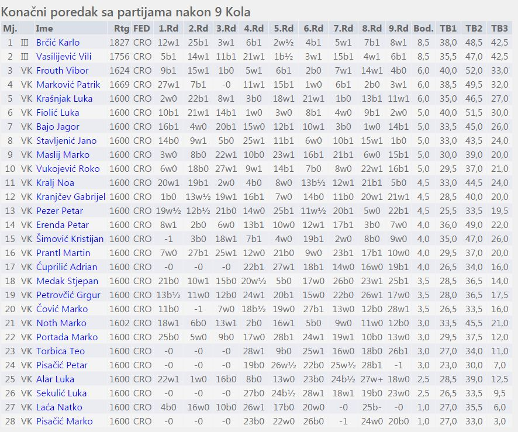
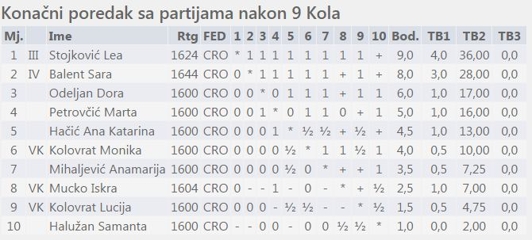
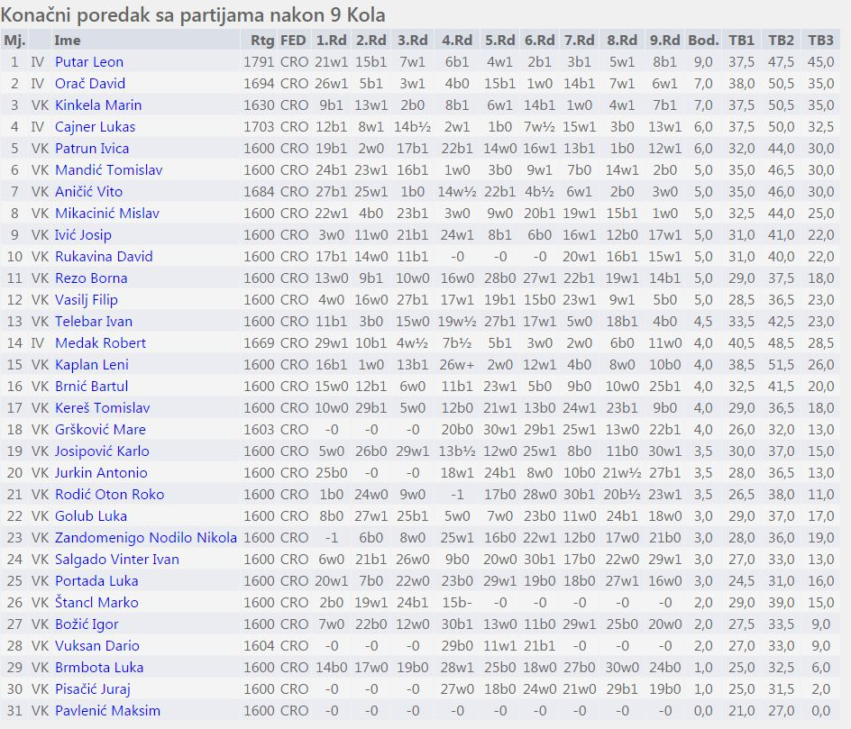

     
Završilo je kadetsko prvenstvo za mlađe natjecatelje, nastupilo je devet naših članova, istina, s dosta poteškoća jer je petero propustilo prvi krug zbog bolesti, dok je drugi krug propustila samo Lucija, iz istog razloga. Ove godine atmosfera je bila dosta ugodnija, ponajprije zbog profesionalnosti sudaca (za razliku od prijašnjih godina) pa ću tako izraziti pohvale za gospodu Damira Obada, Jelenka Mikacinića i Joakima Puškaša. Za ove dobne skupine ipak je bitniji pedagoški pristup, a to je bilo vrlo zadovoljavajuće. Nažalost, ove godine nam se Zagrebački šahovski savez osramotio (inače ga uvijek hvalim…), zbog neprimjerene dodjele odličja (najmlađima su dijelili odličja kada ih više nije bilo…), a posebno zbog naknadnog (!) uvođenja kotizacije samo s objavom na internetskim stranicama Saveza. Dosad je ovaj turnir bio besplatan, točnije, do nekoliko dana prije početka.  Ali, dobro, i na prvašićima se valjda može zaraditi…

Što se tiče nastupa naših mladih šahista, Luka i Monika su i ovaj put svojom igrom pokazali da su ipak iznad ostalih, ugodno me svojom igrom iznenadila Lucija, rezultatom je iznenadila Katarina (peto mjesto do 11 godina, najbolji rezultat!), a Antonio je pokazao zavidnu strpljivost i upornost te mislim da bi vrlo brzo mogao dostići višu razinu. Samanta je igrala prebrzo, što je i inače osobina mladih šahista koji tek počinju, ali ima volju i upornost i vjerujem da će se to brzo primijetiti i na njezinoj igri i rezultatima. Marko je napokon i sam počeo uočavati svoje pogreške u igri pa se nadam da će ih uskoro i ispraviti. Jurja i Petra još čekamo, morat će se više angažirati na treninzima, ali i dalje ozbiljno računamo na njih jer su oni budućnost, i školske i klupske kadetske ekipe.  
U klubu postoji i skupina malih šahista i šahistica koje smo mogli, ali ipak nismo vodili na ovaj turnir (osim Marka, on je već iskusan :)), ali za njih ćemo radije u Klubu organizirati poneki turnir prije nego što ih povedemo na neko službeno natjecanje.

Priliku za bolji rezultat ove su godine definitivno propustili Luka (šesto mjesto do devet godina, kadeti) i Monika (šesto mjesto do jedanaest godina, kadetkinje). Luka je nadigrao većinu svojih protivnika od kojih je izgubio, ali je dobro da je već za turnira počeo ispravljati pogreške koje je činio. Monika je pak svu svoju snagu obično počela pokazivati kada bi već došla u lošiju poziciju, pa je to često bilo prekasno. Impresivno je što njih dvoje sada već znaju i kada treba predati partiju. Njihovu su igru uočili svi koji prate šah ovih dobnih skupina i vjerujem da će nas sljedeće godine još ugodnije iznenaditi.  
Sviđa mi se što su svi kadeti počeli pokazivati i klupsku solidarnost pa su međusobno sklapani i remiji.

Za dva tjedna počinje Pojedinačno kadetsko prvenstvo Zagreba za starije natjecatelje i mislim da bi se tom turniru trebali pridružiti svi iz mlađih skupina koji žele napredovati. Tu nema pritiska, a izvrsna je prilika da se odigra još devet partija i nauči i ponešto novo. Ponajprije mislim na sve naše djevojke, kojima se možda pridruži i Ana, te na Luku i Antonija, koji bi i tamo mogli skinuti poneki skalp!

Pobjednik turnira kadeta do devet godina jest **Karlo Brčić** iz ŠK Ericsson – Nikola Tesla, Zagreb.  
Pobjednik turnira  kadeta do jedanaest godina je **Leon Putar**  iz ŠK Brestje, Sesvete.  
Uvjerljiva pobjednica turnira kadetkinja do 11 godina jest **Lea Stojković**  iz ŠK Ban Jelačić, Zaprešić.

[Rezultati kadeta do 9.](http://chess-results.com/tnr205917.aspx?lan=13&art=4&wi=821)  
[Rezultati kadeta do 11.](http://chess-results.com/tnr205918.aspx?lan=13&art=4&wi=821)  
[Rezultati kadetkinja do 11.](http://chess-results.com/tnr205916.aspx?lan=13&art=4&fed=CRO&wi=821&turdet=YES)

  

darko
