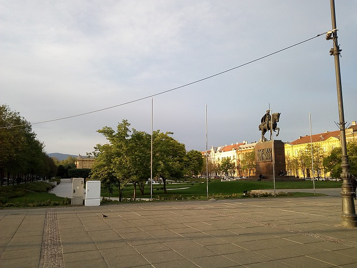
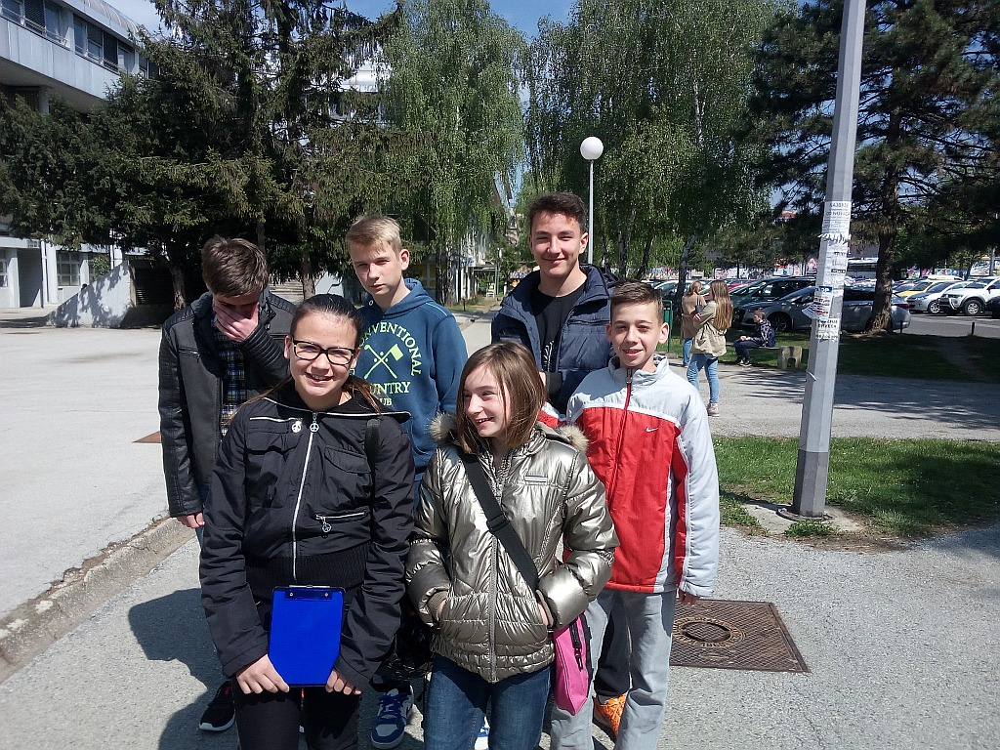

  
Od 18. do 23. travnja u Domu sportova odigrano je Pojedinačno kadetsko prvenstvo Zagreba. Ispostavilo se da termin i nije najsretniji. Dosad se to prvenstvo igralo tri nedjelje zaredom, a ove godine premješteno  je u vrijeme uskrsnih praznika, koje su mnogi iskoristili za druge aktivnosti i interese. Zbog toga je i odziv bio mnogo slabiji nego prijašnjih godina, a usto, s obzirom na to da se igralo i radnim danima, bilo je i problema u organizaciji prijevoza. Tako je i naših članova nastupilo mnogo manje. Neki su imali opravdanje, ali neki i nisu. Uglavnom, zbog slabijeg odziva, djevojčice mlađih dobi igrale su u skupinama sa dječacima, a u starijima su spojene dobne skupine do 13 i do 15 godina. Nije to ništa loše, naprotiv, ali je, nadam se, dovoljno upozorenje da se taj termin ubuduće izbjegne.  
Od naših članova, nastupili su Dora, Antonio, Luka Fiolić, Katarina, Samanta, Kljujev, Božo, Ivan i Vraneša. Dora igra sa zadovoljstvom, i to je velika stvar. A pohvalila se da je napokon skužila i šuster-mat. Antonio zasad uglavnom gubi partije i nadam se da će ustrajati još malo te svladati problem vrijednosti figura. Kada ga se upozori prije partije, tada ispravno mijenja materijal, tako da to očito već razumije, ali iz nekog razloga ne primjenjuje. 🙂  Kod Luke je sve jasno. Nedostaje mu partija. Čim naiđe na solidnijeg protivnika, gubi. I umjesto da iskoristi priliku i odigra i turnir do 13, izabrao je HNL-ov derbi kao prioritet. Starije su djevojke igrale sedam kola, i polako napreduju. Samanta i dalje ima problem da u otvaranju poklanja pješake, dok Katarina uporno odbija savjete kako da postavi pješačku strukturu. Uporno. Ipak, bilo je lijepo vidjeti kako koriste vrijeme između kola i igraju međusobno. Od velikih dečki, Božo je odigrao najlošije. Uspio je svladati problem razvoja figura, ali je počeo nepotrebno trošiti tempo-poteze. Usto, pokazalo se da nije dovoljno pripremio neka otvaranja koja igra. Kljujev je ovdje tek počeo shvaćati neke stvari, pogotovo one vezane za otvaranja, na kojima uopće ne radi samostalno. Samo pokupi mrvice znanja koje mu udijele klupski kolege. Ivan je pak na turnir došao (pre)zaigran, a kako je odigrao prvo, tako je odigrao i posljednje kolo. Pomalo neozbiljno. Katkad čak i podcjenjivački prema protivnicima. Ktomu, još ne igra dovoljno agresivno neke pozicije. Vraneši je također u nekoliko partija nedostajalo agresivnosti, ali je odigrao dobar turnir. Njega je od postolja udaljila brzopletost. A posljednjeg dana turnira velikodušno je poklanjao remije u dobivenim pozicijama. Ipak, od starijih, on jedini možda zaslužuje pohvalu za nastup, ali samo za prvih šest kola.  
**Pojedinačno kadetsko prvenstvo Zagreba 2017., pobjednici**  
[Djevojčice do 9 godina](http://chess-results.com/tnr275053.aspx?lan=1&art=1&fed=CRO&wi=821)  
1. **VK** **Resman, Katarina** 1600 ŠK Podsused, Zagreb  
2. VK Karlušić, Sara 1607 ŠK Caissa, Zagreb  
3. VK Smetiško, Ana 1615 ŠK Ericsson-Nikola Tesla, Zagreb  
[Dječaci do 9 godina](http://chess-results.com/tnr275053.aspx?lan=1&art=1&fed=CRO&wi=821)  
1. **VK** **Frouth, Vibor** 1658 ŠK Zagreb, Zagreb  
2. VK Gal, Andrej 1650 ŠK Novi Zagreb, Zagreb  
3. VK Delibašić, Dominik 1600 ŠK Zagreb, Zagreb  
[Djevojčice do 11 godina](http://chess-results.com/tnr275055.aspx?lan=1&art=1&fed=CRO&wi=821)  
1. **I Putar, Lara** 1806 Šk Brestje, Sesvete  
2. I Smetiško, Renata 1746 ŠK Ericsson-Nikola Tesla, Zagreb  
3. VK Weygand, Nora 1600 ŠK Caissa, Zagreb  
[Dječaci do 11 godina](http://chess-results.com/tnr275055.aspx?lan=1&art=1&fed=CRO&wi=821)  
1.  **III Vasilijević, Vili** 1807 HAŠK Mladost, Zagreb  
2. IV Marković, Patrik 1772 ŠK Sljeme-Agroproteinka, Sesvete  
3. III Brčić, Karlo 1839 ŠK Ericsson-Nikola Tesla, Zagreb  
[Kadetkinje do 13/15 godina](http://chess-results.com/tnr276536.aspx?lan=1&art=1&fed=CRO&wi=821)  
1. **II Mahečić, Kaja** *U13* 1716 ŠK Brestje, Sesvete  
2.  **I Kostelac, Tea** *U15* 1688 ŠK Podsused, Zagreb  
3. I Putar, Lara *U13* 1806 ŠK Brestje, Sesvete  
4. II Balent, Sara *U13* 1646 ŠK Podsused, Zagreb  
[Kadeti do 13 godina](http://chess-results.com/tnr275058.aspx?lan=1&art=1&fed=CRO&wi=821)  
1\. **III Karlušić, Luka** 1805 ŠK Caissa, Zagreb  
2\. II Putar, Leon 1831 ŠK Brestje, Sesvete  
3\. IV Orač, David 1745 ŠK Vrustun 1252, Vurnovec  
[Kadeti do 15 godina](http://chess-results.com/tnr275060.aspx?lan=1&art=1&fed=CRO&wi=821)  
1\. **I Smetiško, Josip** 2014 ŠK Ericsson-Nikola Tesla, Zagreb  
2\. II Mahečić, Lovre 1874 ŠK Brestje, Sesvete  
3\. III Alfirević, Duje 1891 ŠK Brestje, Sesvete
