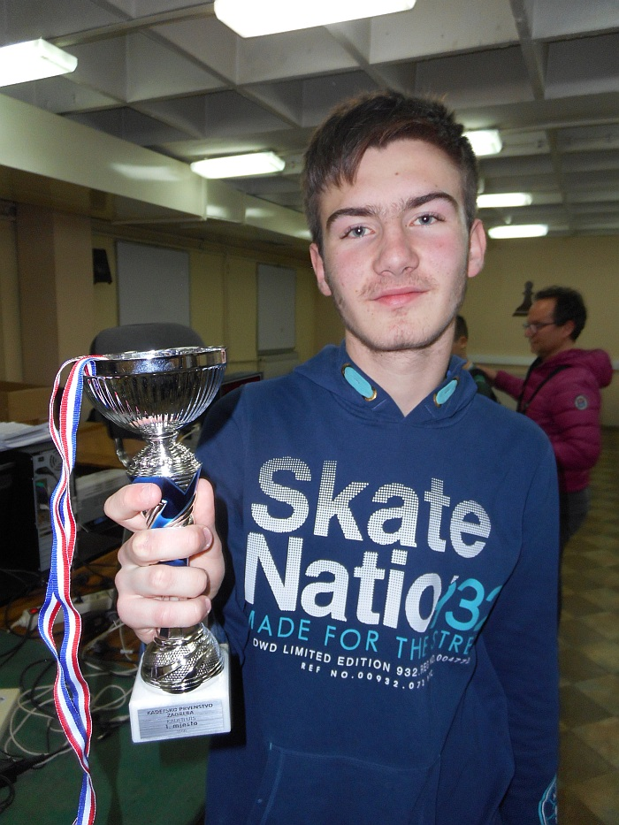
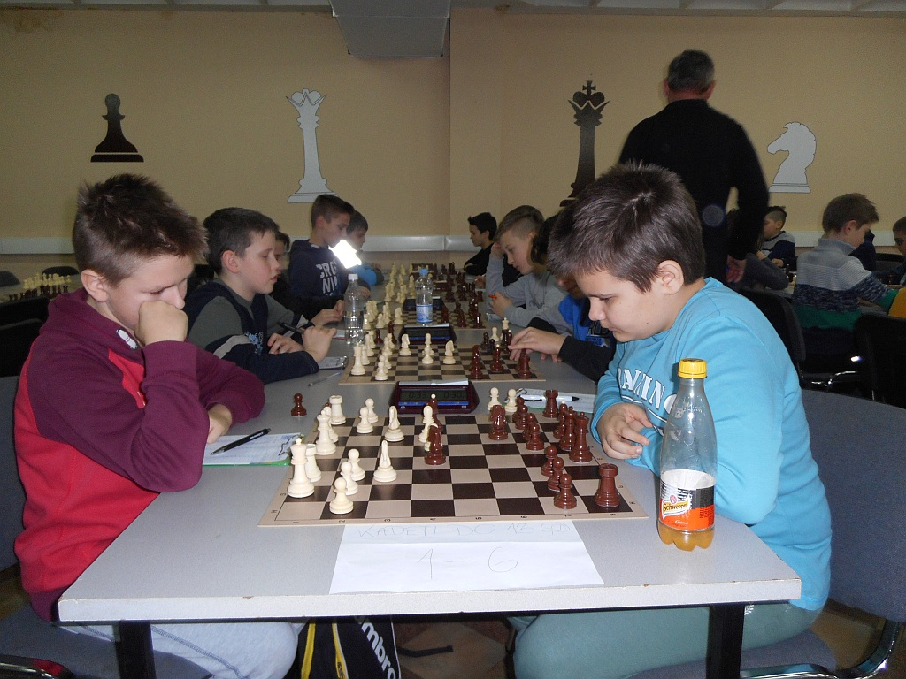
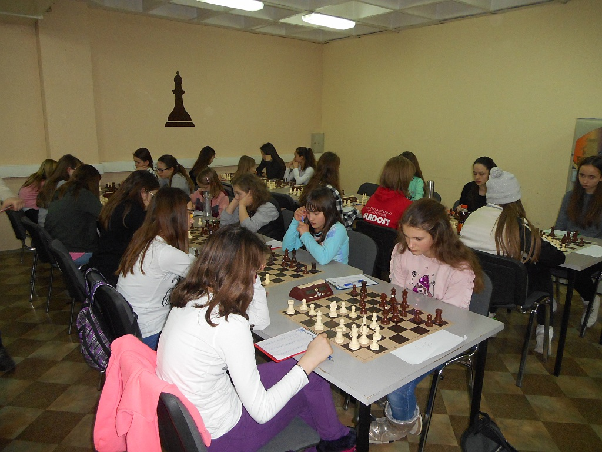

Danas su završena pojedinačna kadetska prvenstva Zagreba u konkurencijama U13 i U15. Nastupilo je 12 naših članova. U konkurenciji **[U15](http://chess-results.com/tnr329659.aspx?lan=13&art=4)** nastupili su Bruno, Kljujev, Božo,Vraneša i Ivan. Ivan Maravić osvojio je turnir vrlo lijepom i atraktivnom igrom. Imao je jaku konkurenciju, ali je pokazao i znatan napredak u posljednjih godinu dana. Igra agresivnije, ima dobre ideje i samo ga je tempo igre spriječio da ne ostvari i uvjerljiviji rezultat. **Čestitamo Ivanu na osvojenom prvom mjestu!** Vraneša i Božo su upali među prvih deset, a Kljujeva i Brunu su “milimetri” dijelili od jednakog uspjeha. Dečki su dobra ekipa i vjerujem da će to već ove godine pokazati u kadetskoj ligi.  
U ovoj konkurenciji drugo mjesto osvojio je Luka Karlušić iz ŠK Caissa, a treće mjesto pripalo je Lovri Mahečiću iz ŠK Rugvica – Vrbani. Četvrto mjesto pripalo je u posljednje vrijeme sve boljem Mariu Koliću iz ŠK Podsused.  
U konkurenciji [**U13**](http://chess-results.com/tnr329658.aspx?lan=13&art=4&fed=CRO) od naših predstavnika nastupio je samo Luka Fiolić i zauzeo visoko osmo mjesto. Još uvijek igra prebrzo za neki ozbiljniji rezultat, ali obzirom da je svih sedam igrača ispred njega starije, i to dvije godine, vjerujem da će i Luka uskoro do postolja u ovoj konkurenciji. Prvo mjestu u konkurenciji U13 osvojio je Leon Putar, a drugo mjesto Šimun Dumančić, obojica iz ŠK Sljeme-Agroproteinka. Treće mjesto pripalo je Davidu Oraču iz ŠK Vrustun 1252.  
U konkurenciji kadetkinja [**U13**](http://chess-results.com/tnr334642.aspx?lan=13&art=1&fed=CRO), naše igračice, Ana, Monika, Katarina, Samanta, Franka i Lucija pokazale su ozbiljan pristup i dobru igru. Ana je više nego ugodno iznenadila osvajanjem visokog četvrtog mjesta, a samo joj je pola boda nedostajalo do postolja. Monika je dosta loše počela turnir, ali se do kraja uspjela ispraviti i s osvojenih pet bodova završila je turnir na sedmom mjestu. Među prvih deset upala je i Katarina. Inače, djevojke su podjednake snage, a to su pokazali i rezultati na ovom turniru. Katarina, Samanta, Franka i Lucija osvojile su svaka po četiri boda, a samo je buholz odlučivao o poretku.  
Prvo mjesto na ovom turniru uvjerljivo je osvojila Lea Stojković iz ŠK Podsused. Drugo mjesto osvojila je Lara Putar iz ŠK Sljeme-Agroproteinka, a treće mjesto Sara Balent, također iz ŠK Podsused. Lea je pokazala najzreliju igru i uprkos nekoliko previda na turniru, turnir je osvojila s čitavim bodom prednosti ispred drugoplasirane Lare.

    
darko
