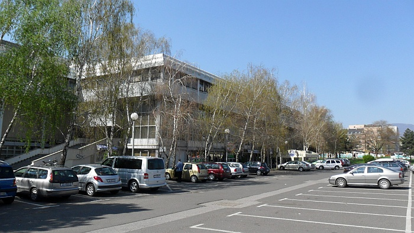

Sljedeće tri **nedjelje, 31. siječnja** te **7. i 14. veljače,** igra se Pojedinačno kadetsko prvenstvo Zagreba  za dobne skupine do 9 i do 11 godina. Organizator natjecanja je Zagrebački šahovski savez. Prvenstvo se igra u Domu sportova, a **prijave** se predaju prije početka turnira **od 8.30 do 9 sati**. Organizator osigurava digitalne satove i šahovske garniture. Tempo igre je **30 minuta plus 30 sekundi** za svaki odigrani potez pa nema opravdanja za previde! 🙂 Pravo nastupa na turniru imaju svi naši članovi, i to u skupini do 9 godina godišta 2007. i 2008. te u skupini do 11 godina godišta 2005. i 2006. Neki su članovi još na početku svoga šahovskog napretka pa im nastup i nije obvezatan, ali ako žele, dovoljno je da se pojave. Takvo iskustvo obično im puno pomogne u nadolazećim natjecanjima, a posebno za isto prvenstvo sljedeće godine. Za one koji već imaju iskustvo igranja ovog turnira i članove navedene u nastavku teksta nastup je obvezatan. Zabranjeno im je razboliti se, a dužnost roditelja jest organizirati im druge obveze tako da se ne kose s terminima nastupa na turniru te im pripremiti sendviče da izdrže tri kola, koliko ih se igra svaki dan Prvenstva.

Kadeti do 9:

1.  Luka Fiolić
2.  Petar Pisačić
3.  Marko Pisačić

Kadetkinje do 11:

1.  Monika Kolovrat
2.  Lucija Kolovrat
3.  Samanta Halužan
4.  Ana Katarina Hačić

Kadeti do 11:

1.  Juraj Pisačić
2.  Antonio Jurkin

darko  
[Pravilnik-kadeti-2016](/files/wp/2016/01/Pravilnik-kadeti-2016.docx)
