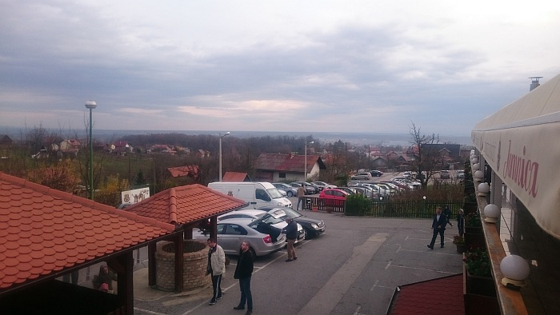
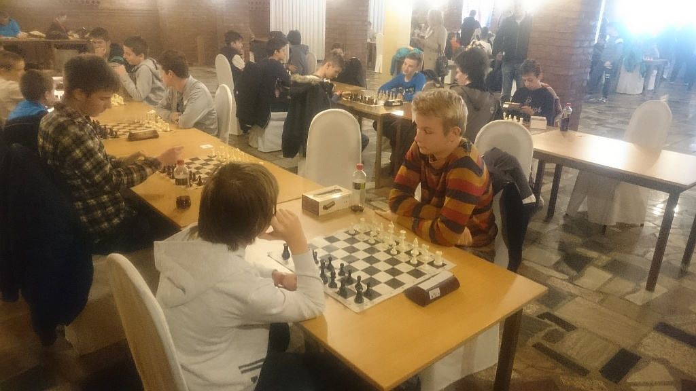
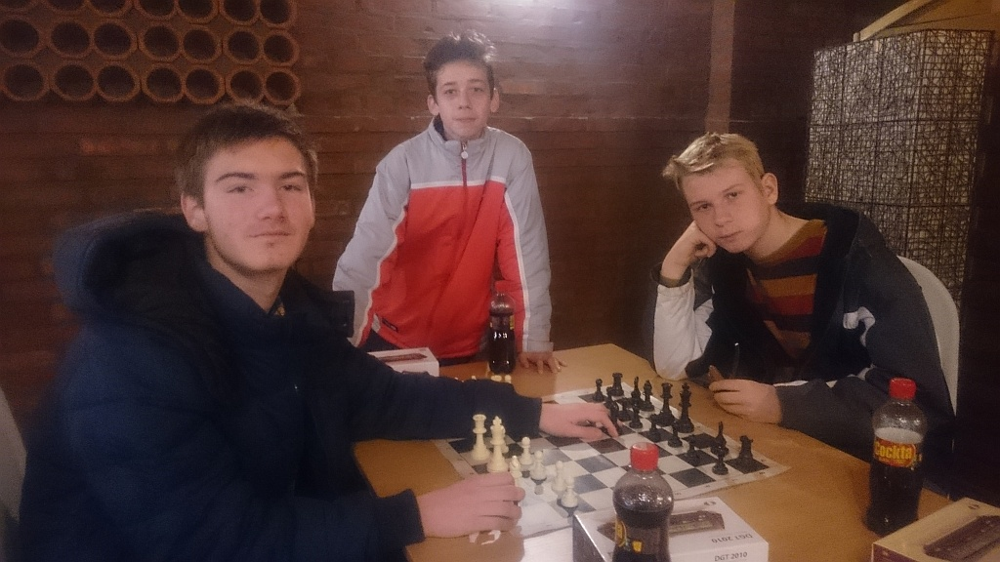
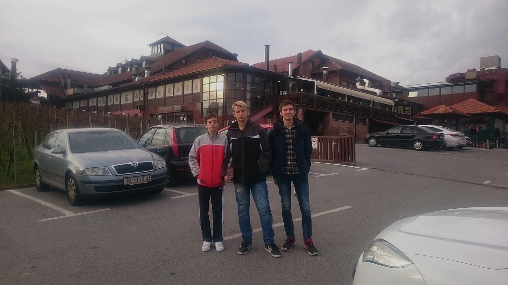
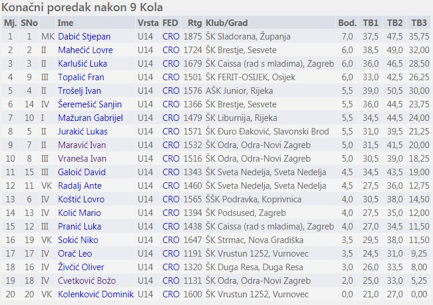

  
Od 24. do 26. studenoga, u ugostiteljskom objektu Klet Bunčić u Dugom selu, a u organizaciji HŠS-a, odigrano je Pojedinačno kadetsko prvenstvo Hrvatske u ubrzanom šahu. Igralo se devet kola s tempom 15+10.  
[Turnir](http://chess-results.com/tnr316250.aspx?lan=13&art=1&wi=821) je podijeljen u skupine U14, U12, U10, U8. Odaziv je u muškoj konkurenciji bio vrlo dobar, dok se za turnire djevojčica to ne može reći.  
Nama je zanimljiv turnir U14, jer su trojica naših kadeta uspjela nagovoriti roditelje da ih voze na natjecanje. Nastupili su Božo Cvetković, Ivan Maravić i Ivan Vraneša. Božo nije uspio ostvariti zapaženiji rezultat, dok su se druga dvojica tijesno uvukla među prvih deset. Ipak, ne toliko rezultat, koliko je važno da su odigrali jedan brži turnir i skupili još malo iskustva. Za manje od dva mjeseca čeka ih ekipno školsko prvenstvo koje se igra na još brži tempo. Šteta je samo što im se nije pridružio još netko od preostale trojice iz prve ekipe. I ovaj put, Luka Fiolić dao je prioritet nogometu te nije nastupio.  
U14 **–** POBJEDNICI  
1\. MK Stjepan Dabić, 1875 ŠK Sladorana, Županja  
2\. II Lovre Mahečić, 1724 ŠK Brestje, Sesvete  
3\. II Luka Karlušić, 1679 ŠK Caissa, Zagreb

     
darko
