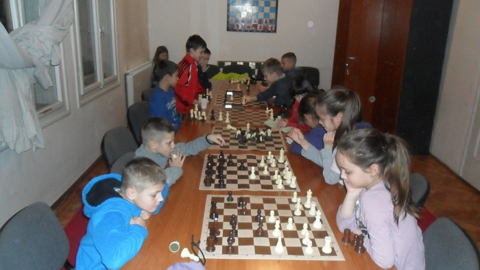
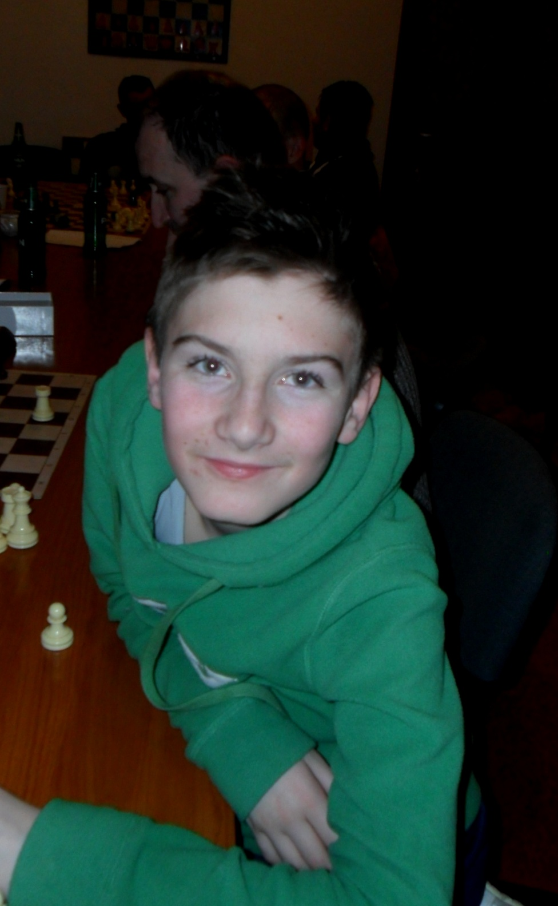
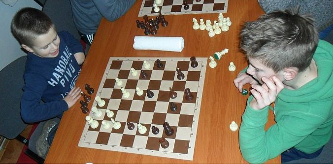

Prošlog vikenda završeno je pojedinačno prvenstvo Zagreba za kadete i kadetkinje do 9 i 11 godina. Imali smo deset predstavnika, a da neki nisu bili bolesni,  imali bismo i više. Neki su pauzirali po dva do tri kola zbog bolesti, ali sve u svemu, bilo je dobro. Dio natjecatelja nastupio je prvi put na šahovskom turniru i vjerujem da će sljedeći put biti samo lakše. Sada se moramo početi pripremati za pojedinačno prvenstvo Hrvatske. Oni najmanji moraju dobro naučiti matiranja, a djevojke početi pisati (osim Ane, ona već zapisuje partije kao velika!). Ivanu čestitamo na osvojenome drugome mjestu, bez ijednog poraza na turniru!

Mjesta:  
**Ivan – 2.**  
**Luka – 5.**  
**Franka – 5.**  
**Monika – 7.**  
**Lucija – 9.**  
**Ana – 10.**  
**Juraj – 14.**  
**Petar – 16.**  
**Vraneša – 17.**  
**Marko – 18.**



Ovo će nam biti podsjetnik za sljedeću godinu, kada očekujemo samo bolje rezultate. Šteta je samo što nismo uspjeli nabaviti Ivanovu sliku s peharom!

 Na slici lijevo su naše velike nade Ivan i Luka, koji ostaju u klubu i dulje od ostalih, a na slici desno je Ivan, bez pehara. 🙂

[do\_11\_f\_zg\_2015](/files/wp/2015/02/do_11_f_zg_2015.pdf) [do\_11\_zg\_2015](/files/wp/2015/02/do_11_zg_2015.pdf) [do9\_f\_zg\_2015](/files/wp/2015/02/do9_f_zg_2015.pdf) [do9\_zg\_2015](/files/wp/2015/02/do9_zg_2015.pdf)

**Sutra** počinje pojedinačno [**kadetsko prvenstvo Zagreba do 13**](http://www.chess-results.com/tnr162686.aspx?lan=13&art=1&rd=9&fedb=CRO&turdet=YES&flag=30&wi=984) i trajat će ovu nedjelju i sljedeći vikend, tj. i subotu i nedjelju. Početak je u 9 sati, ali teba doći barem pola sata prije, ponijeti sa sobom olovke i zdravstvene iskaznice ili odgovarajući dokument. Od naših članova očekuje se nastup Brune, Stipe, Bože, Luke Frana te također Ivana i Vraneše, koji su nastupili u mlađoj kategoriji, ali će im ovo biti dodatno usavršavanje. Tko zna, možda im se pridruži i Luka, ili Ana… ([Rezultati.](./pregled-prv-zg-do-13-2015.jpg "Tablica"))  
Za kraj, jedna partija s pojedinačnog prvenstva Zagreba 2015. za kadetkinje do 11 godina starosti.

```pgn
[Event "kadetsko ZG F 11 2015"]

[Site "www.sahovski-klub.com"]
[Date "2015.02.08"]
[Round "6"]
[White "Ana , Kolovrat   - ŠK Odra"]
[Black "Bruna, Miholic   - ŠK Novi Zagreb"]
[Result "1-0"]
[ECO "C46"]
[PlyCount "43"]

1. e4 e5 2. Nf3 Nc6 3. Nc3 Bd6 4. Bc4 Na5 5. Bd3 Nf6 6. O-O O-O 7. Nb5 Bb4 8. h3 Qe7 9. Nxc7 Bc5 10. Nxa8 d5 11. Re1 dxe4 12. Bxe4 Nxe4 13. Rxe4 Bf5 14. Rxe5 Qd6 15. d3 Rxa8 16. Bf4 Qb6 17. d4 Bd6 18. Re1 Bxf4 19. Re2 Rc8 20. Qe1 Nc4 21. Re8+ Rxe8 22. Qxe8# 1-0
```

darko
