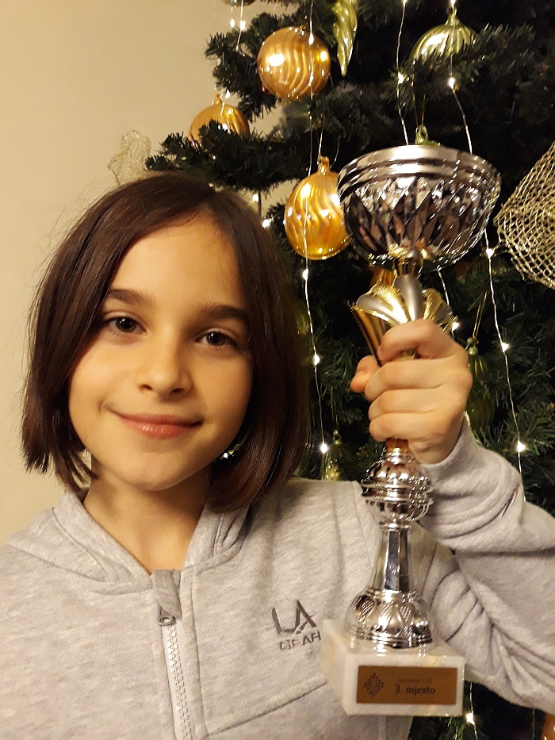

  
U organizaciji HŠS-a danas je u Zagrebu, u hotelu Panorama odigrano Pojedinačno ubrzano kadetsko prvenstvo Hrvatske. Prvenstvo se igralo po dobnim skupinama do 8, 10, 12 i 14 godina, posebno za djevojčice, posebno za dječake. Tempo igre bio je 15+10. Veliki uspjeh ostvarila je naša članica **Lucija Botica** (ŠK Odra, Zagreb) osvojivši **treće mjesto** u konkurenciji djevojčica do 12 godina. U sedam kola ostvarila je pet pobjeda i dva poraza i to samo od zlatne **Marte Trgovac** (ŠK Polet, Buševec) i srebrne **Klare Begić** (ŠK Ploče, Ploče). Lijep uspjeh, a ujedno i potvrda da se vježbom i radom može puno postići. Dio naših kadeta i kadetkinja trenutno nastupa na seniorskom sporopoteznom turniru (Zagreb open u organizaciji ZŠS-a) i šteta je što se turniri preklapaju jer vjerujem da bi se vratili i sa više odličja. Čestitke Botici na osvojenom peharu i nadamo se da je samo jedan u nizu!

Konačni poredak sa partijama nakon 7 kola

<table><tbody><tr><td>Mj.</td><td></td><td>Ime</td><td>FED</td><td>1.Rd</td><td>2.Rd</td><td>3.Rd</td><td>4.Rd</td><td>5.Rd</td><td>6.Rd</td><td>7.Rd</td><td>&nbsp;TB1</td><td>&nbsp;TB2</td><td>&nbsp;Rp</td></tr><tr><td><strong>1</strong></td><td>MK</td><td><strong>Trgovac Marta</strong></td><td>CRO</td><td>10b1</td><td>2w1</td><td>3b1</td><td>6w1</td><td>5b1</td><td>4w0</td><td>7b1</td><td><strong>6,0</strong></td><td>24,5</td><td>1922</td></tr><tr><td><strong>2</strong></td><td>VK</td><td><strong>Begić Klara</strong></td><td>CRO</td><td>9b1</td><td>1b0</td><td>8w1</td><td>3w1</td><td>7b1</td><td>5w1</td><td>6w1</td><td><strong>6,0</strong></td><td>23,0</td><td>1908</td></tr><tr><td><strong>3</strong></td><td>VK</td><td><strong>Botica Lucija</strong></td><td>CRO</td><td>6w1</td><td>5b1</td><td>1w0</td><td>2b0</td><td>8w1</td><td>9b1</td><td>10b1</td><td><strong>5,0</strong></td><td>23,0</td><td>1758</td></tr><tr><td>4</td><td>IV</td><td>Turkalj Ivana Emili</td><td>CRO</td><td>8w0</td><td>7b1</td><td>6w0</td><td>5b0</td><td>10w1</td><td>1b1</td><td>9w1</td><td>4,0</td><td>20,0</td><td>1650</td></tr><tr><td>5</td><td>VK</td><td>Vukoja Luna</td><td>CRO</td><td>7b1</td><td>3w0</td><td>9b1</td><td>4w1</td><td>1w0</td><td>2b0</td><td>8w½</td><td>3,5</td><td>26,5</td><td>1591</td></tr><tr><td>6</td><td>III</td><td>Weygand Nora</td><td>CRO</td><td>3b0</td><td>10w1</td><td>4b1</td><td>1b0</td><td>9w1</td><td>7w0</td><td>2b0</td><td>3,0</td><td>26,0</td><td>1542</td></tr><tr><td>7</td><td>VK</td><td>Vukmirović Rita</td><td>CRO</td><td>5w0</td><td>4w0</td><td>10b1</td><td>8b1</td><td>2w0</td><td>6b1</td><td>1w0</td><td>3,0</td><td>25,0</td><td>1534</td></tr><tr><td>8</td><td>VK</td><td>Burić Lucija</td><td>CRO</td><td>4b1</td><td>9w0</td><td>2b0</td><td>7w0</td><td>3b0</td><td>10w1</td><td>5b½</td><td>2,5</td><td>23,5</td><td>1521</td></tr><tr><td>9</td><td>IV</td><td>Buchwald Svea</td><td>CRO</td><td>2w0</td><td>8b1</td><td>5w0</td><td>10b1</td><td>6b0</td><td>3w0</td><td>4b0</td><td>2,0</td><td>24,0</td><td>1455</td></tr><tr><td>10</td><td>VK</td><td>Horvačić Elena</td><td>CRO</td><td>1w0</td><td>6b0</td><td>7w0</td><td>9w0</td><td>4b0</td><td>8b0</td><td>3w0</td><td>0,0</td><td>23,5</td><td>&nbsp;800</td></tr></tbody></table>

darko
