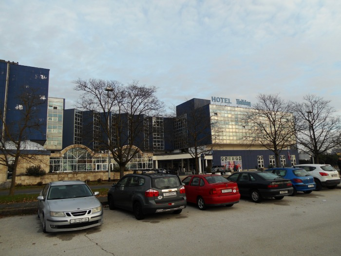
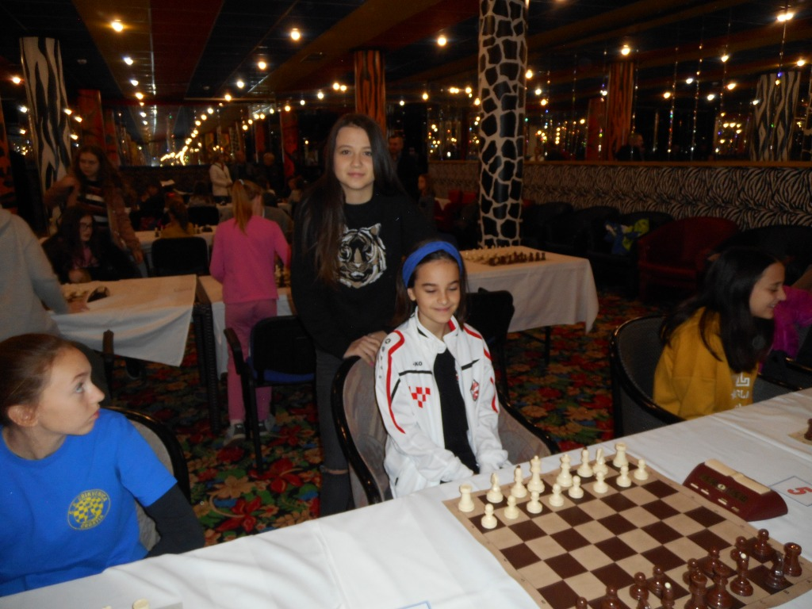
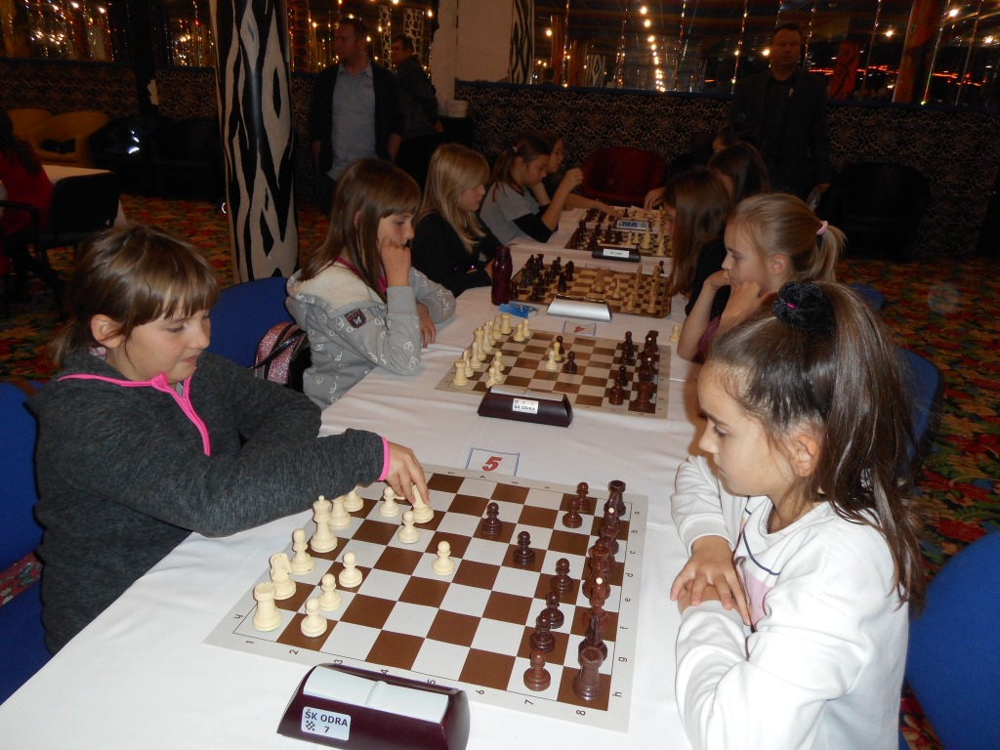

  
Za vikend, 30. studenog i 1. prosinca, u organizaciji HŠS-a, u hotelu Holiday u Zagrebu, odigrano je [Ubrzano (rapid) prvenstvo Hrvatske za kadete i kadetkinje](https://chess-results.com/tnr491878.aspx?lan=13&art=0). Tempo igre bio je 15+10. Prvenstvo se igralo u konkurencijama U8, U10, U12 i U14, odvojeno za dječake i djevojčice. Nastupilo je ukupno 158 natjecatelja, a najzastupljenija skupina bila je ona do 10 godina za dječake, gdje je bilo 40 učesnika. Od naših predstavnika nastupili su  
Samanta, U14, 7. mjesto  
Višeslav, U8, 8. mjesto  
Lucija Fiolić, U10, 8. mjesto  
Ivana Fiolić, U10, 6. mjesto  
Botica, U12, 6. mjesto.  
Botica nije uspjela obraniti [prošlogodišnji rezultat](/novosti/pojedinacno-ubrzano-kadetsko-prvenstvo-hrvatske-2018/) kada je osvojila broncu. Dobro je igrala, a za medalju joj je bila potrebna pobjeda u zadnjem kolu do koje ipak nije došla.  Ivanu je također bod dijelio od postolja, ali je vrijednija činjenica da napreduje velikom brzinom.  
Mala je šteta što više naših igrača nije nastupilo na ovom natjecanju, jer ovaj tempo najviše i vježbaju, obzirom da su i školska natjecanja sličnog tempa.

**POBJEDNICI:**  
U14  
II Filip Car (ŠK Ban Jelačić, Zaprešić) i MK Marta Trgovac (ŠK Polet, Buševec)

U12  
I Borna Franc (ŠK Samobor) i  I Petra Karij (ŠU Bljesak, Garešnica)

U10  
III Max Poljan (ŠK Stridon, Štrigova) i MK Ema Hajdinić (ŠK Kraljevica)

U8  
IV Gabriel Šoštarić (ŠK Polet, Buševec) i III Tara Škiljan (ŠK Crikvenica)

  
