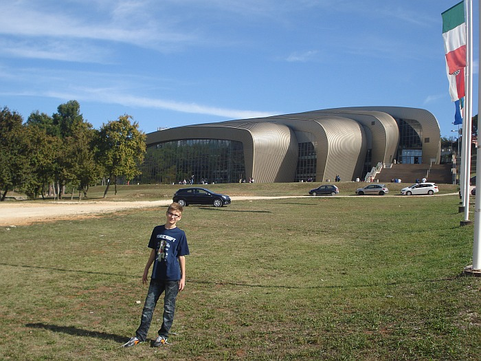
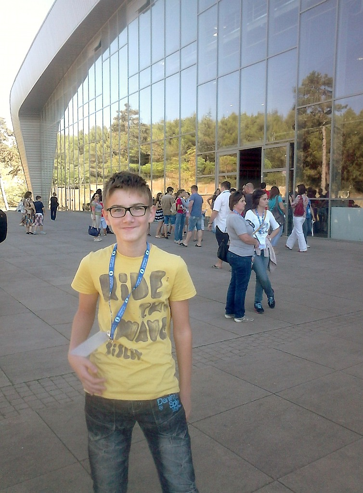
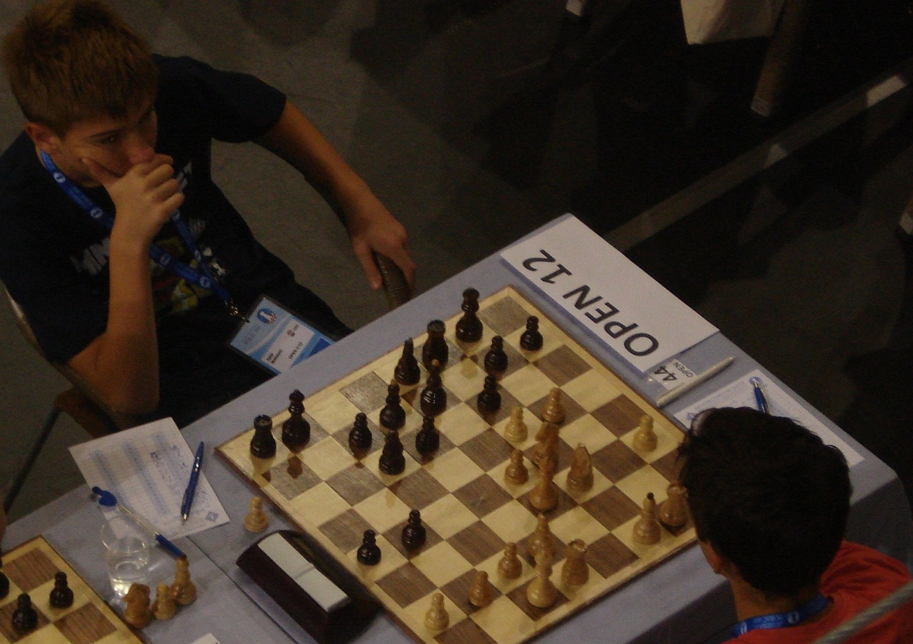

U tijeku je dvadeset peto Europsko prvenstvo za mlade u šahu i održava se u Poreču. Tu donekle olakotnu okolnost iskoristio je naš kadet Ivan te se hrabro bori sa svojim vršnjacima. Dapače, pregledavši partije zaključak je da je i bolji od njih. Rezultat je prilično loš start, pola boda iz četiri partije, ali je igrom pokazao da je bolji od većine svojih protivnika. Nedostaje mu samo iskustvo (koje upravo  stječe) da bi i rezultat bio u skladu s pokazanom igrom. Tako katkad ubrza igru kada ne bi trebao, katkad uđe u varijantu koju nedovoljno poznaje (četvrto kolo), a katkad pojednostavni poziciju kada bi trebao nastaviti pritisak (drugo kolo). U svakom slučaju, partije su to koje su već u razini naših seniora! Želimo mu da nastavi tim tempom, da se jednako posveti sljedećim partijama, kao što je to bio slučaj u prva četiri kola, i vjerujem da će prvenstvo ispuniti sva očekivanja!

[Rezultati.](http://chess-results.com/tnr180031.aspx?lan=13&art=2&rd=5&turdet=YES&flag=30&wi=984)

```pgn
[Event "25th European Youth Chess Championship 2015"]
[Date "2015/09/22"]
[Round "2"]
[White "Maravic, Ivan 1564"]
[Black "Hegedus, Dominik 1802"]
[Result "1/2"]

1. e4 c5 2. Nf3 Nc6 3. d4 cxd4 4. Nxd4 Nf6 5. Nc3 d6 6. Be3 e5 7. Ndb5 a6 8. Na3
Be6 9. f3 Be7 10. Bc4 b5 11. Bd5 Bxd5 12. Nxd5 Nxd5 13. Qxd5 Rc8 14. Rc1 Bg5 15.
Bxg5 Qxg5 16. O-O Nd4 17. Rcd1 O-O 18. c3 Ne2+ 19. Kh1 Qh6 20. Rf2 Nf4 21. Qd2
Rfd8 22. Nc2 Qe6 23. Nb4 a5 24. Nd5 Nxd5 25. Qxd5 Qxd5 26. Rxd5 b4 27. Rxa5 bxc3
28. bxc3 Rxc3 29. h3 g6 30. Rd2 f6 31. Ra6 Kf7 32. Rdxd6 Rxd6 33. Rxd6 Ra3 34.
Rd2 f5 35. Re2 Ke6 36. Kg1 fxe4 37. fxe4 h5 38. h4 Kf6 39. Kf2 g5 40. hxg5+ Kxg5
41. Rc2 Kf4 42. Re2 h4 43. Kf1 h3 44. gxh3 Rxh3 45. Kg2 Ra3 46. Kf2 1/2-1/2
```

---

```pgn
[Event "25th European Youth Chess Championship 2015"]
[Site "www.sahovski-klub.com"]
[Date "2015/09/23"]
[Round "3"]
[White "Faybish, Nathaniel 1602"]
[Black "Maravic, Ivan 1564"]
[Result "1:0"]
[PlyCount "87"]
1. e4 e5 2. d4 exd4 3. Qxd4 Nc6 4. Qe3 d6 5. Bd2 Be7 6. Nc3 Nf6 7. O-O-O O-O 8. h3 a6 9. f4 b5 10. g4 Ne8 11. Nf3 b4 12. Ne2 a5 13. g5 Bd7 14. f5 a4 15. Rg1 f6 16. Nf4 Qb8 17. Bc4+ Kh8 18. Be6 Bxe6 19. Nxe6 Rg8 20. gxf6 Bxf6 21. Nfg5 Ne5 22. Qg3 h6 23. Nf3 Nxf3 24. Qxf3 Qb5 25. Be3 Qc6 26. Qg2 Bxb2+ 27. Kb1 Nf6 28. Bd2 Nxe4 (28...b3! 29. cxb3 axb3 30. axb3 Be5) 29. Kxb2 a3+ 30. Ka1 Qxc2 31. Bxb4 Qc4 32. Rd4 Qb5 33. Rxe4 Qxf5 34. Nxc7 Qf6+ 35. Kb1 Rab8 36. Nd5 Qf5 37. Rd1 Rb5 38. Qg4 Qf2 39. Qe2 Qf5 40. Qxb5 Qxe4+ 41. Qd3 Qe5 42. Qxa3 Rb8 43. Qd3 Rb7 44. Rc1 1-0
```

---

```pgn
[Event "25th European Youth Chess Championship 2015"]
[Site "www.sahovski-klub.com"]
[Date "2015.09.24"]
[Round "4"]
[White "Maravic, Ivan 1564"]
[Black "Jordanov, Mihail 1276"]
[Result "0-1"]
[ECO "C89"]
[PlyCount "48"]

1. e4 e5 2. Nf3 Nc6 3. Bb5 a6 4. Ba4
Nf6 5. O-O b5 6. Bb3 Be7 7. Re1 O-O 8. c3 d5 9. exd5 Nxd5 10. Nxe5 Nxe5 11.
Rxe5 c6 12. d4 Bd6 13. Re1 Qh4 14. g3 Qh3 15. Qf3? (15. Re4! g5 16. Qe2 f5 17. Bxd5+ cxd5 18. Re6) 15... Bg4 16. Qg2 Qh5 17. Nd2 (17. Bxd5 cxd5 18. Bf4 Bh3
19. g4 Rae8 20. Na3 Qh4 21. Qg3) 17... Rfe8 18. Re4 Rxe4 19. Qxe4 Nf6 20. Qd3
Re8 21. Qf1 Bh3 22. Bd1 Qf5 23. g4 Nxg4 24. Qxh3 Qxf2+ 0-1
```
