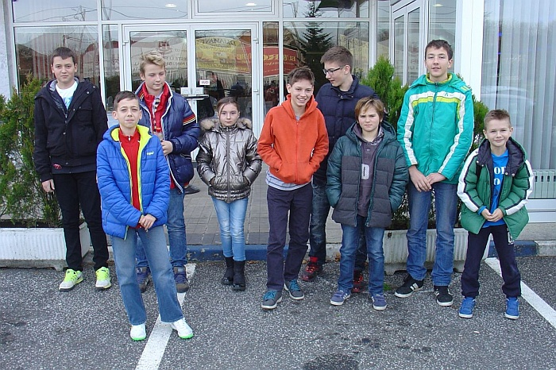
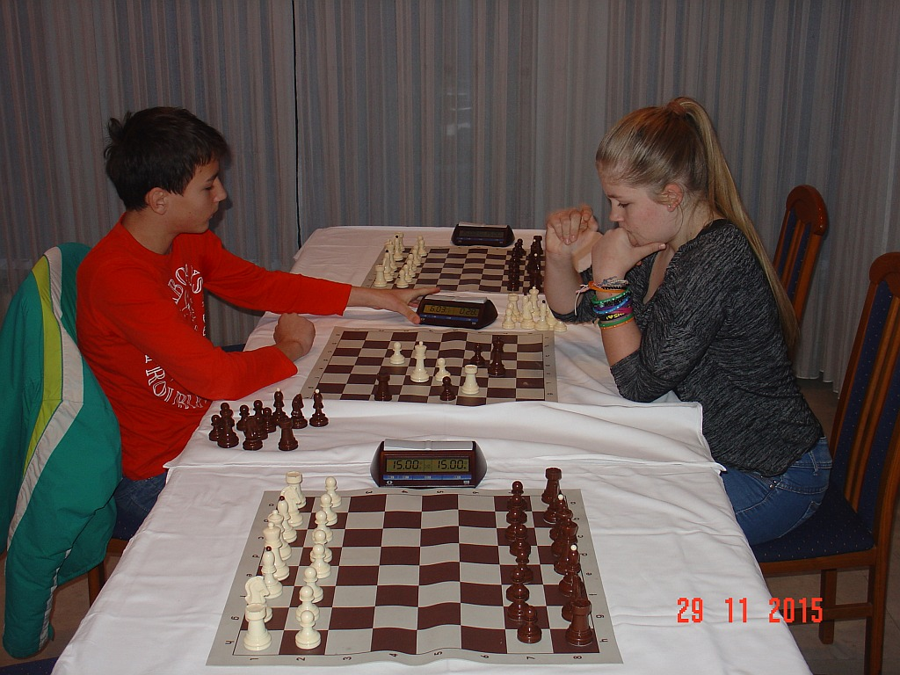
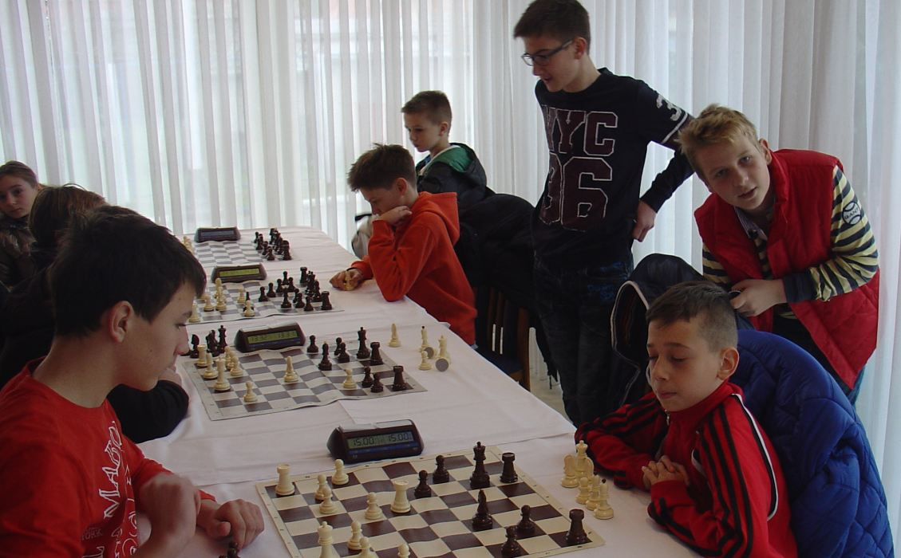

Jučer je u [Hotelu Antunović](http://www.hotelantunovicsesvete.com/) u Sesvetskom Kraljevcu, na pozivnom kadetskom turniru u organizaciji kadetskoga ŠK Brestje, odigran turnir na kojem je nastupilo devet naših članova s dobrim rezultatima. Zahvaljujemo ŠK Brestje i gospodinu Joakimu Puškašu na pozivu. Također, zahvaljujemo Darku Vraneši i Stjepanu Maraviću na organizaciji prijevoza.  
Što se tiče nastupa naših kadeta, iz tablica s rezultatima vidi se da je bilo napeto do kraja. Vraneši i Luki bile su potrebne pobjede u petom kolu za osvajanje prvog mjesta, ali je Vraneša izgubio, a Luka remizirao. Katarini je za postolje također trebala pobjeda u posljednjem kolu, ali je i ta partija završila podjelom bodova. Ivana je od postolja udaljio poraz od Kaje Mahečić u trećem kolu. Kljujev je na ovom turniru izgubio samo od Vraneše, a najbolji rezultat ostvario je Bruno, osvojivši drugo mjesto bez izgubljene partije! U “švicarcu” je pola boda veliko kao kuća, ali dečki to već znaju.  
Prvo mjesto na A-turniru osvojio je Sanjin Šeremešić iz ŠK Podsused. Na turniru U-15 prvo mjesto osvojio je Karlo Pleša iz ŠK Velika Gorica, drugo mjesto osvojio je **Bruno Kolovrat** iz ŠK Odra, a treće mjesto Dora Jazbec iz ŠK Polet, Buševec. Na turniru U-10 prvo mjesto pripalo je Patriku Markoviću iz ŠK Brestje.  
Čestitke pobjednicima i svim našim članovima koji su se odvažili nastupiti na ovom turniru, posebno Katarini i Filipu, kojima je ovo prvi turnir izvan Kluba. Nadamo se još kojoj pozivnici jer se igranjem na turnirima povećava snaga svakog igrača, bez obzira na rezultat!  
         
[A-skupina-studeni-2015](/files/wp/2015/11/A-skupina-studeni-2015.pdf) [U-15-studeni-2015](/files/wp/2015/11/A-skupina-studeni-2015.pdf) [U-10-studeni-2015](/files/wp/2015/11/A-skupina-studeni-2015.pdf)
