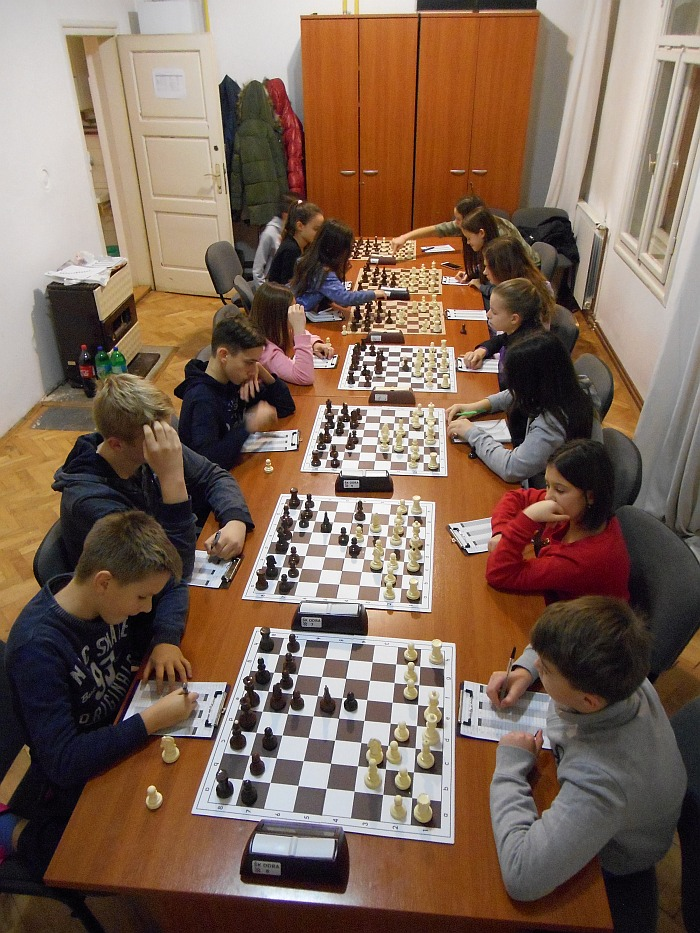
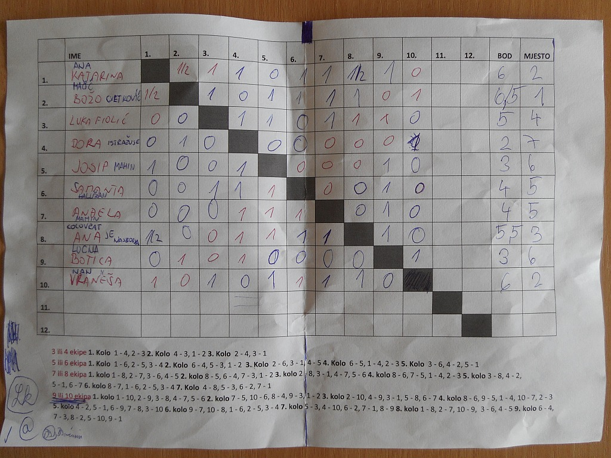
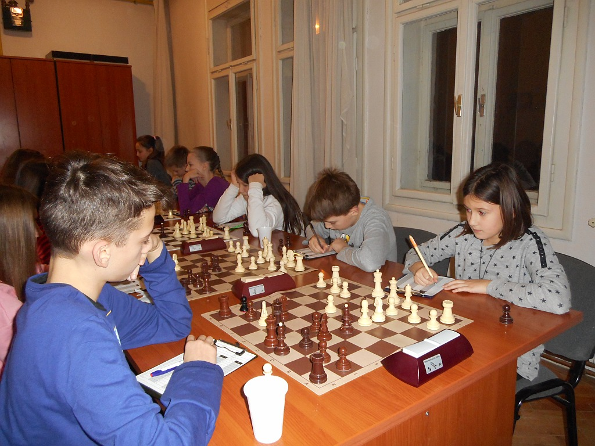
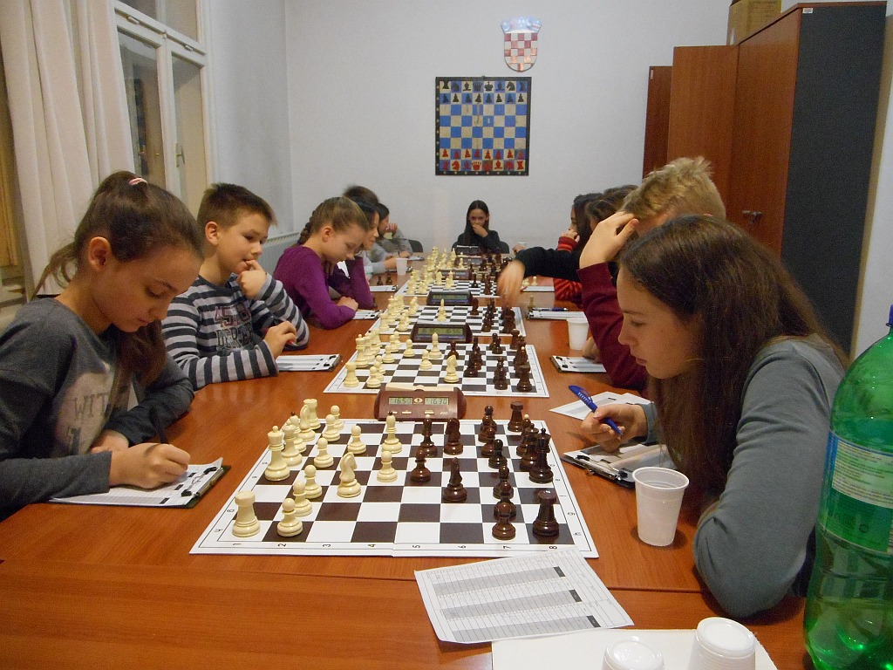
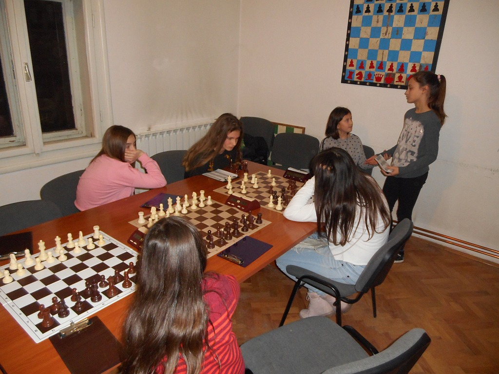
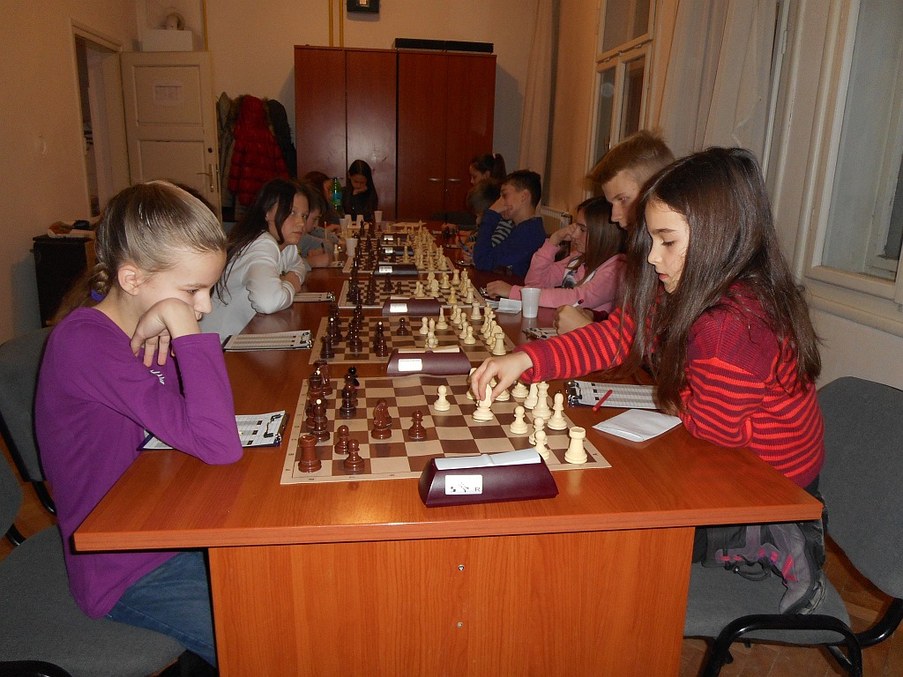
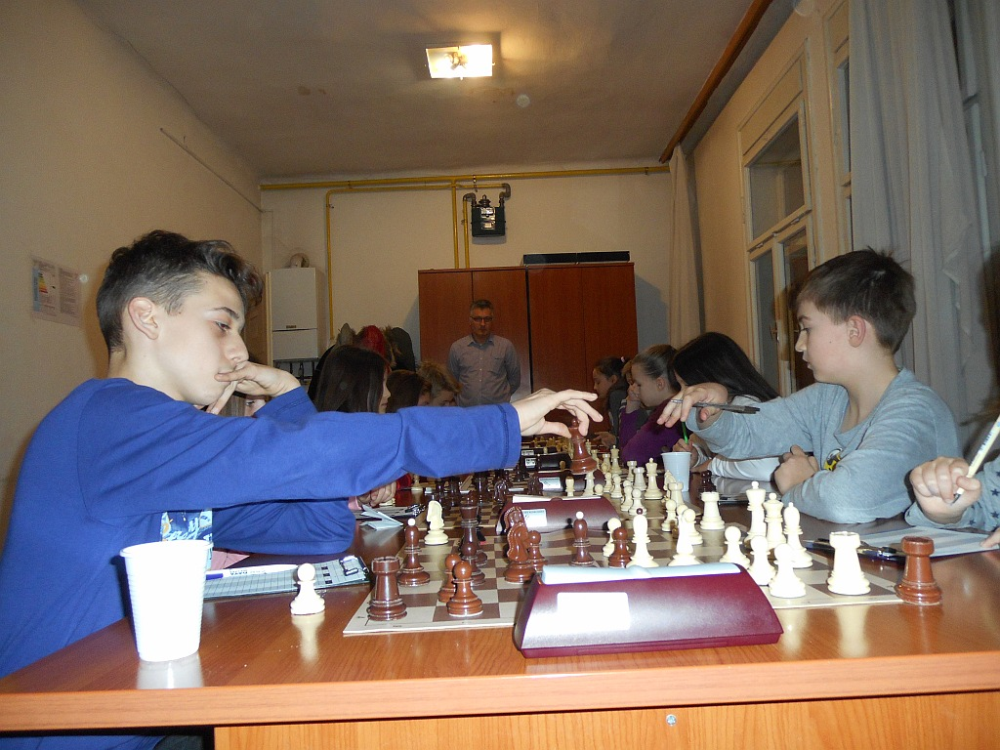

  
Odigran je još jedan edukativno-pripremni turnir članova Kluba. Nažalost, dosta je klinaca izostalo. Na turnir nisu došli Roko, Filip i Luka Matašić, a zakasnile su Lucija, Franka i Monika. Cure su se djelomično iskupile tako što su došle kasnije i odigrale s Amarom i međusobno nekoliko ozbiljnijih partija. Lucija je pomogla i tako što je zapisivala rezultate i fotografirala učesnike. Nasreću, stariji dečki, Božo i Vraneša, koji su već osmi odnosno sedmi razred, pristali su pomoći i odigrati turnir s mlađom ekipom te im pružili priliku da se okušaju i protiv jačih protivnika. Vjerujem da bi i Ivan pomogao, ali je on trenutačno na turniru u Rapcu.

Turnir se igrao na tempo 15+30, a partije koje su igrane duže od sat vremena, prekidali smo i završavali procjenom. Na turniru su nastupili Katarina, Božo, Luka Fiolić, Dora, Josip, Samanta, Anđela, Ana, Botica i Vraneša. Zapisivanje poteza je bilo obavezno, a igralo se na devet nemogućih poteza. Turnir je osvojio Božo  koji je pobijedio i Vranešu, najvećeg konkurenta i prvog favorita ovog turnira. Ovo natjecanje nam je poslužilo i da okvirno odredimo ekipe za Školsko ekipno prvenstvo grada Zagreba. Luki je već obećano mjesto u ekipi, ali je nedavno samostalno odlučio promijeniti repertoar otvaranja, nesvjestan da mu za to treba najmanje godina i pol učenja. Tako je zabrinuo i kapetana Vranešu, jer je uporan da igra pozicije koje još ne poznaje dovoljno. Još je mlad, tek je napunio deset godina, vjerujem da će uspjeti jer je svestran  igrač, razumije i pozicionu i taktičku igru, ali nisam siguran u (skorašnje) rezultate koje će postići protiv ozbiljnijih protivnika. To se već vidjelo i na ovom natjecanju. Do sada je gubio od Monike i Katarine, a sada ga je sredila i Samanta. Ipak, Luka je već jači igrač od Brune, a samo mrvicu slabiji od Kljujeva. Božo, Vraneša i Ivan su za sada osnova ekipe.  
Među djevojkama, Katarina i Samanta su zacementirale mjesto u ekipi, zahvaljujući bržim i kvalitetnijim reakcijama na brži tempo. Katarina je umalo pobijedila i Božu, ali se uplašila pružene prilike te zgrabila priliku i remizirala. Ana je i ovdje pokazala da je jača od kolegica, ali je i dalje nesigurna u vremenskom tjesnacu. Anđela je igrala prilično rastreseno i njoj svakako treba više sporijih turnirskih partija, ali sumnjam da će ju roditelji pustiti. Tako će osnovu ekipe djevojaka činiti Monika, Samanta, Katarina i Ana, dok će “uskakati” Lucija, Anđela i Franka. Anđela je djelovala pomalo nezadovoljna dogovorom, dok je Ana to i jasno iskazala, kao i priliči njenom otvorenom karakteru. Lucija je izrasla u pravu zafrkanticu pa ih je sve zezala kako su medalju uspjele osvojiti samo s njom u ekipi, dok su prošle godine, kada je ona ispala iz ekipe, ostale bez odličja. Prilikom dogovora, imao sam problema objasniti i zašto Botica ne može igrati s njima u ekipi, kada već ne igra za svoju školu. 🙂 Čini mi se da su Boticu već dobro prihvatili, svi joj pomažu i ukazuju na pogreške, ali kako se klinci međusobno cijene i prema tome koliko tko dobro igra, na Botici je da se potrudi da ih što prije dostigne. Ona je na ovom turniru savladala pisanje, a ugodno me iznenadila kada sam primjetio da je već nakon tri-četiri partije i malo uputa, počela i pravilno razvijati figure. Zanimljiva je bila partija između nje i Dore, koja je najmlađa. Dora je uspjela prodati štos sa žrtvom figure i osvojiti materijal, ali je zaboravila na razvoj. Tako je na kraju pobjeda ipak otišla Botici koja se držala uputa. Za Doru je pak napredak što je smanjila broj nemogućih poteza na minimum. Josip je pak imao istu boljku kao i Dora, nije razvijao figure. Stariji dečki su ga pohvalili, ali očito samo zato što se držao uputa kada je imao jake protivnike. Ne znam kako je pobijedio Katarinu, ali mu svaka čast na toj pobjedi. Možda je i protiv nje odlučio odigrati ozbiljnije kao protiv Bože i Vraneše.  
Malo su me ljutile Katarina i Samanta jer se nisu držale uputa o razvoju u otvaranju. Katarina i inače teško prihvaća savjete, ali je zadnjih pola godina ipak počela. Samanta je do sada prihvaćala savjete, a sada je krenula Katarininim stopama.  
     
  
