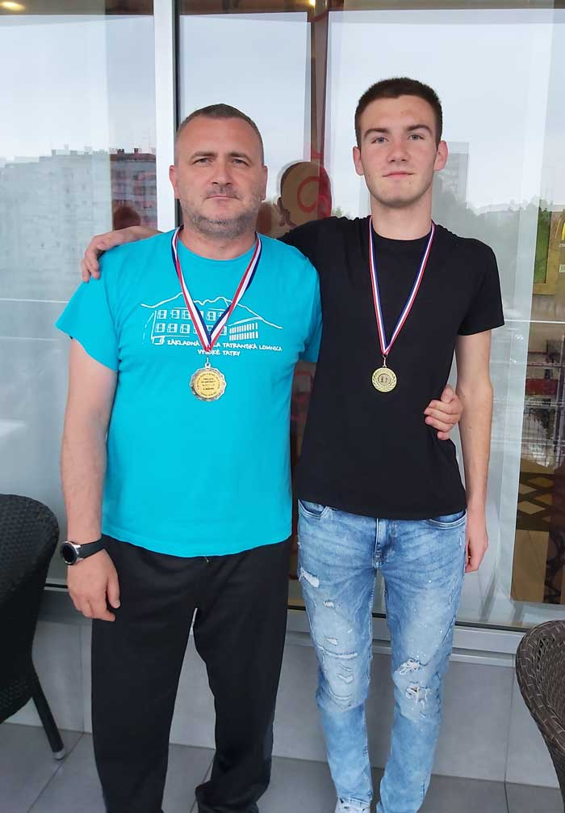
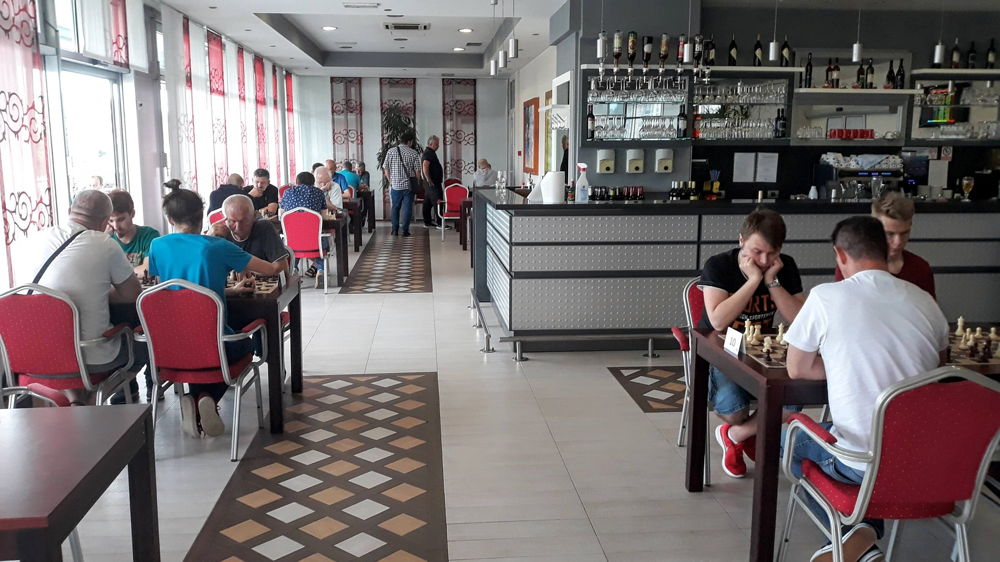

„**Oderci su nas odrali!**“, izjavio je direktor turnira Željko Bedić prilikom podjele odličja za najbolje igrače.

U subotu 20. lipnja vrijedni karlovački šahovski entuzijasti na čelu s neumornim Željkom Bedićem organizirali su brzopotezni turnir u 13 kola na tempo igre 3+2. Na turnir je došlo 26 šahista iz Karlovca, Zagreba, Zagorja, Sv. Nedelje, Odre… Turnir je bio odlično organiziran, a igrao se u lijepom ambijentu restorana “Panorama”.Nastupilo je pet naših članova: Nikola P., Ivan V., Ivan C., Ivan M. i Stjepan M. **N**ikoli je ovo bio prvi nastup ikada! Za prvi put je odigrao i više nego dobro, osvojio je 5 bodova, pokazao je da može igrati pod vremenskim pritiskom i nije se bojao ući u riskantne varijante. Osvojio je 20. mjesto. Sve pohvale za prvi nastup!

**I**van Vraneša je bio najlošiji Ivan na turniru, ali igra je bila veoma dobra, pokazao je da se može nositi i s majstorima i da mu samo nedostaje više partija da bude u borbi za sami vrh. Sa sedam bodova osvojio je 15. mjesto i srebrnu medalju za drugoga juniora!

**I**van Cvetković je pokazao vrhunsku igru u prvih nekoliko kola i nadigravao protivnike, po pozicijama i igri je zaslužio biti vodeći nakon četiri kola, međutim, budući da mu je ovo prvi jednodnevni turnir u ovom tisućljeću, počeo je posustajati sredinom turnira i na kraju osvojio sedam bodova i zauzeo 13. mjesto.

**Ivan Maravić** je počeo turnir veoma loše, trebalo mu je nekoliko partija da počne igrati malo brže i da ne bude na manje od pola minute nakon 20 poteza, nakon što se prilagodio vremenu je odigrao nekoliko solidnih partija i osvojio 8 bodova, 9. mjesto i **zlato za najboljeg juniora**!  
**Stjepan Maravić** je bio najbolji na turniru! Pokazao je veoma solidnu i čvrstu igru te nije izgubio niti jednu partiju (jedini na turniru!) i tako **zasluženo osvojio zlato**!  
**D**rugo mjesto osvojio je Damir Mravunac iz Španskog, a treće mjesto Damir Samovojska iz Huma na Sutli, treći junior bio je Karlovčanin Luka Sertić.  
**T**urnir je protekao u fer i prijateljskom ozračju. Sudac Matija Žibrat je vodio turnir korektno i nije imao niti jednu spornu situaciju za riješiti. Na kraju turnira su se dijelili razni pokloni za sve sudionike i svatko je mogao pronaći nešto za sebe, također je bila organizira i večera nakon turnira 😊. Ovo je pravi primjer kako bi jedan „cuger“ turnir trebao izgledati i možemo se samo nadati da će biti još ovakvih turnira!

## Konačni poredak nakon 13 kola

<table><tbody><tr><td><strong>Mj.</strong></td><td><strong>SNo</strong></td><td></td><td><strong>Ime</strong></td><td><strong>FED</strong></td><td><strong>Rtg</strong></td><td><strong>Bod.</strong></td><td><strong>&nbsp;TB1&nbsp;</strong></td><td><strong>&nbsp;TB2&nbsp;</strong></td><td><strong>&nbsp;TB3&nbsp;</strong></td></tr><tr><td>1.</td><td>5</td><td></td><td><strong>Maravic Stjepan</strong></td><td>CRO</td><td>2130</td><td>9,0</td><td>1,0</td><td>5</td><td>100,5</td></tr><tr><td>2.</td><td>1</td><td></td><td>Mravunac Damir</td><td>CRO</td><td>2195</td><td>9,0</td><td>0,0</td><td>7</td><td>99,0</td></tr><tr><td>3.</td><td>2</td><td>FM</td><td>Samovojska Damir</td><td>CRO</td><td>2190</td><td>8,5</td><td>1,5</td><td>6</td><td>103,5</td></tr><tr><td>4.</td><td>7</td><td></td><td>Galoic Boris</td><td>CRO</td><td>1969</td><td>8,5</td><td>1,5</td><td>6</td><td>97,5</td></tr><tr><td>5.</td><td>4</td><td></td><td>Zelenika Zoran</td><td>CRO</td><td>2138</td><td>8,5</td><td>1,5</td><td>5</td><td>103,5</td></tr><tr><td>6.</td><td>3</td><td></td><td>Bedic Zeljko</td><td>CRO</td><td>2154</td><td>8,5</td><td>1,5</td><td>5</td><td>100,0</td></tr><tr><td>7.</td><td>8</td><td></td><td>Blazic Damir</td><td>CRO</td><td>1968</td><td>8,0</td><td>0,0</td><td>7</td><td>96,5</td></tr><tr><td>8.</td><td>13</td><td></td><td>Jusufi Denis</td><td>CRO</td><td>1876</td><td>8,0</td><td>0,0</td><td>7</td><td>86,0</td></tr><tr><td>9.</td><td>15</td><td></td><td><strong>Maravic Ivan</strong></td><td>CRO</td><td>1797</td><td>8,0</td><td>0,0</td><td>6</td><td>88,5</td></tr><tr><td>10.</td><td>26</td><td></td><td>Zerdo Predrag</td><td>CRO</td><td>0</td><td>7,5</td><td>0,0</td><td>7</td><td>100,5</td></tr><tr><td>11.</td><td>6</td><td></td><td>Paus Veljko</td><td>CRO</td><td>2001</td><td>7,5</td><td>0,0</td><td>7</td><td>91,5</td></tr><tr><td>12.</td><td>10</td><td></td><td>Drvar Izidor</td><td>CRO</td><td>1942</td><td>7,0</td><td>0,0</td><td>7</td><td>91,5</td></tr><tr><td>13.</td><td>9</td><td></td><td><strong>Cvetkovic Ivan</strong></td><td>CRO</td><td>1948</td><td>7,0</td><td>0,0</td><td>6</td><td>83,5</td></tr><tr><td>14.</td><td>12</td><td></td><td>Deris Antun</td><td>CRO</td><td>1894</td><td>7,0</td><td>0,0</td><td>6</td><td>83,5</td></tr><tr><td>15.</td><td>17</td><td></td><td><strong>Vranesa Ivan</strong></td><td>CRO</td><td>1684</td><td>7,0</td><td>0,0</td><td>6</td><td>83,0</td></tr><tr><td>16.</td><td>16</td><td></td><td>Tomljenovic Velimir</td><td>CRO</td><td>1712</td><td>6,5</td><td>0,5</td><td>6</td><td>85,5</td></tr><tr><td>17.</td><td>11</td><td></td><td>Dotlic Zdravko</td><td>CRO</td><td>1898</td><td>6,5</td><td>0,5</td><td>6</td><td>76,5</td></tr><tr><td>18.</td><td>18</td><td></td><td>Sertic Luka</td><td>CRO</td><td>1594</td><td>6,0</td><td>1,0</td><td>6</td><td>71,0</td></tr><tr><td>19.</td><td>14</td><td></td><td>Kolibas Tihomir</td><td>CRO</td><td>1819</td><td>6,0</td><td>0,0</td><td>6</td><td>70,0</td></tr><tr><td>20.</td><td>25</td><td></td><td><strong>Pischiutta Nikola</strong></td><td>CRO</td><td>0</td><td>5,0</td><td>0,0</td><td>5</td><td>69,0</td></tr><tr><td>21.</td><td>19</td><td></td><td>Markovic Bozidar</td><td>CRO</td><td>1538</td><td>4,0</td><td>2,0</td><td>4</td><td>68,0</td></tr><tr><td>22.</td><td>23</td><td></td><td>Vinski Perun</td><td>CRO</td><td>1365</td><td>4,0</td><td>1,0</td><td>4</td><td>68,0</td></tr><tr><td>23.</td><td>21</td><td></td><td>Popov Luka</td><td>CRO</td><td>1490</td><td>4,0</td><td>0,0</td><td>4</td><td>69,5</td></tr><tr><td>24.</td><td>24</td><td></td><td>Brnadic Ilija</td><td>CRO</td><td>1084</td><td>3,5</td><td>0,0</td><td>3</td><td>69,5</td></tr><tr><td>25.</td><td>20</td><td></td><td>Bedic Luka</td><td>CRO</td><td>1532</td><td>2,5</td><td>0,0</td><td>2</td><td>71,0</td></tr><tr><td>26.</td><td>22</td><td></td><td>Paladinic Pazulinec Leon</td><td>CRO</td><td>1430</td><td>2,0</td><td>0,0</td><td>2</td><td>70,5</td></tr></tbody></table>

*IvanM*
