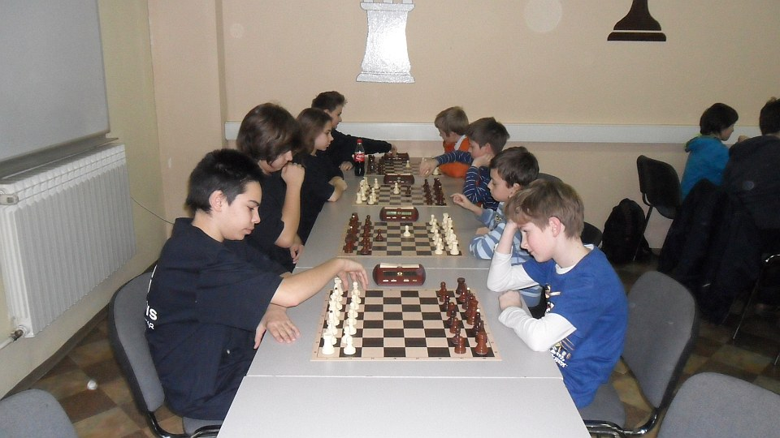
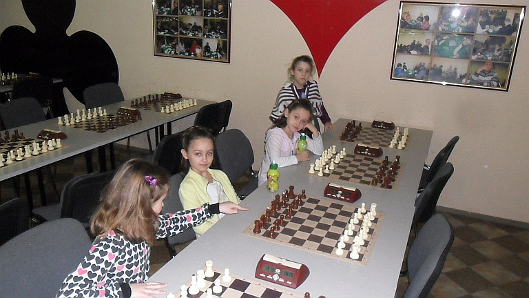
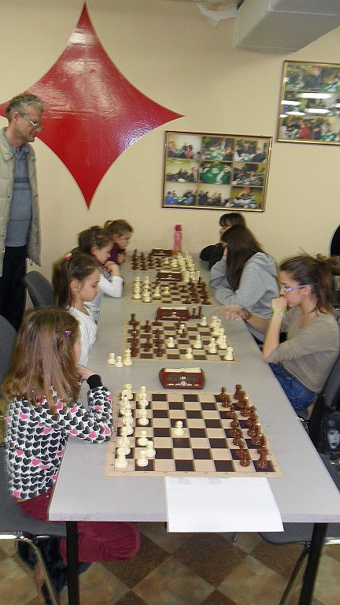
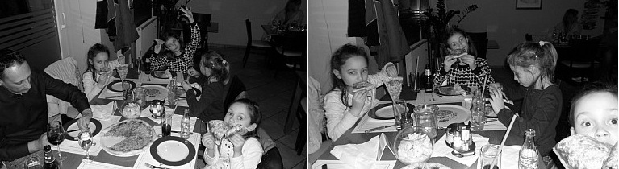
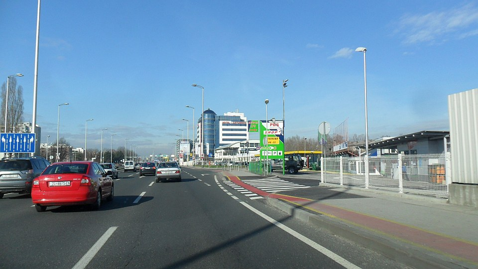
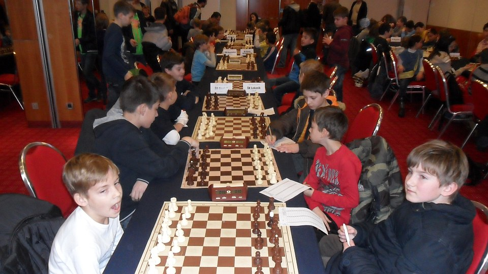
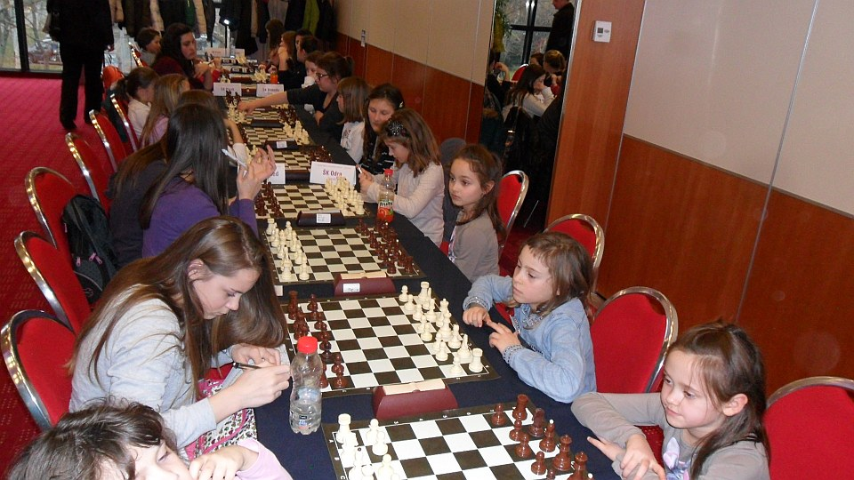

Ovaj tjedan bio je pun zbivanja, posebno za mlađi naraštaj. Tako su u srijedu i četvrtak nastavljeni turniri osnovnih škola grada Zagreba. Dečki su igrali u četvrtak, a nastavljaju sljedeći tjedan, u srijedu 5. ožujka. [Dječaci, raspored](/files/wp/2014/03/3Rasp-ah58M-2r.pdf "Raspored, ekipno OŠ dječaci")  
Djevojčice su igrale u srijedu, a nastavljaju u četvrtak 6. ožujka. [Djevojčice, raspored](/files/wp/2014/03/Rasp-ah58--2r.pdf)  
Sada je to već ozbiljnija razina i ekipe se ne mogu baš pohvaliti velikim rezultatima. Ipak, pojedinačno su ulovili poneki bod, što samo pokazuje da i na toj razini mogu svi igrati, bez obzira na trenutačne rezultate. Sa svakom partijom napreduju te se nadam da će partija biti što više, i izvan obvezatnih natjecanja. Naravno, velika je to obveza i za roditelje, ali su dosad pokazali veliko razumijevanje, što vrlo obećava.

 

              

Danas su počele kadetske lige. [Dečki](http://chess-results.com/tnr124935.aspx?lan=13&art=0&rd=3&wi=821) su čak ubilježili i jednu ekipnu pobjedu, a kod [djevojčica](http://chess-results.com/tnr124936.aspx?lan=13&art=0&wi=821) su za posebnu pohvalu Franka, koja je remizirala prvo kolo, i Ana, koja je pobijedila u trećem kolu, matom! Otišao sam prije kraja, ali vjerujem da su se trudile zapisivati poteze u posljednjem kolu, tako da možda u sljedeći petak u Klubu i vidimo tu pobjedu.  
Natjecanja u kadetskim ligama nastavljaju se 29. ožujka.

