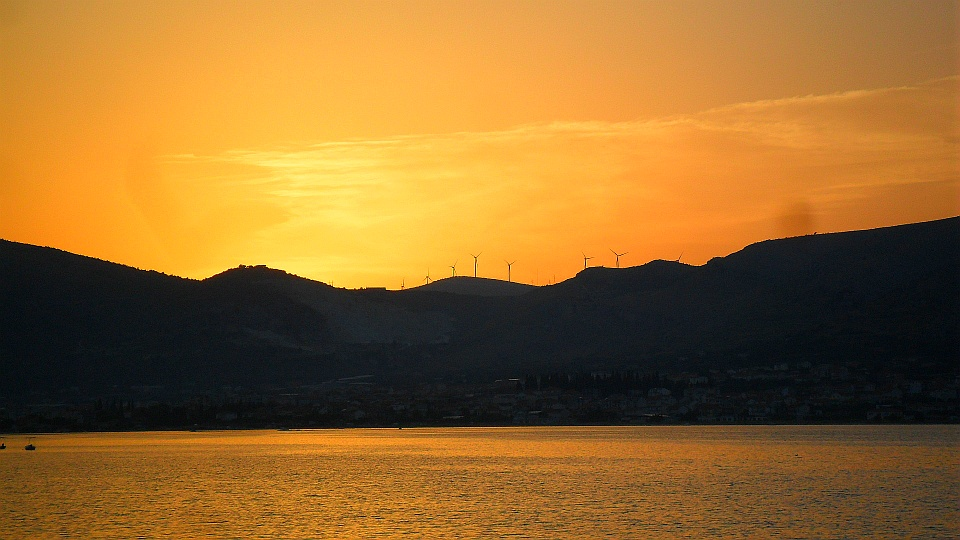
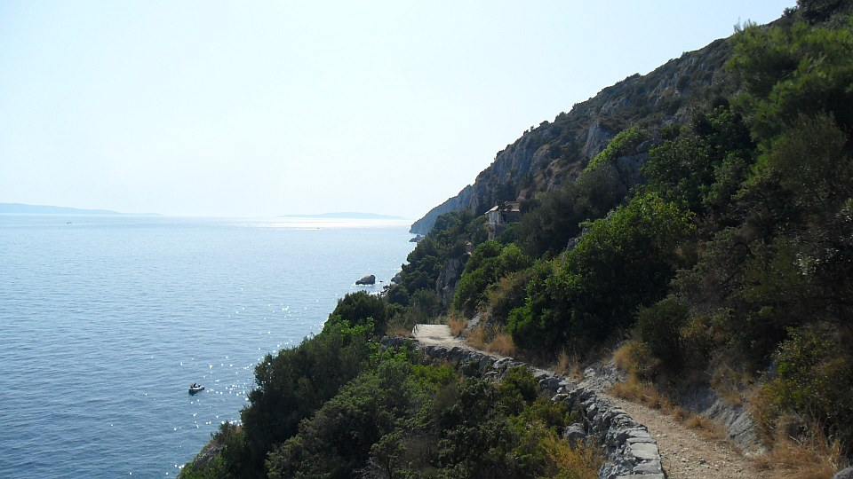

Prošle godine smo malo šutjeli o tome. Ove godine nećemo. 🙂 Dakle, od 21. do 27 lipnja u Kaštel Štafiliću održat će se [Kadetsko prvenstvo Hrvatske](/files/wp/2014/05/Kadet-prv-Hrv-2014-raspis.pdf "prv. hrvatske 2014, raspis") u šahu. U klubu imamo i kadete i kadetkinje, odnedavno još dva registrirana člana, Erica i Luku (za Luku još čekamo potvrdu od HŠS-a) i svi su zaslužili odlazak. Da su neka bolja vremena i da nije neki poseban problem izdvojiti 1600kn. za smještaj i 100 ili 150 kn za kotizaciju, bilo bi super. Svi bi išli.  
Ovako, sretna okolnost je  da u blizini natjecanja naš podpredsjednik ima apartman koji je voljan ustupiti za smještaj, dok je dr. Cvetković voljan biti pratnja i skrb. Tako da ćemo ove godine imati predstavnike na završnom kadetskom natjecanju!

Svi zainteresirani, osim Vraneše i Ivana koji su se već javili, molim da se što prije jave!

Naravno, bilo bi dobro da kao završnu probu svi zainteresirani odigraju i [kadetsko prv. u Varaždinu](/files/wp/2014/04/RASPIS-OPEN-VARAZDIN-2014.pdf "raspis Varazdin"). Jedan tata je već izrazio spremnost da vozi pa bi bilo dobro u toku tjedna da se prvo djeca, a onda i roditelji dogovore oko toga.

