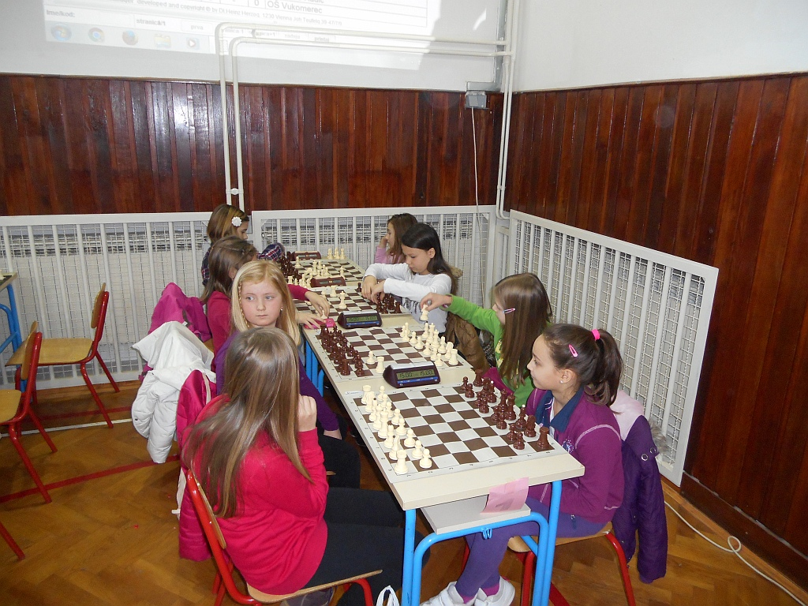
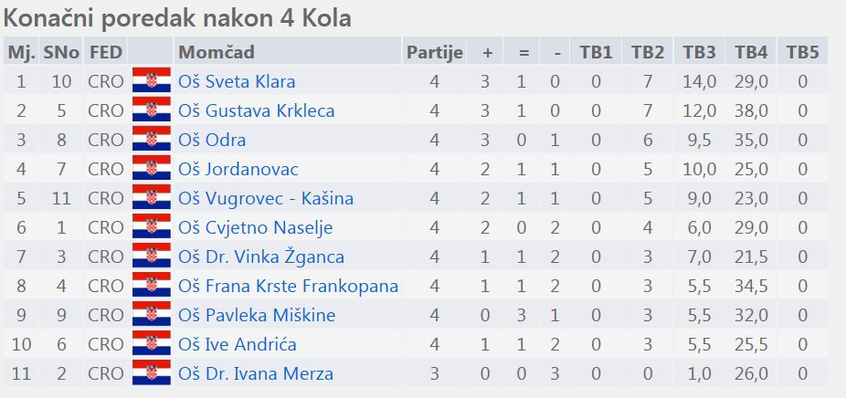
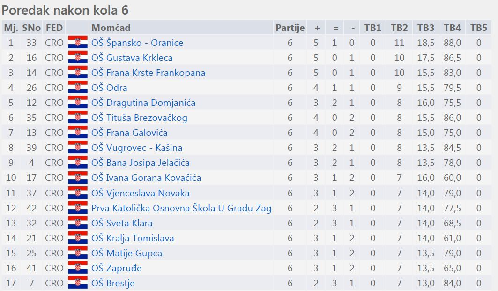

Fantastičan rezultat ostvarile su djevojke iz OŠ Odra! Pobjedom u trećem kolu nad OŠ Jordanovac te usprkos porazu u četvrtom kolu od trenutačno jače ekipe OŠ Gustava Krkleca, osvojile su **treće mjesto** i kvalificirale se u Završnicu Prvenstva Zagreba u šahu za djevojčice 2016., koje je ujedno poluzavršnica Državnog prvenstva školskih sportskih društava Republike Hrvatske. Samo prve četiri ekipe stekle su pravo nastupa, a naše su djevojke **Monika, Anđela, Samanta, Katarina i Lucija** sada u ozbiljnoj prilici boriti se i za odličja. Na završnici prve tri ekipe dobivaju diplome i medalje. Danas je najbolji rezultat ostvarila Katarina, s dvije pobjede iz dvije partije. Finale se igra za tri tjedna i nadam se da će sve djevojke biti zdrave i u formi. 🙂

Dečki su također odigrali dosta dobro, danas su pobijedili u dva meča, ali su u trećem kolu doživjeli neugodan poraz od ekipe OŠ Špansko (samo je Kljujev spasio čast ekipe remijem na trećoj ploči) pa su djelovali malo pokislo, ali svejedno, pogled na tablicu i dalje je vrlo dobar. Trenutačno su četvrti u konkurenciji 42 škole, imaju bod više od najbliže konkurencije te im se, uspiju li zadržati tu poziciju, također smiješi ulazak u finale. Vraneša je danas igrao malo bolestan i to se odmah vidjelo na rezultatu, ali je zato Bruno danas bio u formi i ostvario stopostotni učinak. Sljedeći krug dečki igraju za tjedan dana i želimo im mnogo sreće!

     
