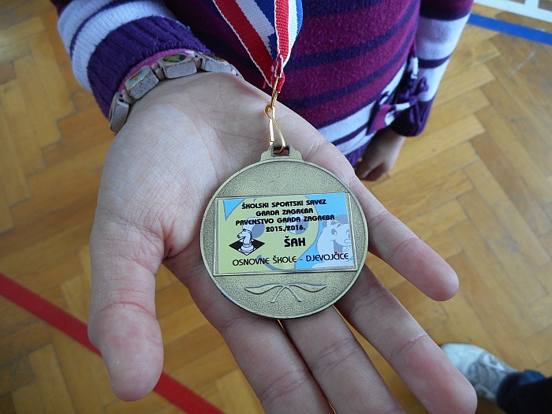

Nakon uspješno odigranih kvalifikacija, pod vodstvom prof. Krešimira Tomaška, naše su djevojke danas igrale finale Prvenstva OŠ Grada Zagreba u šahu. **Osvojile su treće mjesto!** Prvi je to ekipni uspjeh ove generacije i to više ova bronca ima zlatni sjaj! **Monika Kolovrat, Anđela Mahin, Ana Katarina Hačić, Samanta Halužan** i **Lucija Kolovrat** zajedno su zaslužne za ovaj uspjeh i nadam se, osim što se svi ponosimo njima, da će im ovo biti i poticaj da se još više trude, igraju i uče te se već sljedeće godine pokušaju dočepati i srebra. Danas je nažalost zbog bolesti izostala Samanta,  ali je njezina medalja čeka u školi. Za prvo mjesto borile su se ekipe podjednake snage,  OŠ Klara i OŠ Gustava Krkleca, koje su trenutačno jače od ostalih dviju ekipa, a prvo mjesto i plasman na ekipno prvenstvo Hrvatske prema dodatnim kriterijima osvojila je ekipa **OŠ Gustava Krkleca**. U borbi za treće mjesto OŠ Odra pobijedila je (drugi put) OŠ Jordanovac s 3:1 i zasluženo se popela na postolje. Čestitke djevojkama!

U konkurenciji dječaka prvo mjesto i plasman na prvenstvo Hrvatske osvojila je ekipa **OŠ Tituša Brezovačkoga**, ekipe s kojom su naši dečki igrali 2:2 u posljednjem kolu kvalifikacija. Dečki već igraju ozbiljniji šah, a ekipa OŠ Tituša Brezovačkog u ovom je finalu pokazala svu svoju snagu te su zasluženo osvojili prvo mjesto iako su kvalifikacije prošli tek kao četvrta ekipa kvalifikacija.

Čestitke svim pobjednicima, a za one koji nisu bili na natjecanju, objavljujemo nekoliko fotografija s natjecanja…

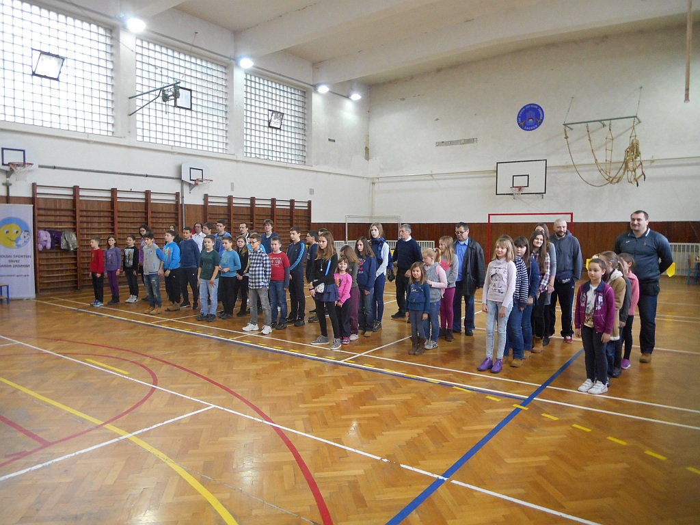 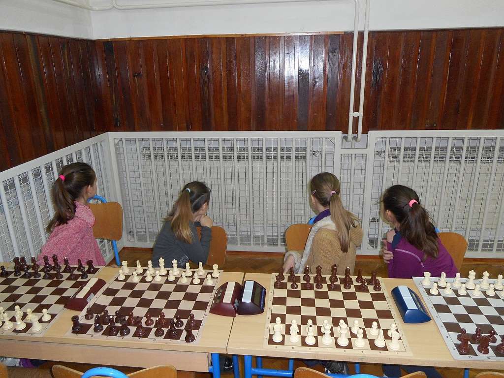 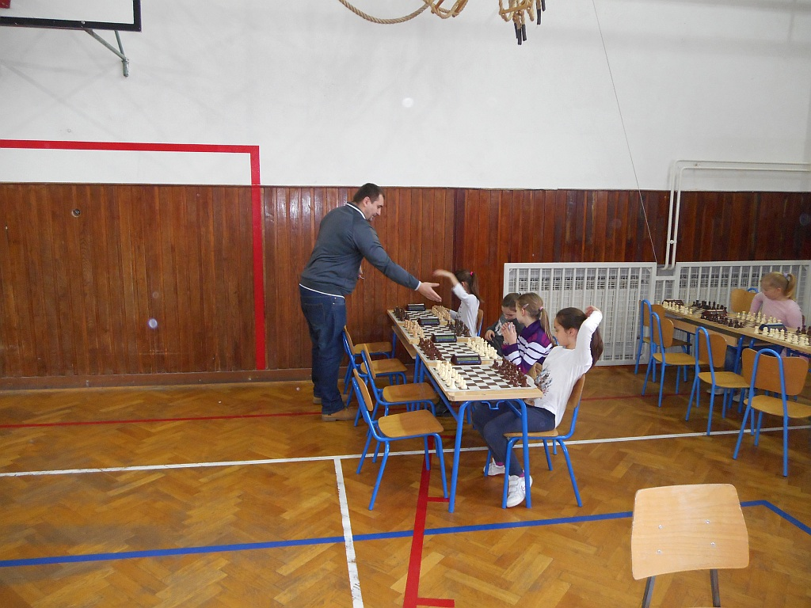 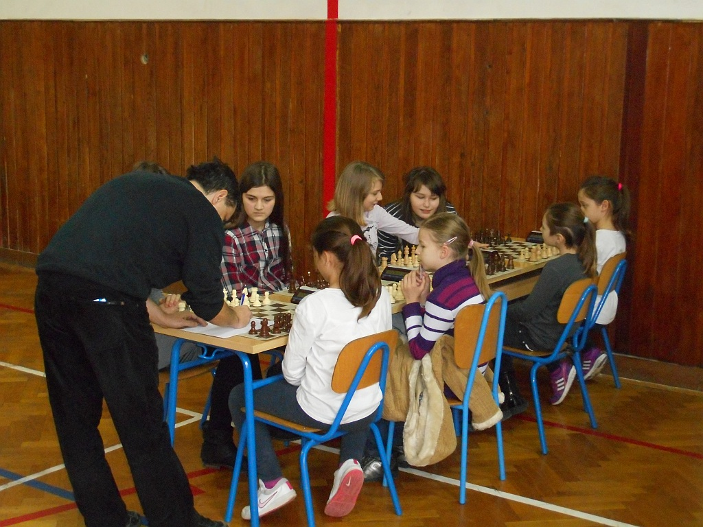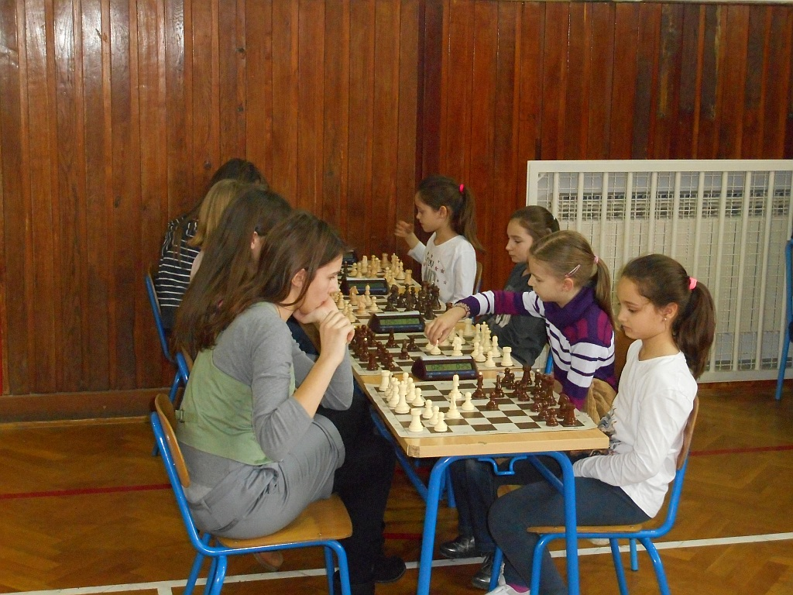 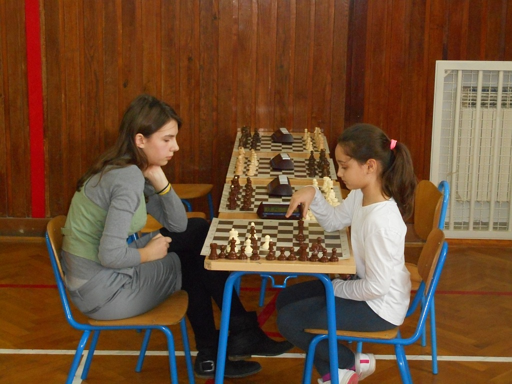 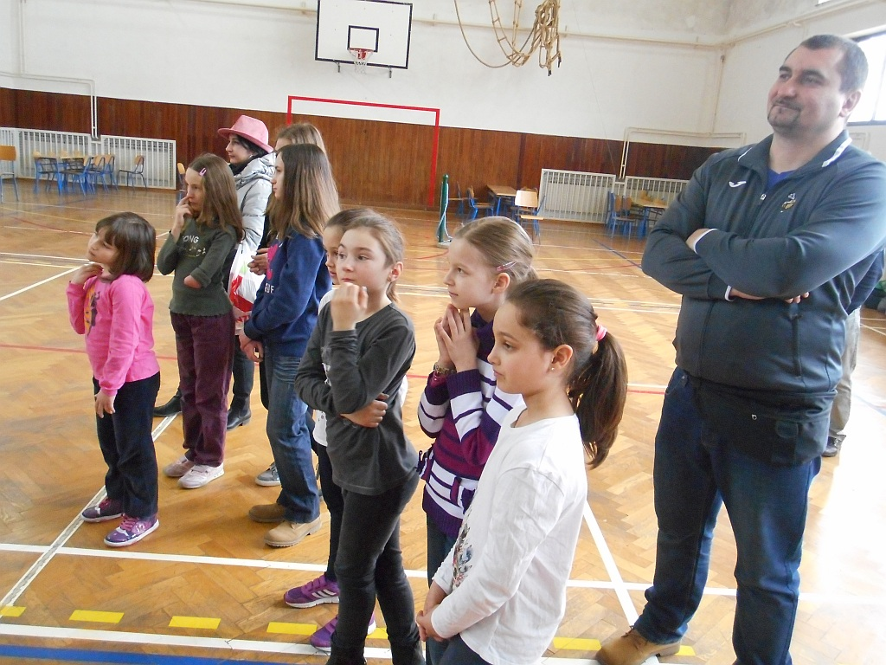 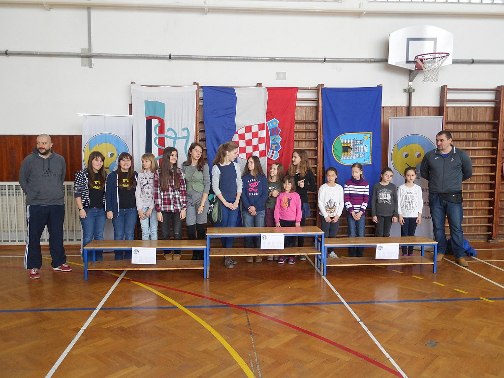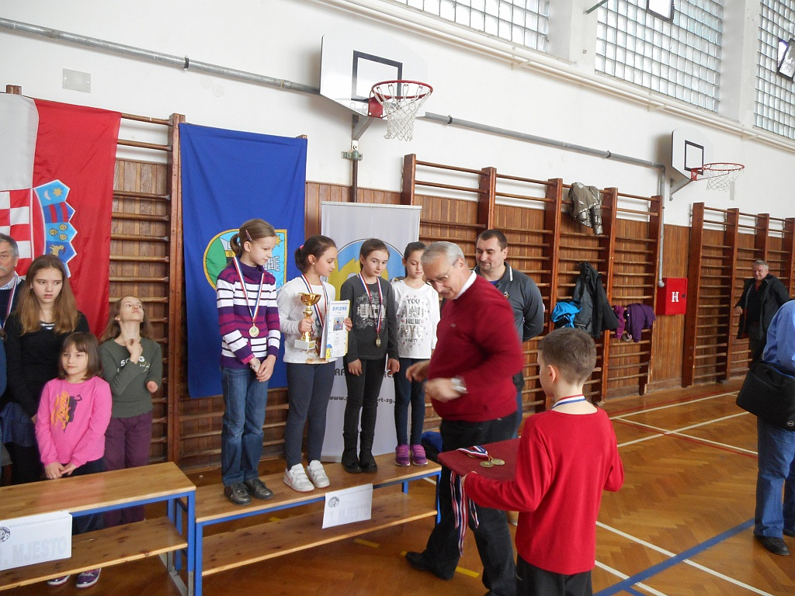 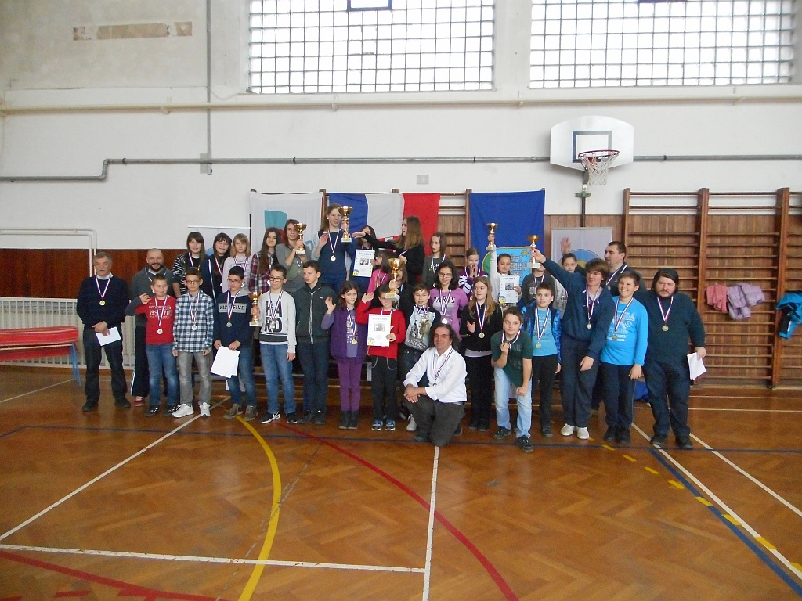 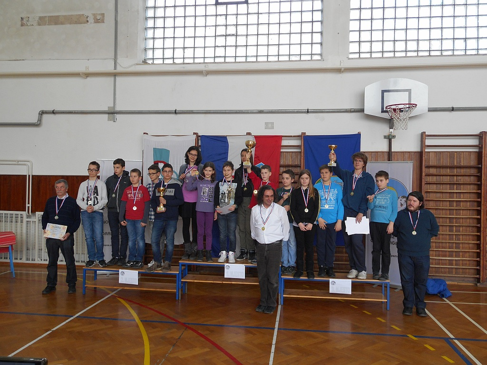 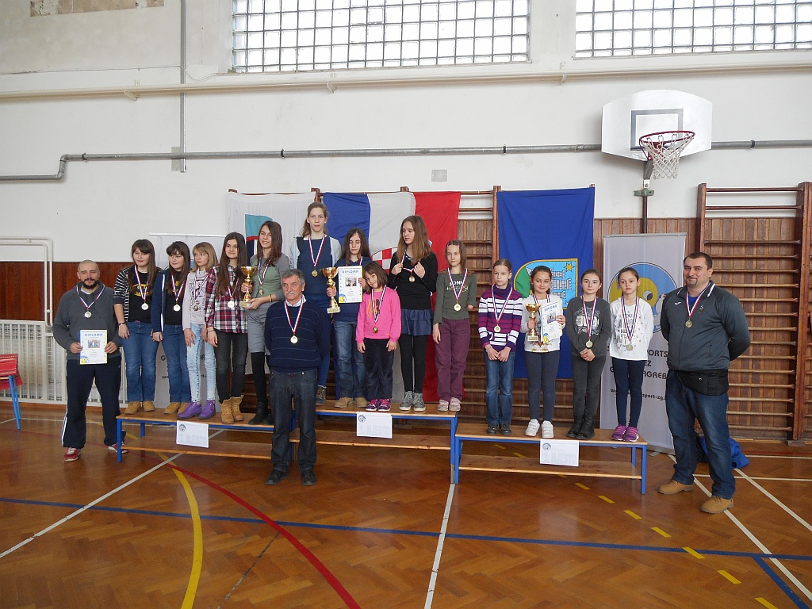   
[Rezultati djevojke.](http://chess-results.com/tnr207620.aspx?lan=13&art=0&turdet=YES&flag=30&wi=984)  
[Rezultati dečki.](http://chess-results.com/tnr207619.aspx?lan=13&art=0&turdet=YES&flag=30&wi=984)
