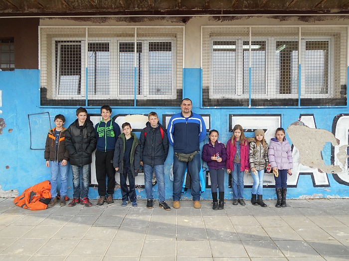
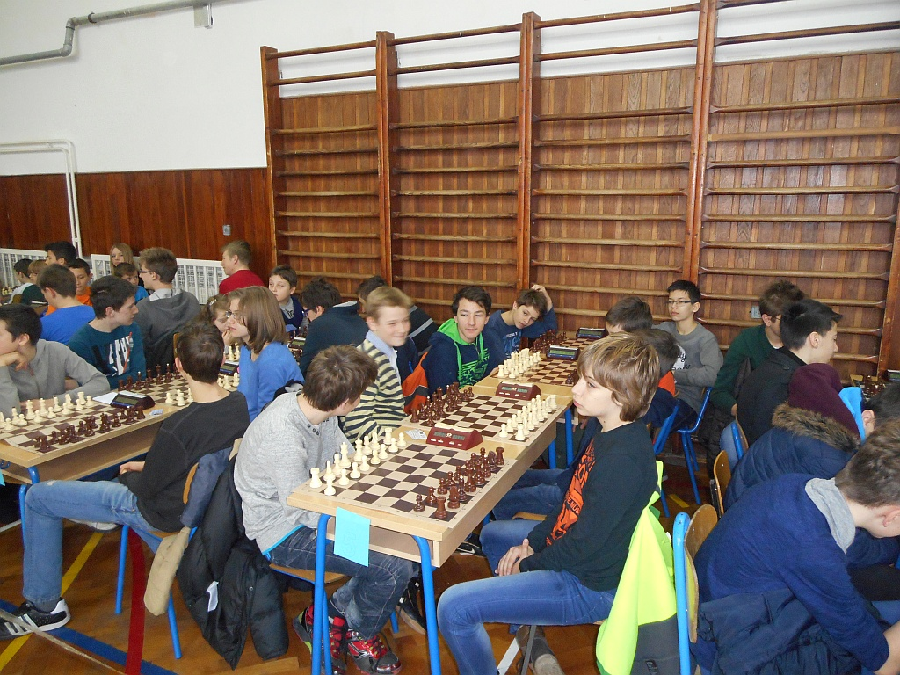
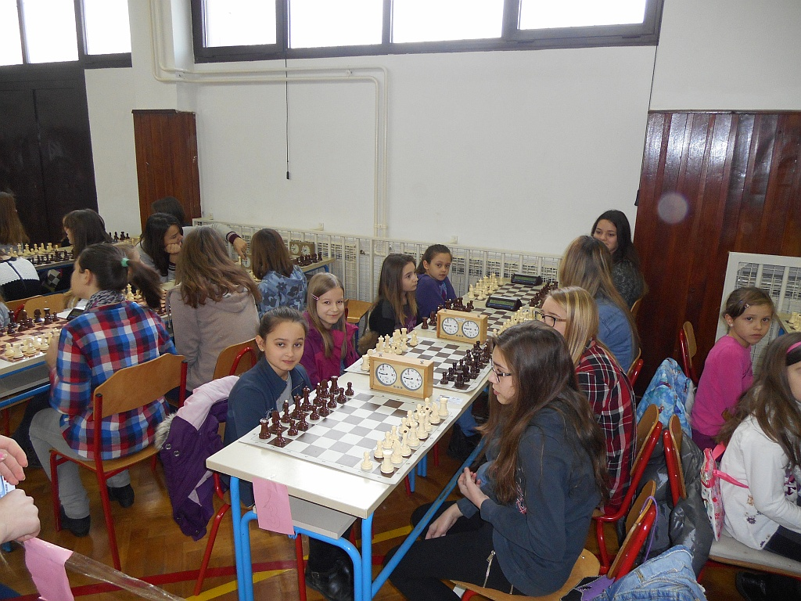
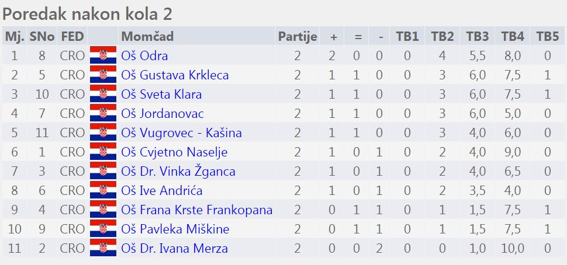

Danas je vrlo uspješno počelo prvenstvo osnovnih škola, kvalifikacijski krug. Prvenstvo se igra u OŠ Frana Krste Frankopana i, osim Samante, koja je danas nažalost izostala zbog bolesti, ekipe su bile kompletne. Voditelj ekipa je prof. Tomaško. Dečki će igrati devet kvalifikacijskih mečeva (tri subote), dok će djevojke igrati četiri meča. Zasad su dečki odigrali tri kola i trenutačno su, uz dvije pobjede i jedan neriješeni meč, na vrlo visokome šestome mjestu. Najbolje rezultate ostvarili su Ivan, sa sve tri pobjede, te Božo, s bod i pol iz dvije partije. Dečkima je prošle godine za dlaku izmakao prolaz kroz kvalifikacije, a očekujem da će ove godine u tome i uspjeti. [Rezultati dečki.](http://chess-results.com/tnr205774.aspx?lan=13&art=0&turdet=YES&flag=30&wi=984)  
Djevojke su odigrale prva dva meča i u oba pobijedile. S obzirom na to da se dosad sjećam samo jedne jedine ekipne pobjede, i to one od prošle godine, kada su nastupile samo Monika i Franka, ovo je nevjerojatan rezultatat! Prvo kolo pobijedile su četiri osmašice s 3:1. Lucija i Katarina pobijedile su po jednu partiju, Anđela je osvojila bod i pol, a Monika dva boda! Uspiju li djevojke odigrati još jedan neriješeni meč, postoje čak i izgledi da prođu kvalifikacije. Zasad možemo samo uživati u pogledu na tablicu nakon dva kola, gdje su trenutačno na vodećoj poziciji, jedine s dvije meč pobjede. 🙂  [Rezultati djevojke.  
](http://chess-results.com/tnr205775.aspx?lan=13&art=0&turdet=YES&flag=30&wi=984)Prvenstvo se nastavlja za sedam dana na istome mjestu.

     

darko
