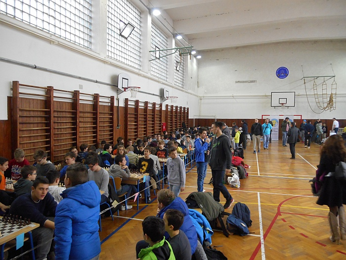

Završene su kvalifikacije za ulazak u finale Prvenstva OŠ Grada Zagreba i, nažalost, naši su dečki ovaj put ozbiljno podbacili. Danas su odigrali tri neodlučena meča. U prva dva vodili su s 2 : 0, ali nije bilo dovoljno koncentracije da se osvoji još barem pola boda za meč-pobjedu. U trećem su meču spašavali živu glavu u susretu s ekipom OŠ Tituša Brezovačkog. Na kraju su bili sedmi, a to je prilično daleko od potrebnoga četvrtog mjesta. Tako će za dva tjedna samo djevojke OŠ Odra nastupiti u finalu. Dečki, kojima se takvo nešto dogodilo i prošle godine, morat će čekati sljedeću godinu za popravni ispit. Teško je reći što im se dogodilo. S tri  su remija na neki način dokazali da tu vjerojatno nema ekipe jače od njih, ali uistinu nisu pokazali svoju punu snagu. I to je velika šteta. Danas su neki uspjeli izgubiti na pad zastavice i sa 6 sekundi prednosti ispod minute i s nadmoćnom pozicijom (nećemo reći da se to dogodilo Ivanu), neki su podlegli pritisku i izgubili sve tri partije (nećemo reći da se to dogodilo Vraneši), neki pokazuju nedovoljno samouvjerenosti, neki su sretni što igraju niže ploče, a baš svi nedovoljno uče. Već su veliki, peti i šesti razred, i pred njima je sada jedna godina u kojoj će morati mnogo više raditi, igrati mnogo više turnira te početi i samostalno učiti. Vjerujem da će tek tada sljedeće godine biti na tablici tamo gdje objektivno po svojoj snazi i pripadaju. **Ivan, Vraneša, Kljujev, Bruno** i **Božo**  također su članovi prve kadetske ekipe ŠK Odra, a kadetska liga počinje za točno mjesec dana te se iskreno nadam da će tamo, uz ozbiljniji tempo igre, pokazati da ne pripadaju više u četvrtu ligu.  
Ovo su prve četiri ekipe koje su se kvalificirale u finale.  
1\. OŠ Špansko – Oranice  
2\. OŠ Frana Galovića  
3\. OŠ Gustava Krkleca  
4\. OŠ Tituša Brezovačkog  
Čestitke pobjednicima kvalifikacija!  
[Rezultati.](http://chess-results.com/tnr205774.aspx?lan=13&art=63&turdet=YES&flag=30&wi=984)  
———————————————————————————-  
**Najave**  
Sljedećeg vikenda u hotelu Westin igra se **Šahovski festival – Zagreb 2015./16.**, s tempom kao i na **Pojedinačnome kadetskom prvenstvu Zagreba 2016.**, 30 + 30, koje počinje za dva tjedna, tj. u nedjelju 21. veljače. To je prilično dobra prilika za prilagodbu tempa i pripremu za pojedinačno prvenstvo. Natjecatelji mlađe dobi (do 10 i do 12 godina) igraju u subotu i nedjelju:  
1., 2. i 3. kolo 20. veljače u 09.30, 11.30 i 14.30  
4., 5. i 6. kolo 21. veljače u 09.30, 11.30 i 14.30.  
Stariji kadeti imaju prvo kolo već u petak jer je njihov tempo 60 + 30:  
1\. kolo 19. veljače u 18 sati  
2., 3. i 4. kolo 20. veljače u 09.30, 15 i 18 sati  
5\. i 6. kolo 21. veljače u 10 i 15 sati.  
Zasad su prijavljeni Ivan, Vraneša i Luka. Ostale prijave očekujem do utorka. Nadam se da će i neke djevojke iskoristiti priliku te odigrati šest partija kako bi se što bolje pripremile za finale prvenstva osnovnih škola. To vrijedi i za Anu, koja iz objektivnih razloga nije u školskoj ekipi, ali računamo na nju u prvom krugu kadetske lige 12. ožujka. (Preostala dva kruga kadetske lige igraju se najvjerojatnije 19. ožujka i 9. travnja.) Također, očekujem od Luke i Antonija, kao i od većine djevojaka, da nastupe na pojedinačnom prvenstvu Zagreba za starije natjecatelje te iskoriste ova dva mjeseca dok traju kadetski turniri da se što bolje priviknu na turnirske nastupe i time podignu kvalitetu svoje igre na višu razinu. Pojedinačno se igra nedjeljom i vjerujem da mogu prilagoditi i odraditi sve ostale obveze, usprkos nastupu na tom natjecanju.
