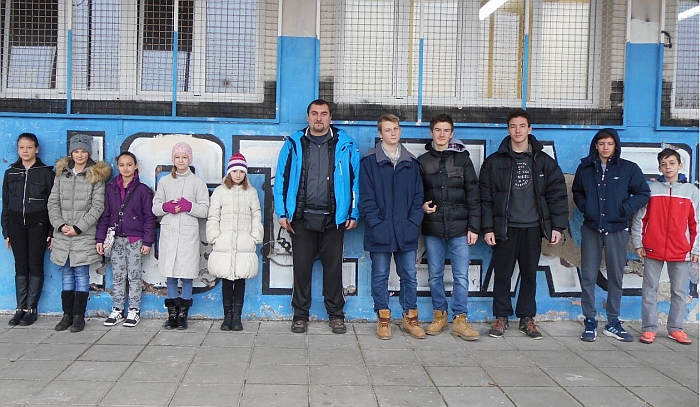
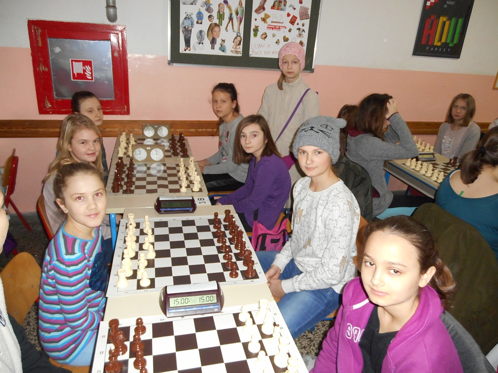
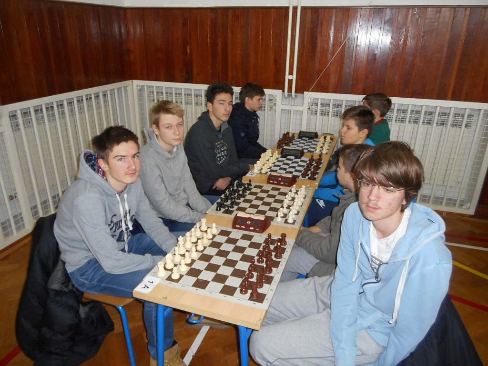
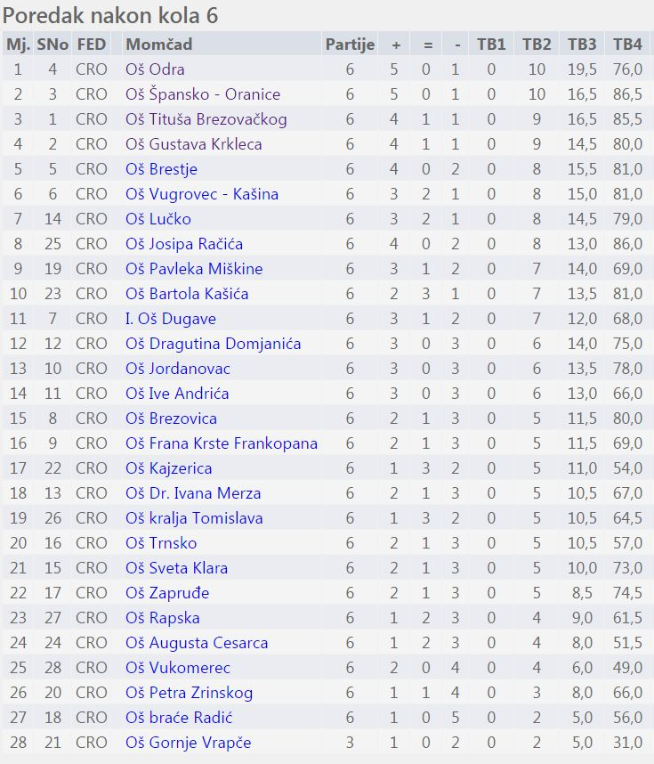

  
Danas je odigran drugi krug kvalifikacija. Dečke očekuje još jedan krug jer igraju devet kola, a djevojke su završile. Prije posljednjeg kola dijelile su željeno četvrto mjesto koje vodi u finale, ali su protivnice iz OŠ Klara bile bolje. Ženska ekipa OŠ Odra prilično je napredovala od prošle godine i, što je najvažnije, prilično su se sprijateljile. Kako ni konkurencija ne spava, samo o njima samima ovisi koliko će u predstojećoj godini uložiti truda, vježbajući, učeći i igrajući turnire, kako bi za godinu dana ostvarile minimalni pomak na tablici i ponovo ušle u borbu za medalje. Ni jedna od njih nije podbacila rezultatski, čak je i Monika pokazala da može pobjeđivati na prvoj ploči. Ana je danas također zablistala s dvije pobjede, kao i Katarina. Anđela je standardno dobra, a Samanta me svojom snalažljivošću uvijek ugodno iznenadi. Nadam se da će se cure, zajedno s Lucijom, Hanom i Dorom, u sljedećih godinu dana još više posvetiti šahu i na sljedećemu školskom prvenstvu bez većih problema ući u finale.  
Dečki. Danas su pokazali nešto što nisam znao da imaju. Izgubili su četvrto kolo od OŠ Špansko, ali nisu bili nadigrani. Vraneša je držao nešto lošiju poziciju i ušao u vremenski tjesnac. Kada je napokon iskoristio neoprezno otvaranje pozicije i razbio protivnika, izgubio je na vrijeme. To je bod koji je odlučio rezultat. No tada su dečki hladnokrvno pomeli sljedeće protivnike s 4:0. A onda je došlo šesto kolo, u kojem su ih pokušali nepravedno diskvalificirati zbog navodne promjene sastava, nejasnog pravilnika i nekih sitnih zloba pojedinaca koji bi trebali biti primjer djeci. Nasreću, organizator je  ipak pokazao razumijevanje i, nakon što su nestali i protivnici i ploče s figurama na trećemu i četvrtom stolu, svi su se na kraju urazumili i s malim zakašnjenjem odigran je fer meč na sve četiri ploče. Naši dečki nisu se dali smesti niti su se uspaničili i svaka im čast na tome. Vjerojatno im je pomoglo što su već i svjesni svoje snage. Na kraju svih peripetija, pomeli su protivnike i u šestom kolu te, zahvaljujući porazu vodeće ekipe, ponovo izbili na čelo tablice. Vjerujem da im je sada, kada su vodeći nakon šest kola, uvelike porasla šansa za ulazak u finale. Sljedeći, posljednji krug kvalifikacija, igra se za tjedan dana.  
 

[rezultati dečki](http://chess-results.com/tnr261758.aspx?lan=13&art=0&turdet=YES&flag=30&wi=984)  
[rezultati djevojke](http://chess-results.com/tnr261759.aspx?lan=13&art=0&turdet=YES&flag=30&wi=984)

[Rezultati kvalifikacija 2017 – djevojke](/files/wp/2017/02/RezSah_Z_2017-kvalifikacije.pdf)
