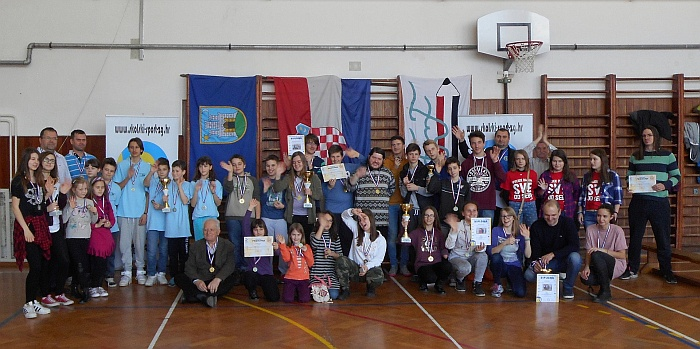
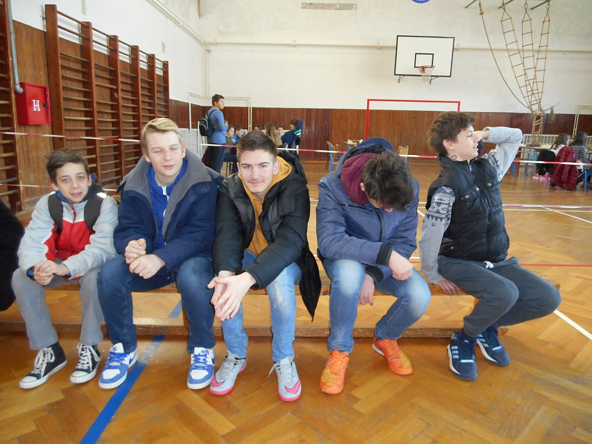
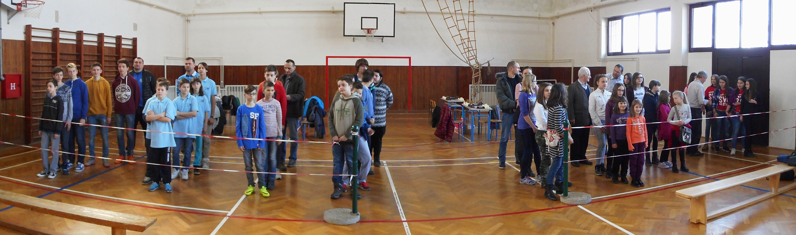
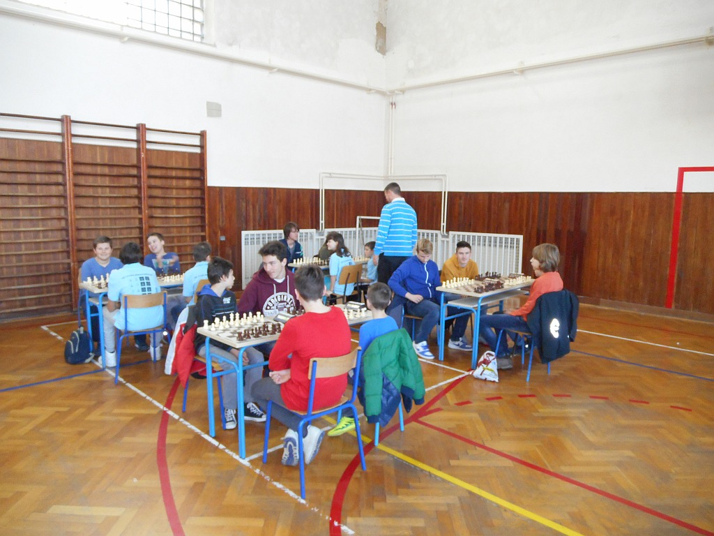
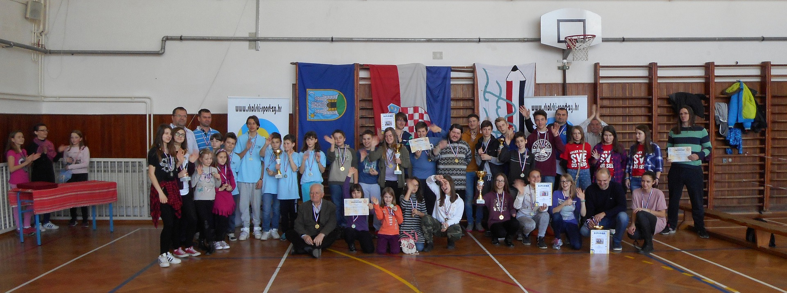
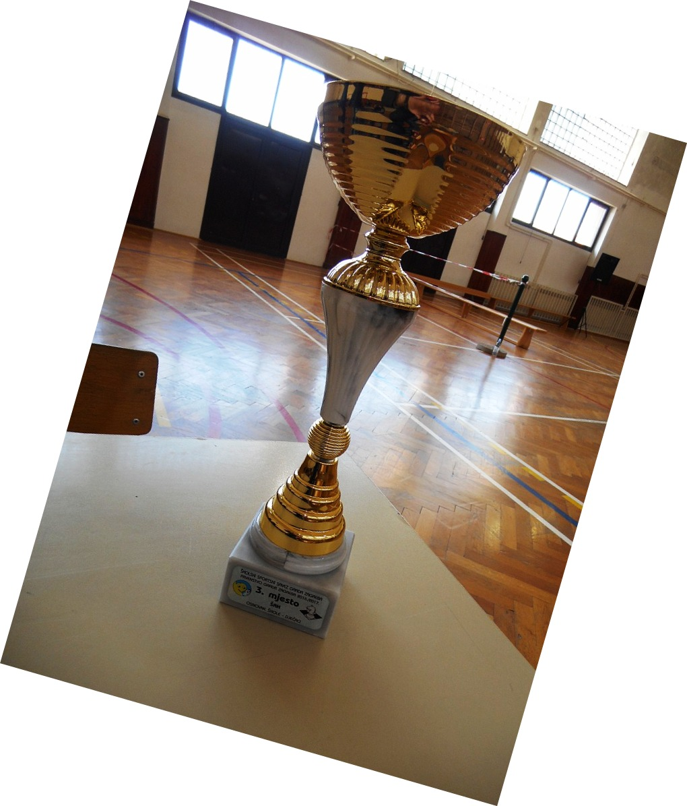
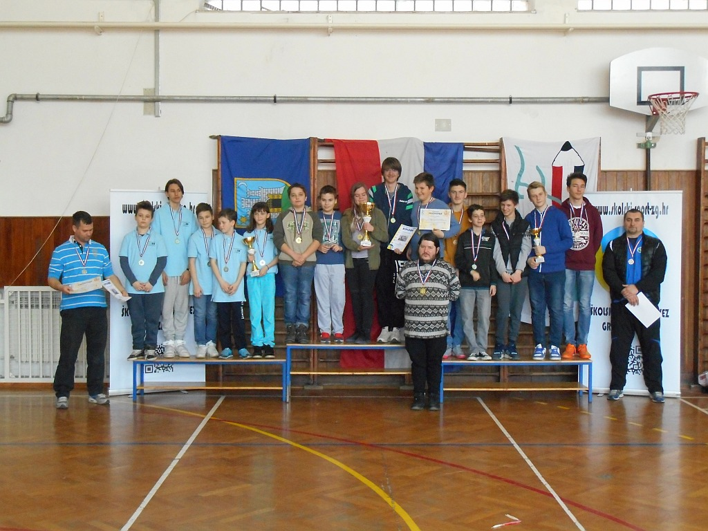

  
Danas je odigrano finale ekipnog prvenstva OŠ Grada Zagreba u šahu, a naši dečki iz OŠ Odra okitili su se broncom! Tim uspjehom dostigli su djevojke OŠ Odra, koje su broncu osvojile prošle godine. Iskreno se nadam da će dogodine obje naše ekipe igrati u finalu i poboljšati rezultat. 🙂  Zasluženo prvo mjesto i plasman na prvenstvo Hrvatske osvojila je ekipa OŠ Špansko, koja je i u kvalifikacijama nanijela jedini poraz našoj ekipi. Drugo mjesto osvojili su prošlogodišnji prvaci, ekipa OŠ Tituša Brezovačkoga.  
Dečki su nastupili u ovom sastavu: Ivan Maravić, Ivan Vraneša, Ivan Kljujev, Božo Cvetković i Bruno Kolovrat, a voditelj ekipe bio je prof. Krešimir Tomaško. Dečki su se hrabro borili, ali se mora iskreno priznati da su konkurenti ovaj put bili spremniji i jači. Nasreću, recept je jednostavan i prihvate li se naši dečki vježbe i rada, vjerujem da će dogodine broncu pretvoriti u neki plemenitiji metal. Oni su sedmi razred, a Vraneša šesti i imaju još jednu veliku priliku da izbore plasman na državno prvenstvo. Na njima se danas vidjelo i malo razočaranje jer su svjesni da mogu više i nadam se da će im ovaj rezultat, koji jest veliki uspjeh, dati dodatni motiv da ostvare i onaj najveći te osvoje prvenstvo grada. Uskoro ih očekuju nastupi u drugoj kadetskoj ligi i tamo će imati još toga za pokazati.  
Čestitke dečkima, a posebno Ivanu Maraviću, koji je cijeli turnir odigrao bez poraza igrajući prvu ploču, kao i Ivanu Kljujevu, koji je ostvario 100% učinak u finalu! Želimo im još mnogo odličja!

  *(fotografija „finale-prvenstav-OS-Zagreba-2017-a.jpg” nije dostupna ni na staroj stranici)* 

        

[rezultati](http://chess-results.com/tnr264474.aspx?lan=13&art=0&turdet=YES&flag=30&wi=984)

darko
