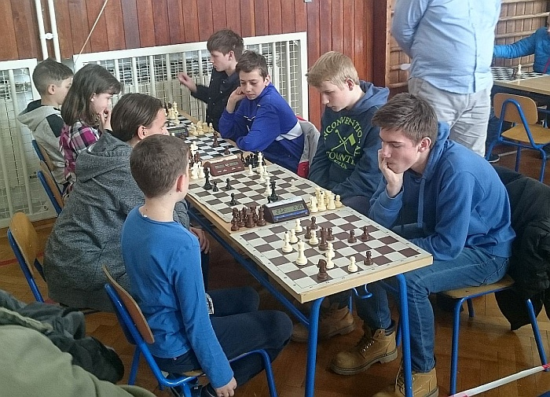

U subotu 4. veljače u OŠ Frana Krste Frankopana počelo je Ekipno prvenstvo osnovnih škola Grada Zagreba u šahu za školsku godinu 2016./2017. Nakon prošlogodišnjega velikog uspjeha, kada su djevojke OŠ Odra ušle u finale i osvojile broncu, već ove godine nadamo se dvostrukom uspjehu pa da i dečki (napokon!) uhvate to željeno finale i uđu u borbu za medalje. Nažalost, djevojke su prvo kolo počele porazom i nakon tri kola (polovica ženskoga kvalifikacijskog turnira) imaju tri meč-boda i već ove subote čeka ih velika borba za ulazak među prve četiri ekipe, koliko ih ide u finale. Dečki su rezultatski počeli mnogo bolje i imaju sve tri pobjede i šest meč-bodova, ali oni igraju devet kola i čeka ih još dosta teških susreta. Nasreću, već su u trećem kolu pokazali da su mrvicu napredovali. Naime, pobijedili su ekipu OŠ Tituša Brezovačkog, prošlogodišnje prvake! Šteta je samo što su izgubili dobivenu partiju na drugoj ploči, gdje je Vraneša bio bijeli i nije uočio jednostavan dobitak u poziciji na dijagramu.

```pgn
[Annotator "by,darek"]
[SetUp "1"]
[FEN "6k1/2p2p2/5p2/p7/1qQ5/5P1P/2P3PK/8 w - - 0 1"]
[PlyCount "11"]

1. Qxb4 axb4 2. Kg3 c5 (2... f5 3. Kf4 c5 4. Kxf5 c4 5. Ke4 b3 6. cxb3 cxb3 7.Kd3) 3. Kf4 c4 4. Ke3 b3 5. cxb3 cxb3 6. Kd3 *   *
```

Dečki igraju u sljedećem sastavu: Ivan Maravić, Ivan Vraneša (K), Ivan Kljujev, Božo Cvetković i Bruno Kolovrat.  
Djevojke su u ovom sastavu: Monika Kolovrat (K), Ana Kolovrat, Ana Katarina Hačić, Anđela Mahin i Samanta Halužan.

Turnir se nastavlja u subotu, a početak četvrtog kola je u 9 sati.

Rezultati prva tri kola nalaze se u prilogu. [dečki – tablica i rezultati prva tri kola](/files/wp/2017/02/Rez-ah58M-1r3k.pdf), [djevojke – tablica i rezultati prva tri kola](/files/wp/2017/02/Rez-ah58--1r3k.pdf)
