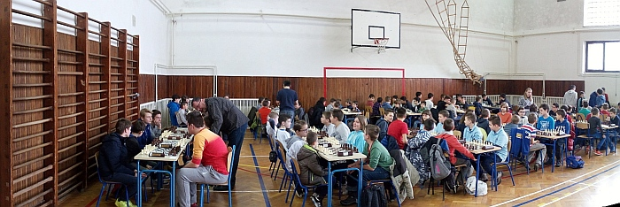
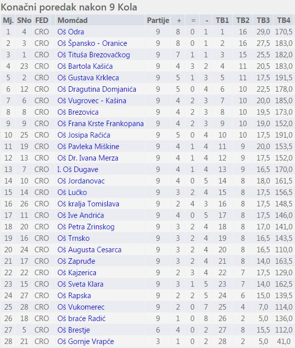
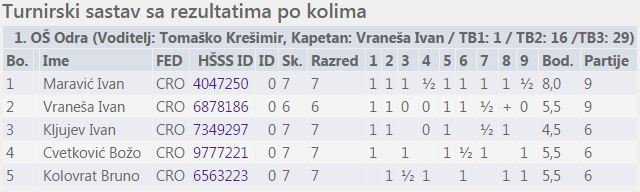
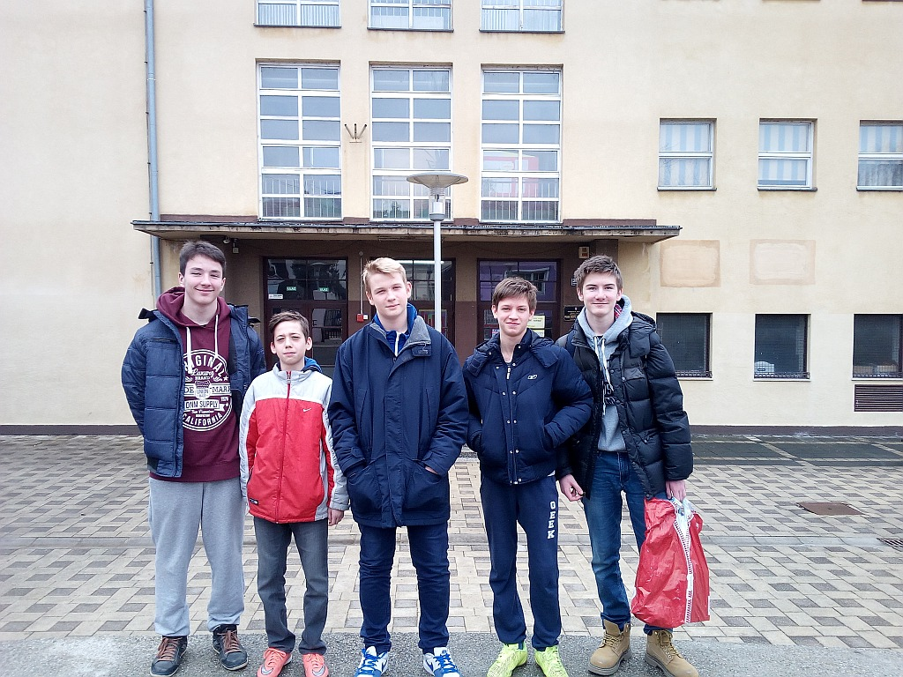

  
Jučer su u OŠ Frana Krste Frankopana završene kvalifikacije prvenstva osnovnih škola Grada Zagreba u šahu. Prve četiri ekipe igrat će finale 4. ožujka od osam sati. Dečki iz OŠ Odra napokon su uspjeli ući u finale, i to s prvog mjesta!  
  
  
Ove godine u kvalifikacijama je nastupilo 28 škola, što je mnogo manji broj od prošlogodišnjega, kada su kvalifikacije igrale 42 ekipe. U konkurenciji djevojaka ove godine nastupilo je 13 škola, što je mali pozitivni pomak u odnosu na prošlogodišnjih 11.  
Prve četiri ekipe prilično su izjednačene i borba za prvo mjesto bit će zanimljiva. Naši su dečki odigrali i više nego dobro, a čak njih trojica, Ivan, Božo i Bruno, nisu osjetili gorčinu poraza na ovom turniru. Plasman u finale ove godine osigurali su već nakon osmoga kola, ali nisu bili milostivi ni prema protivnicima u posljednjem kolu.  
Nažalost, i u ovom krugu dogodio se incident. Trener je ozlijedio ruku kada je nakon sedmoga kola mlatio Kljujeva, koji je katastrofalno odigrao pješačku završnicu i remizirao dobivenu poziciju. Nadam se da je ovo dovoljno ozbiljno upozorenje igračima da se ubuduće ne izmiču i otimaju za vrijeme provedbe pedagoških mjera. 🙂  
Dečki sada imaju dva tjedna da se što bolje pripreme, a mi im želimo da jednako uspješno odigraju i finale.  
[Rezultati kvalifikacija 2017 – M](/files/wp/2017/02/Rez-ah58M.pdf)

---

**Najava turnira**

4\. ožujka: Finale ekipnog prvenstva OŠ Grada Zagreba  
8\. ožujka: nastavak, Ekipno prvenstvo OŠ N. Zagreba do četvrtog razreda  
18\. ožujka, 1. i 8. travnja: I. liga, kadetkinje  
18\. ožujka, 1. i 8. travnja: II. liga, kadeti  
19\. i 26. ožujka, 2., 9. i 30. travnja: V. seniorska liga  
18., 19. i 20. travnja: Pojedinačno kadetsko prvenstvo Zagreba do 9 i 11 godina  
21., 22. i 23. travnja: Pojedinačno kadetsko prvenstvo Zagreba do 13 i 15 godina  
10\. svibnja: nastavak, Ekipno prvenstvo OŠ N. Zagreba do četvrtog razreda  
20\. i 21. svibnja: [Međunarodni turnir juniorki „Buševec 2017.“  
](http://sahovski-klub.com/raspis-busevec-2017/)16.-22. lipnja: Pojedinačno kadetsko prvenstvo Hrvatske za kadetkinje i kadete  
do 7, 9, 11, 13 i 15 godina, hotel „Medena“ u Trogiru.
