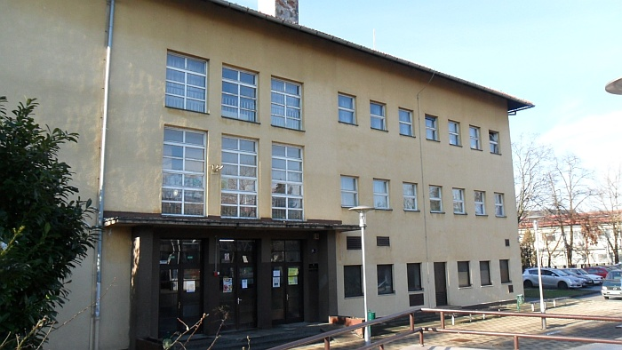

U subotu 30. siječnja počinje Prvenstvo osnovnih škola Grada Zagreba. Ekipe se prijavljuju između 8.30 i 9.30. Natjecanje bi trebalo početi u 9.30. Svi natjecatelji trebaju doći do 9 sati. Igra se na petnaest minuta po igraču, bez vremenskog dodatka. Pisanje nije obvezatno. Prvenstvo će se igrati u prostorima OŠ Frana Krste Frankopana u Ivanićgradskoj 24. Predviđeni datumi kvalifikacija su 30. siječnja te 6., 13., 20. i 27. veljače. Ne znam zašto su odredili tolike datume jer su prošle godine kvalifikacije u ženskoj konkurenciji završile u jednom danu. Tempo od petnaest minuta i samo tri kola po danu? Dopuštena je samo jedna rezerva? S obzirom na to da je organizator Školski sportski savez grada Zagreba, a to je jedna uistinu teška birokratska organizacija, koja je u stanju zbog jednoga pogrešnog zareza na prijavi zabraniti nastup na natjecanju cijeloj ekipi učenika ili učenica, neću se ni pitati zašto. Oni tek od ove godine prvi put dopuštaju da djevojčice igraju u ekipi s dečkima. Dovoljno o njima.  Prvoplasirana ekipa stječe pravo nastupa na Državnom prvenstvu školskih sportskih društava Republike Hrvatske za 2015. /2016. godinu. U nastavku je prijedlog ekipa OŠ Odra za nastup na prvenstvu.

OŠ ODRA – dečki

1.  Ivan Maravić III
2.  Ivan Vraneša
3.  Ivan Kljujev
4.  Bruno Kolovrat
5.  Božo Cvetković IV

OŠ ODRA – djevojke

1.  Monika Kolovrat
2.  Anđela Mahin
3.  Samanta Halužan
4.  Ana Katarina Hačić
5.  Lucija Kolovrat

Termini ovog prvenstva preklapaju se s turnirom za mlade koji će se održati u hotelu Westin 19., 20. i 21. veljače pa, uprkos mojoj ideji da na turniru nastupe dečki iz prve ekipe, taj termin vjerojatno ostaje slobodan samo za mlađe članove.  
Što se tiče ekipa za **klupsku kadetsku ligu** (dečki s dvije ekipe igraju IV. ligu, a djevojčice I. ligu, predviđeno je da se kadetska liga igra **12\. i 19. ožujka te 9. travnja**), prva ekipa dečkiju bit će istovjetna školskoj, dok su za nastup u drugoj ekipi prijavljeni Luka, Filip, Josip, Antonio, Luka Fran, Petar, Juraj, Stipe, Marko i Toni. Ekipa djevojaka, kao i prva ekipa dečkiju, ostaje neizmijenjena, samo će se ekipi na trećoj ploči pridružiti Ana, kojoj svi želimo da dotad riješi svoje zdravstvene tegobe.  
U povodu današnjeg rođendana jučer je u klubu Josip počastio ekipu pizzama,  
a mi mu  želimo sretan deveti rođendan!
