**1\. krug**  
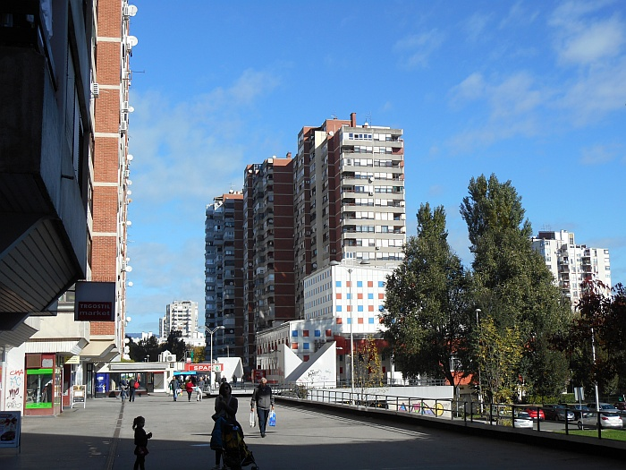Danas je u organizaciji ŠK Travno započelo Ekipno prvenstvo osnovnih škola Novog Zagreba u šahu. OŠ Odra nastupa s dvije ekipe. Iz prve ekipe su ovaj put izbačeni osmaši, kako bi i mlađi dobili šansu. Za prvu ekipu danas su nastupili Vraneša, Luka Fiolić (kapetan), Luka Matašić, Monika i Filip. Za drugu ekipu, sastavljenu samo od djevojaka, nastupile su Ana (kapetan), Katarina, Lucija i Franka. Dogovor je da sljedeći krug Anu i Katarinu, koje imaju druge obaveze taj vikend, zamijene Anđela i Samanta.  
Prvo kolo obilježio je međusobni susret ekipa OŠ Odra, koji je prva ekipa dobila sa 3:1. Pobjedu za drugu ekipu, ubilježila je samo Franka, koja nam se vratila nakon dvije godine izbivanja i svojim zalaganjem već opasno konkurira i za nastup na Prvenstvu OŠ Zagreba, koje će se igrati u veljači.  U prvom kolu moglo se primjetiti ono što se primjećuje i u Klubu, a to je da su Ana i Filip prebacili u višu brzinu i za razliku od igara prije četiri mjeseca, sada pokazuju znatno više.  Svi su impresionirali zalaganjem i ozbiljnošću u pristupu, a posebno me dojmilo to što sada vide po nekoliko poteza. Partija između Luke F. i Katarine je bila puna taktičkih zamki za koje do danas nisam znao da su u stanju smisliti za pločom.  
U drugom kolu prva ekipa imala je lakši posao i uvjerljivo pobijedila OŠ Kajzerica. Druga ekipa imala je ozbiljnije protivnike i zahvaljujući sreći, uspjela je odigrati neodlučeno te upisati prvi ekipni bod. Igrali su protiv OŠ Trnsko, a ekipni bod svojim pobjedama donijele su Katarina i Franka, koja je bila u izgubljenoj poziciji.  
Svi natjecatelji zaslužuju pohvale za pristup igri i pokazanome, dok Luka Fiolić i Luka Matašić, uz pohvale zaslužuju i kritike. Oba dječaka su prilično temperamentna i to teško kontroliraju za vrijeme partije. Luka Matašić i dalje igra prebrzo, a Luka Fiolić je povukao neke poteze bez da je dovoljno promislio.

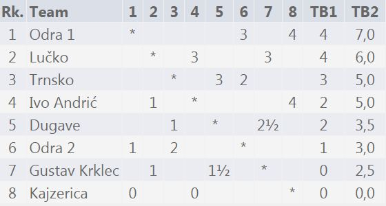  
Detaljni rezultati mogu se vidjeti na [chess-results serveru](http://chess-results.com/tnr305596.aspx?lan=1&art=1&wi=821).

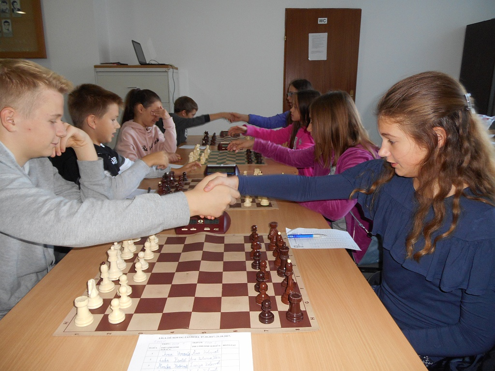 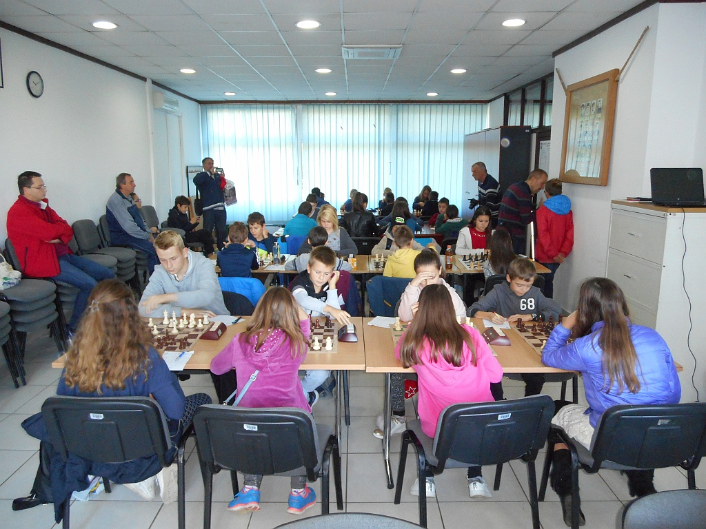 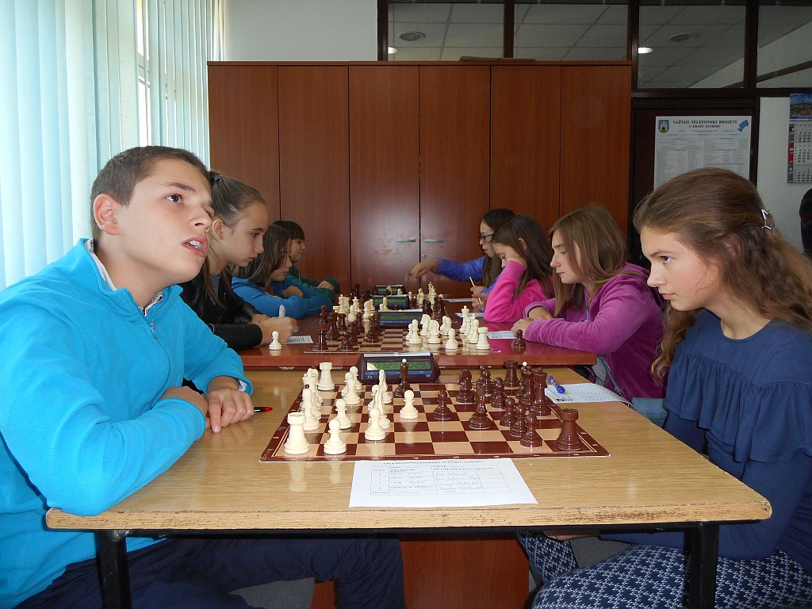 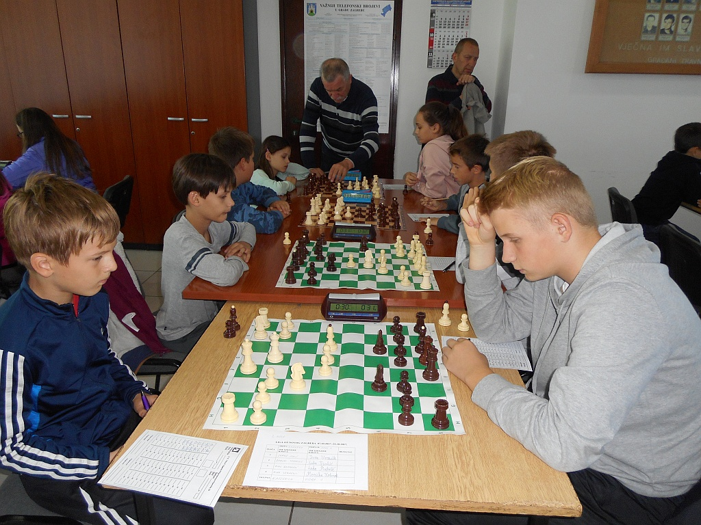  
Sljedeći krug igra se za tjedan dana, a početak je u 9.30.

darko

---

**2\. krug, 14. listopada 2017.**

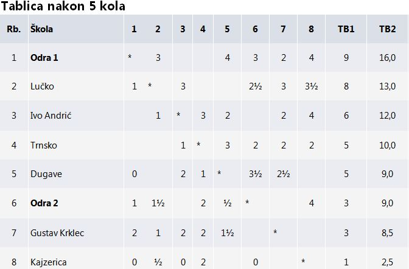

U subotu 14. listopada odigran je drugi krug Ekipnog prvenstva osnovnih škola Novog Zagreba. Opet je došlo do promjena u planovima pa su za drugu ekipu zaigrale Ana, Katarina, Samanta i Anđela. Anđela je u četvrtom kolu odigrala vjerojatno najljepšu partiju od svih partija naših igrača. Samanta je prošla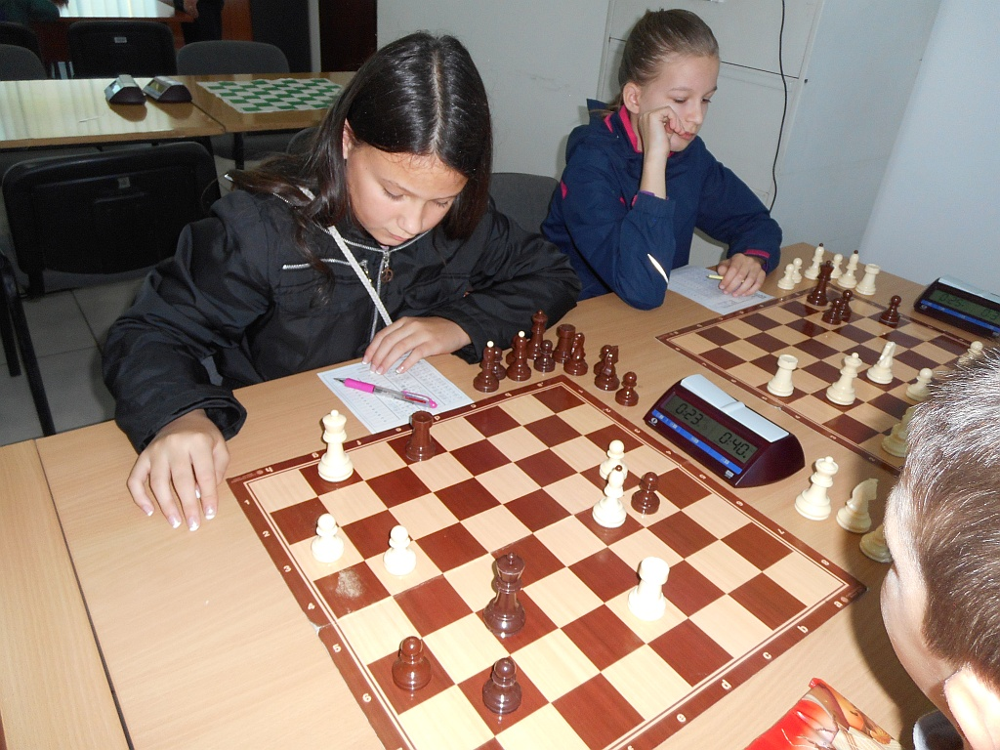 bez poraza, a uspjela je patirati protivnika u petom kolu. Ne tako davno, one su bile te koje su se nadale patu. 🙂  Ana se trudi držati uputa i to je dobar preduvjet za napredak. Katarina je također dobro igrala, ali mi se čini da će se nakon analiza još više popraviti. Djevojke iz druge ekipe su do sada skupile tri meč-boda, ali je još važnije iskustvo. Sveukupno, vrlo sam zadovoljan prikazanim.

Što se tiče prve ekipe, tu nije bilo sjajno. Vraneša je previđao, Luka Fiolić jako teško prihvaća savjete, a Luka Matašić je igrao jednu partiju i to je vjerojatno bila najlošija partija. Potpuno je odbacio sve šahovske principe, igrao damom u otvaranju iako smo toliko puta rekli da se to ne radi. Čini mi se da je trenutno Filip ozbiljniji, a uz to Filip je upisao i pobjedu u petom kolu. Zbog neozbiljnog pristupa dvojice Luka, ekipa je izgubila jedan meč bod protiv realno slabije ekipe. U prvoj ekipi u subotu je zadovoljila jedino Monika jer (zasad) sluša upute, a ima i impresivan skor. Pet od pet!  
Prva ekipa je i dalje vodeća i budu li ozbiljni i sljedeće subote, pruža im se velika prilika.

```pgn
[Event "Ekipno prvenstvo osnovnih škola Novog Zagreba 2017/18"]
[Site "sahovski-klub.com"]
[Date "2017.10.14"]
[Round "4"]
[White "Anđela, Mahin, VK 1600, OŠ Odra"]
[Black "Ivan, Horvat, IV 1704, OŠ Lučko "]
[Result "1-0"]
[ECO "B87"]
[BlackElo "1704"]
[PlyCount "69"]
1. e4 c5 2. Nf3 d6 3. d4 cxd4 4. Nxd4 Nf6 5. Nc3 a6 6. Bc4 e6 7. Be3 b5 8. Bb3
Bb7 9. Qd2 Nxe4 10. Nxe4 Bxe4 11. f3 Bb7 12. O-O-O Qc7 13. Kb1 (13. Bxe6 fxe6 14. Nxe6 Qe7 15. Rhe1 Qxe6 16. Bb6) 13... d5 14. Bf4 Qd7 15. g4 Bd6 16. Bg5 f6 17. Bh4 a5 18. Rhe1 e5 19. Nf5 Rg8 20. Bxd5 Bxd5 21. Qxd5 Rf8 22. Qxa8 g6 23. Nxd6+ Ke7 24. Nf5+ (24. Rxe5+)
24... Ke6 25. Rxd7 Kxd7 26.Qb7+ Ke6 27. Ng7+ Kd6 28. Rd1+ Kc5 29. Bf2+ Kc4 30. Rd4+ Kc5 31. Rd5+ (31. Ne6#) 31... Kb4 32. c3+ Ka4 33. b3+ (33. Qxb5#) 33... Ka3 34. Qe7+ b4 35. Rxa5# 1-0
```

---

**3\. krug, 21. listopada 2017.  
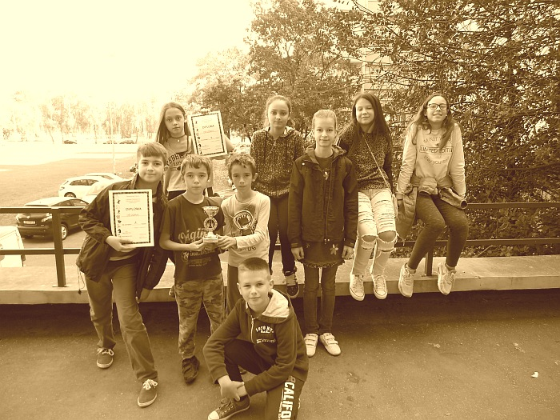Pobjednici!  
**Danas su odigrana posljednja dva kola i nakon teških borbi, **OŠ Odra osvojila je Ekipno prvenstvo osnovnih škola Novog Zagreba 2017.!** Kapetan ekipe Luka Fiolić prisjetio se kako je prije nekoliko godina bio najmlađi član ekipe, kada su također osvojili pehar, a dečki su mu dopustili da drži pehar prilikom slikanja te je za ovo slikanje odlučio velikodušno tu čast prepustiti najmlađim članovima.  
**Drugo mjesto** osvojila je **OŠ Lučko**, a **treće mjesto** pripalo je **OŠ Ivo Andrić.** Treba priznati da su prve ekipe podjednake, naime, OŠ Ivo Andrić pobijedila je u međusobnom susretu OŠ Odra, OŠ Odra pobijedila je OŠ Lučko, a OŠ Lučko pobijedila je OŠ Ivo Andrić. Lučko i Odra su na kraju imali jednak broj meč bodova, ali je naša ekipa skupila više pojedinačnih bodova.

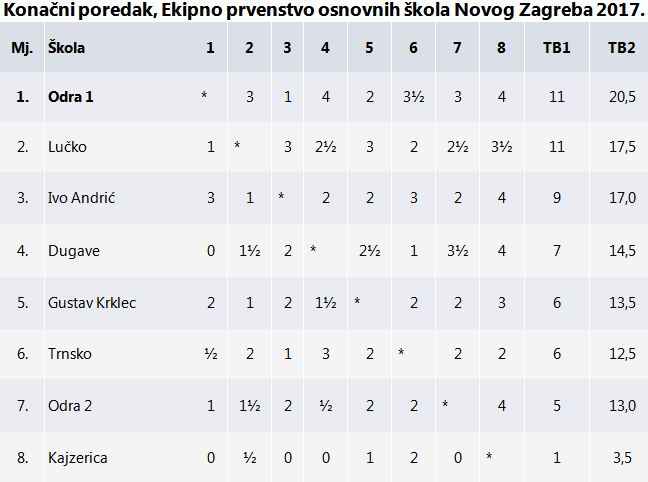  
Danas je iz prve ekipe ispao Vraneša, zbog, recimo to tako, važnih školskih obaveza ;), a bez njega u ekipi nije bilo nimalo lako. Umjesto njega u ekipu je upao Josip. Ekipa je u šestom kolu doživjela prvi poraz, ali je na njihovu sreću OŠ Lučko u istom kolu igrala neriješeno sa OŠ Trnsko, a naša je ekipa pak u posljednjem kolu uvjerljivo pobijedila OŠ Trnsko s 3.5:0.5. Posljednje kolo u ekipu je uskočio i Luka Matašić i ovaj put odigrao ipak znatno ozbiljnije.  
Svi su igrali dobro, a na turniru su posebno impresivan rezultat ostvarili Luka Fiolić i Monika Kolovrat (6/7), Anđela Mahin (4/5) i Samanta Halužan (3/5 sa samo jednim porazom). Vranešu ne spominjem jer je on klasa iznad. I ostali su ugodno iznenadili, ne toliko rezultatom koliko ozbiljnošću u pristupu igri i kvalitetom partija, posebno Ana, Filip i Lucija.  
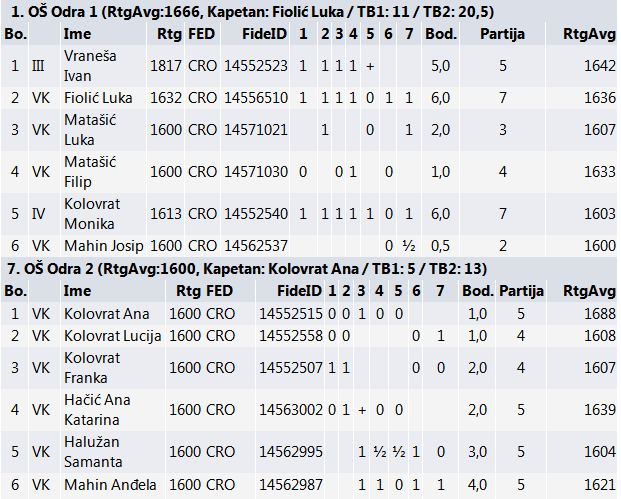  
Još jednom čestitke dečkima i curama na ovom iznimnom uspjehu i nadam se da će nastaviti jednakim tempom i dalje. Već za tri tjedna igra se turnir u Krapini i nadam se da ga neće propustiti nitko tko ozbiljno konkurira za školsku ekipu.

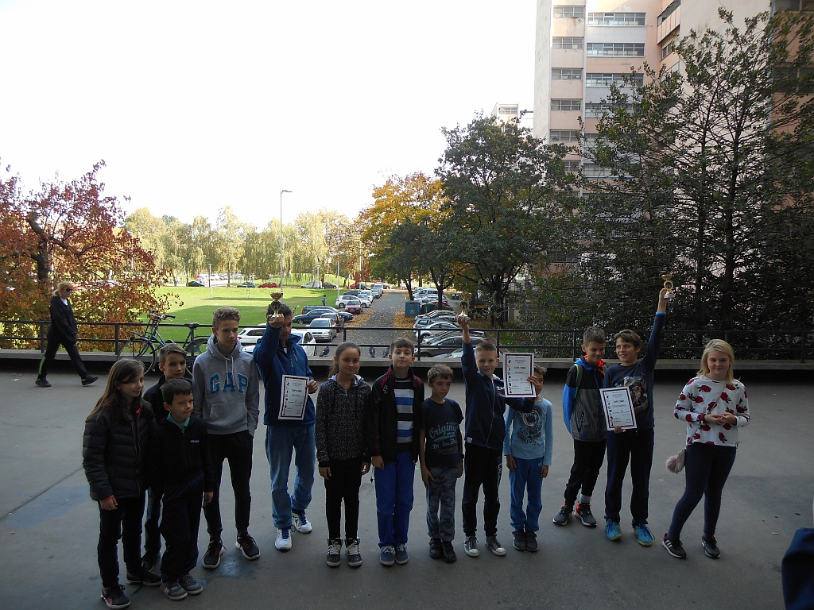 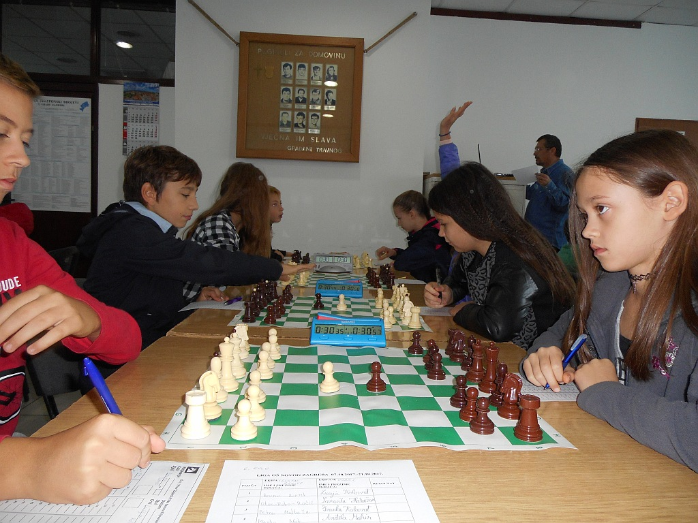 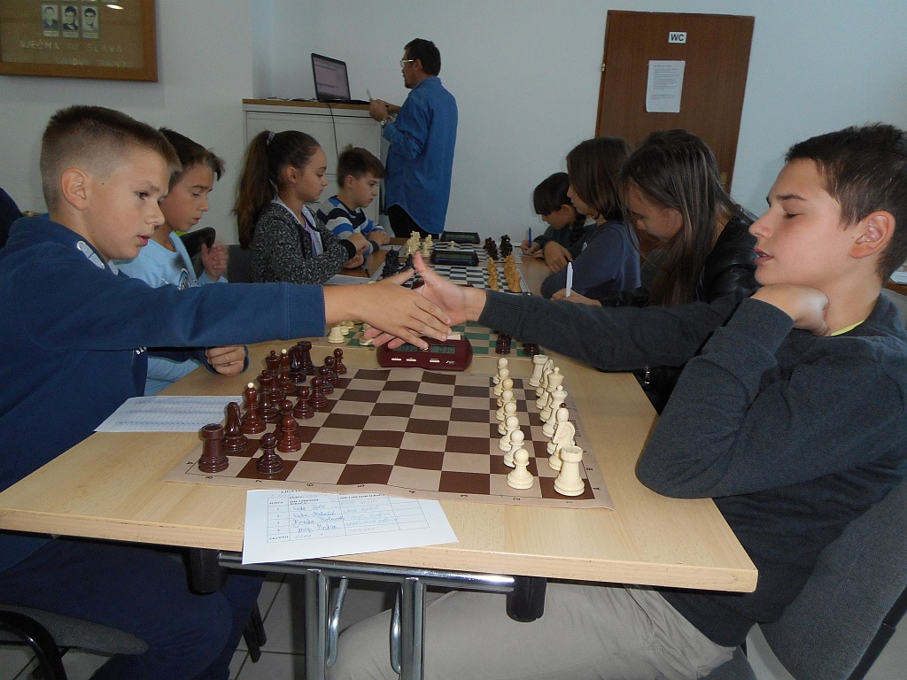 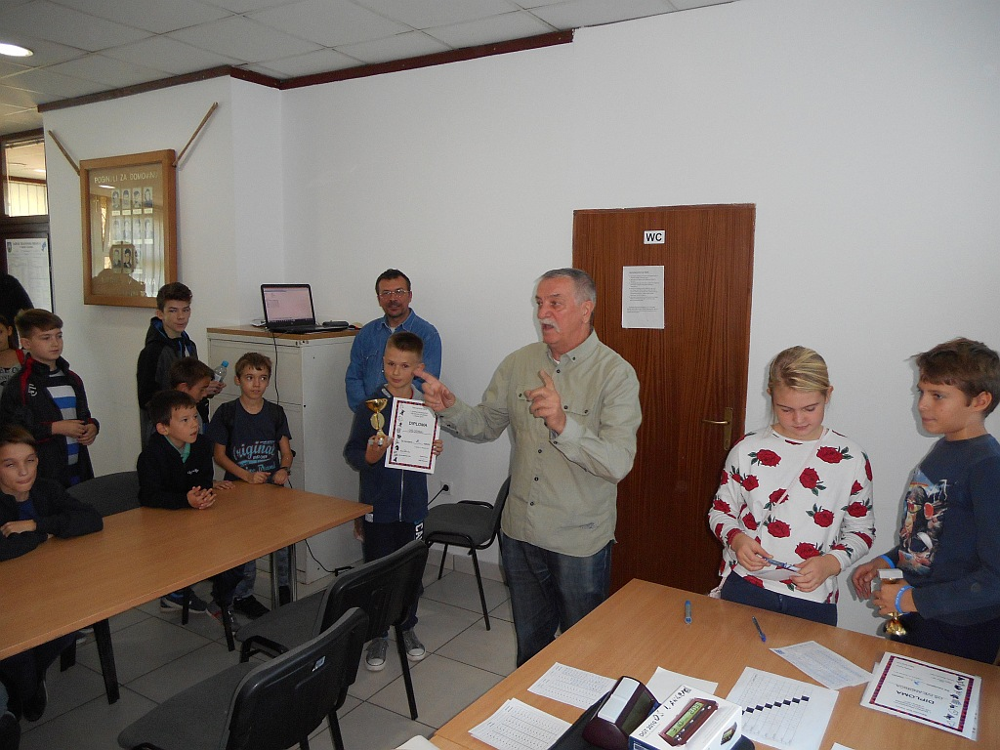

```pgn
[Event "Ekipno prvenstvo osnovnih škola Novog Zagreba 2017/18"]
[Site "sahovski-klub.com"]
[Date "2017.10.21"]
[Round "6"]
[White "Samanta, Halužan VK 1600, OŠ Odra"]
[Black "Oton Roko, Rodić VK 1600, OŠ Gustav Krklec"]
[Result "1-0"]
[ECO "C45"]
[PlyCount "35"]

1. e4 e5 2. Nf3 Nc6 3. d4 Nxd4 4. Nxd4 exd4 5. Qxd4 Nf6 6. Nc3 d6 7. Bc4 c5 8.
Qd3 Ng4 9. Qd5 Be6 10. Bb5+ Bd7 11. Bc4 Qf6 12. f3 Qh4+ 13. g3 Qh3 14. Qxf7+
Kd8 15. Bg5+ Kc8 16. Be6 Qg2 17. Qxd7+ Kb8 18. Qc8# 1-0
```
