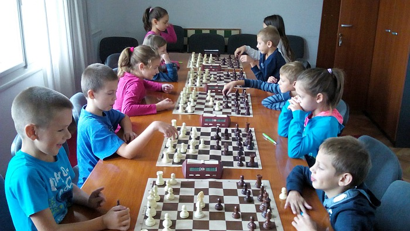
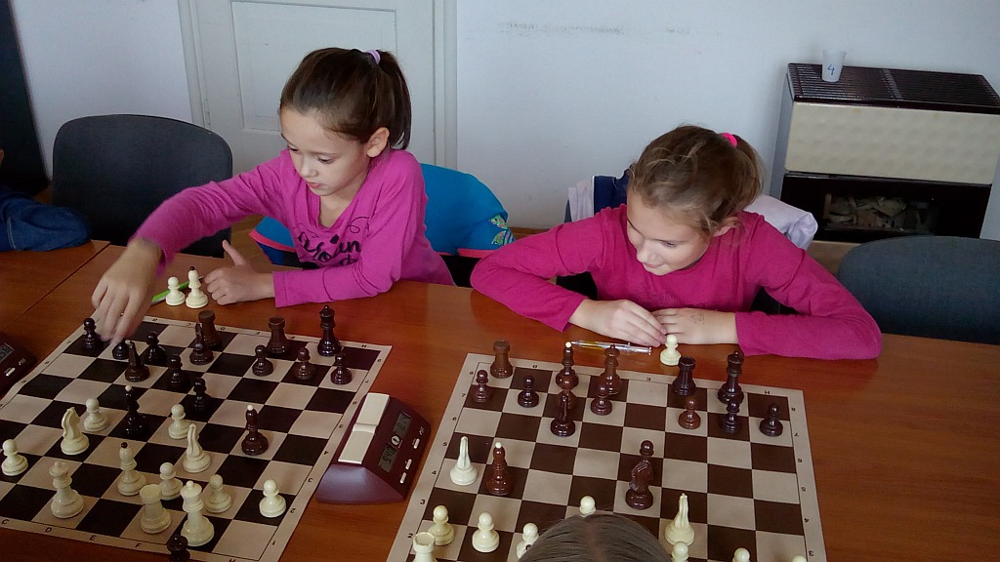
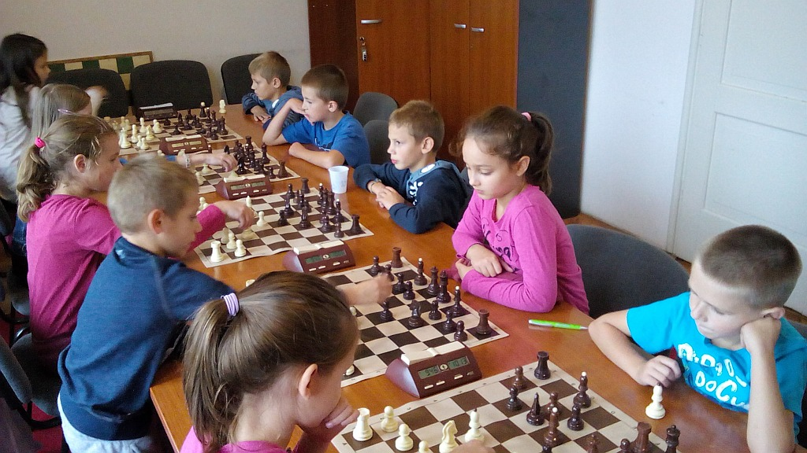

Danas je odigrano prvenstvo Kluba za mlađe kadete (do četvrtog razreda). **Pobjednici** su **Luka Fiolić** u muškoj i **Monika Kolovrat** u ženskoj konkurenciji. To je nekako bilo i očekivano jer Luka od svih najviše igra, petkom ostaje dulje i igra sa starijim kadetima, a ovog ljeta nastupio je i na prvenstvu Hrvatske u Splitu  s vrlo dobrim rezultatom (19. mjesto). Također, Monika je imala izvrstan rezultat prošle godine na prvenstvu Hrvatske do 8 godina, održanome u Sesvetama, kada je osvojila [9\. mjesto](/novosti/zavrseno-je-12-pojedinacno-prvenstvo-hrvatske-za-djecake-i-djevojcice-do-8-godina/) , a usto vrlo pozorno sluša i voli učiti.  
Ugodno su iznenadili brat i sestra Mahin, Josip i Anđela, koji su osvojili druga mjesta iako su tek potkraj prošle školske godine počeli pohađati treninge petkom. Anđela pozorno prati i uči na treninzima, a Josip ima veliku volju, samo ga zasad roditelji ne puštaju da ostaje predugo, tj. sa starijim kadetima nakon pola osam.  Juraj, Petar i Marko nisu dolazili potkraj prošle školske godine zbog bolesti, ali sada su opet redoviti i vjerujem da će ubrzo napredovati, posebno Marko, koji je najmlađi, ali se vidi da je već stekao nešto rutine i povlači poteze bez ustručavanja. Oni su prošle godine iznijeli teret nastupa u Ligi igrajući za Klub i, igrajući ovaj turnir, stječu iskustvo. U ženskoj konkurenciji Ana, koja je najveći talent, ali više nije redovita, pokazala je da nije zaboravila igrati i podijelila je drugo mjesto po bodovima s Anđelom. Kada bi se samo mrvicu ozbiljnije prihvatila šaha, vjerujem da bi opet bila najjača u klubu, kao što je to bilo donedavno. Lucija je jako darovita i sve što joj nedostaje samo su partije, tj. rutina, jer sam uočio da troši dosta energije da realizira dobivene pozicije. Isto vrijedi i za Samantu, kojoj je ovo praktički prvi susret s turnirskim nastupom, a znam da uglavnom svaki problem koji rješavaju na treningu brže riješi od ostalih.  
Na turniru je bilo i nekoliko neriješenih partija, ali to su uglavnom patovi, koji će s vremenom nestati. Od iznenađenja tu je bila pobjeda Anđele nad Josipom. Čudila se Anđela, čudio se Josip, a i ja sam se čudio jer mi je Anđela povjerila da gotovo uvijek gubi od brata!  
Šteta je što se danas nisu pojavili Noa, Lovro i Dora, ali mislim da je to roditeljska krivnja, osobito u slučaju Noe, koji ima veliku želju igrati, ali tata nema vremena…  
Najljepša hvala roditeljima na motivaciji djece jer im je to u ovoj fazi razvoja itekako potrebno.  
Više slika može se naći u [galeriji.](/galerija/)  
    

Tablica:  

| R.br. | Prezime i ime | 1. | 2. | 3. | 4. | 5. | 6. | 7. | 8. | 9. | 10. | Bod | Mjesto |
| --- | --- | --- | --- | --- | --- | --- | --- | --- | --- | --- | --- | --- | --- |
| 1. | **Fiolić, Luka** | \* | 1 | 1 | 1 | 1 | 1 | 1 | 1 | 1 | 1 | 9 | **1.** |
| 2. | Pisačić, Petar | 0 | \* | 0 | 0 | 1 | 1/2 | 0 | 0 | 1/2 | 0 | 2 | 4. |
| 3. | Mahin, Josip | 0 | 1 | \* | 1 | 1 | 1 | 0 | 0 | 1 | 0 | 5 | 2. |
| 4. | Pisačić, Juraj | 0 | 1 | 0 | \* | 1 | 1 | 0 | 1/2 | 1 | 0 | 4,5 | 3. |
| 5. | Pisačić, Marko | 0 | 0 | 0 | 0 | \* | 0 | 0 | 0 | 0 | 0 | 0 | 5. |
| 6. | Halužan, Samanta | 0 | 1/2 | 0 | 0 | 1 | \* | 1/2 | 0 | 0 | 0 | 2 | 5. |
| 7. | Mahin, Anđela | 0 | 1 | 1 | 1 | 1 | 1/2 | \* | 1 | 1/2 | 0 | 6 | 2. |
| 8. | Kolovrat, Ana | 0 | 1 | 1 | 1/2 | 1 | 1 | 0 | \* | 1 | 1/2 | 6 | 3. |
| 9. | Kolovrat, Lucija | 0 | 1/2 | 0 | 0 | 1 | 1 | 1/2 | 0 | \* | 0 | 3 | 4. |
| 10. | **Kolovrat, Monika** | 0 | 1 | 1 | 1 | 1 | 1 | 1 | 1/2 | 1 | \* | 7,5 | **1.** |
