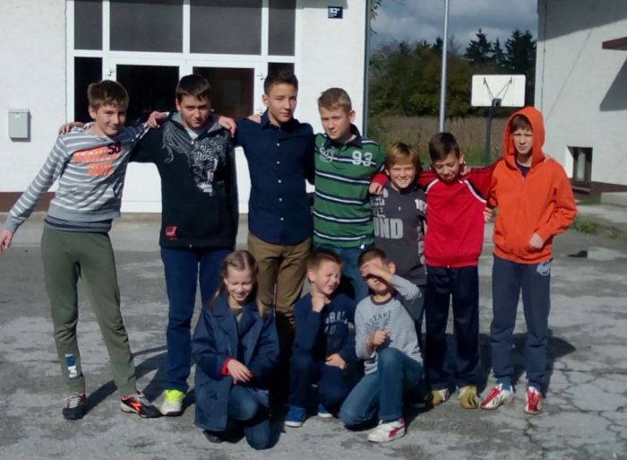
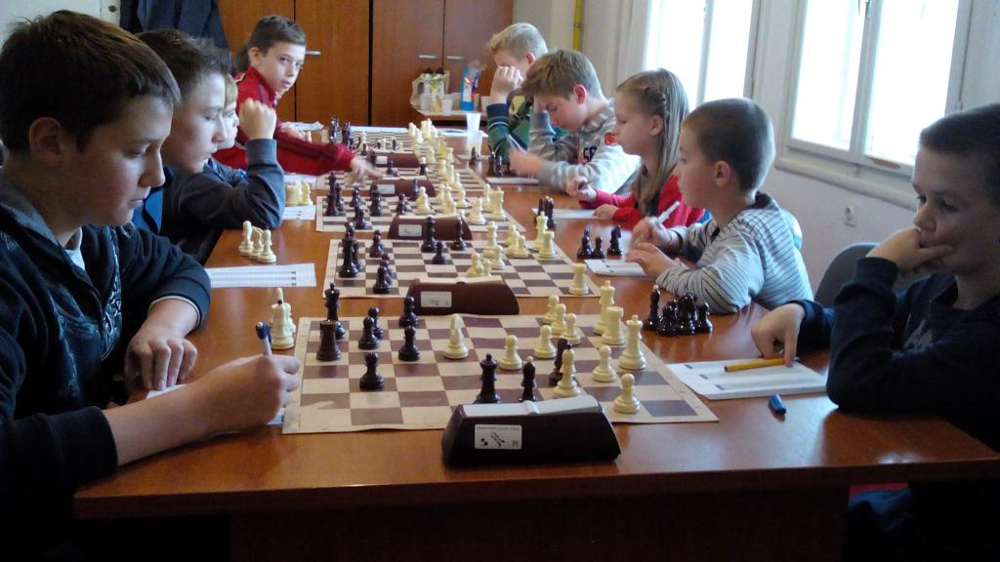
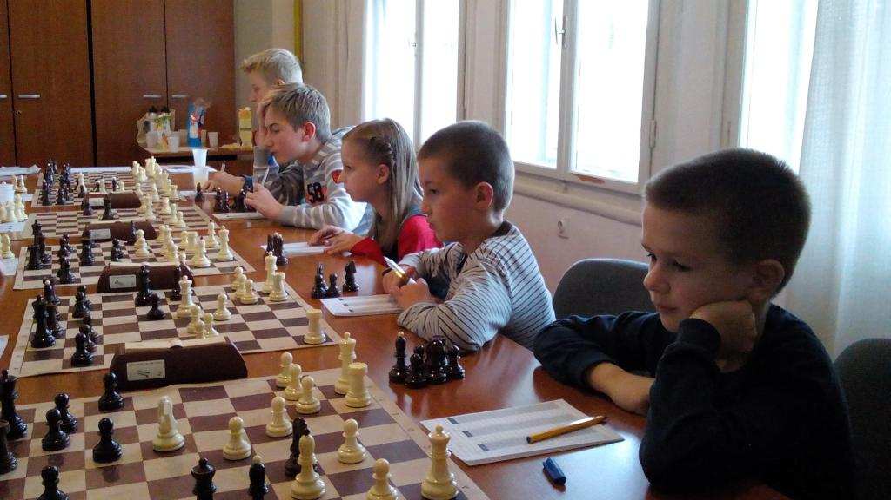
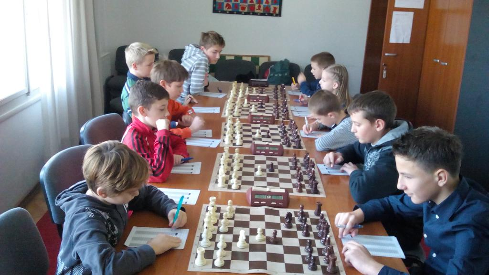
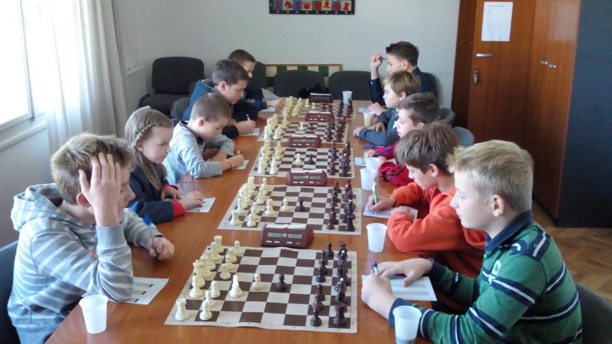
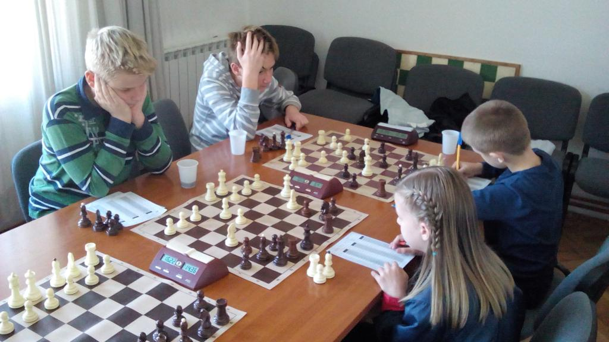

Danas je počelo kadetsko prvenstvo Kluba za starije kadete (od petoga do osmog razreda), kojima se pridružilo nekoliko talenata iz mlađe  dobne skupine kako bi stjecali iskustvo i učili pisati, što im zasad ide vrlo dobro. Na turniru se pojavila većina očekivanih igrača, nedostajali su nam Monika i Stipe, koji su se ovaj put opravdali drugim obvezama, ali se nadam da će nam se pridružiti prvom sljedećom prilikom. Odigrano je pet kola, od 14 do 18 sati,  tako da nam za sljedeći put ostane malo vremena i za pizza-party. Dobili smo sponzora za pizze (koji je želio ostati anoniman pa nećemo reći da je to za ovaj urnir Vranešin tata).  
Bilo je nekoliko iznenađujućih partija, Anđela je potpuno razbila Vranešu i Božu, ali su iskusni lisci na kraju uspjeli pobijediti. Također, Ivan je ušao u totalno izgubljenu završnicu protiv Brune, a onda je Bruno u cajtnotu uspio sve prosuti. Od mlađih samo je Luka uspio uzeti jedan skalp starijoj ekipi i time danas spasiti obraz mlađoj selekciji.  
Iako je podijeljeno dosta opomena, disciplina je bila dobra, partije kako-tako, a pogotovu se vidio pad koncentracije u četvrtome i petom kolu, kada je umor počeo uzimati danak. Ivan je previše previđao, Kljujev i Luka Fran su taktizirali protiv mlađih, što moram reći da mi se ne sviđa, ali mislim da si oni ne mogu pomoći. 🙂 Filip je pokazao zavidnu maštu, dobro se snašao sa pisanjem (njemu je to prvo takvo iskustvo), ali se vidi da je samouk jer se ne pridržava nekih osnovnih postulata o razvoju figura, koje tek treba naučiti. Josip razvija figure bolje od nekih starijih kadeta. Božo je upao u jedan trik iz talijanske partije pa se nadam da će se napokon opametiti i primiti knjige.  
Partije će nam poslužiti za analizu pa sljedećeg petka očekujemo i pomoć dr. Cvetkovića.  
Luki je do daljnjega zabranjen dolazak u šahovsku školu za mlađu grupu. Predobar je u šahu.  
Tablicu ćemo popuniti sljedeće subote, nakon završetka turnira.

      

| R.br. | Prezime i ime | 1. | 2. | 3. | 4. | 5. | 6. | 7. | 8. | 9. | 10. | Bod | Mjesto |
| --- | --- | --- | --- | --- | --- | --- | --- | --- | --- | --- | --- | --- | --- |
| 1. | **Maravić, Ivan** | \* | 1/2 | 1 | 1 | 1 | 1 | 1 | 1 | 1 | 1 | 8,5 | **1.** |
| 2. | Vraneša, Ivan | 1/2 | \* | 1 | 1 | 1\* | 0 | 1 | 1 | 1 | 1 | 7,5 | 2. |
| 3. | Kolovrat, Bruno | 0 | 0 | \* | 1/2 | 1\* | 1/2 | 1 | 1 | 1 | 1 | 6 | 4. |
| 4. | Cvetković, Božo | 0 | 0 | 1/2 | \* | 1\* | 1/2 | 1 | 1 | 1 | 1 | 6 | 3. |
| 5. | Kovačević, Luka Fran | 0 | 0\* | 0\* | 0\* | \* | 1/2 | 0 | 1 | 1 | 0\* | 2,5 | 8. |
| 6. | Kljujev, Ivan | 0 | 1 | 1/2 | 1/2 | 1/2 | \* | 1/2 | 1 | 1 | 1 | 6 | 4. |
| 7. | Bača, Filip | 0 | 0 | 0 | 0 | 1 | 1/2 | \* | 1 | 1 | 0 | 3,5 | 7. |
| 8. | Mahin, Josip | 0 | 0 | 0 | 0 | 0 | 0 | 0 | \* | 0 | 0 | 0 | 10. |
| 9. | Mahin, Anđela | 0 | 0 | 0 | 0 | 0 | 0 | 0 | 1 | \* | 0 | 1 | 9. |
| 10. | Fiolić, Luka | 0 | 0 | 0 | 0 | 1\* | 0 | 1 | 1 | 1 | \* | 4 | 6. |

darko

——  
Dana 24. listopada 2015.

Danas je nastavljeno i završeno kadetsko prvenstvo Kluba za starije kadete. Bilo je napeto, zanimljivo i veselo! Turnir je očekivano osvojio **Ivan**, drugo mjesto osvojio je **Vraneša,** kojeg je danas oprao Kljujev. Mogao je Kljujev danas i Ivana pobijediti, ali nije vidio dvopotez kojim osvaja figuru. Isto tako Josip je imao damu i dva topa viška u partiji protiv Ivana (iako sam mu ja predviđao brzi poraz), ali je izgubio na vrijeme. Još mu nedostaje rutine (i brzine) u cajtnotu. Luka Fran danas nije došao zbog bolesti pa je, iako je današnje partije sve izgubio bez borbe, ipak završio na osmome mjestu. A on inače baš ima dobar osjećaj i lijepo igra. Čekamo samo kada će početi i realizirati svoj talent. Filip je previdio figuru protiv Vraneše već u sedmom potezu, ali je odigrao ravnopravnu partiju s pobjednikom turnira. Nedavno nam se pridružio, ali je pokazao da je (trenutačno!) samo za nijansu slabiji od igrača iz prve ekipe. Bruno je igrao jako dobro, ali se zasad ne snalazi u završnicama. Dođe gotovo do kraja partije u potpuno dobivenoj poziciji, ali onda posustane, kao danas, kada je dva puta propustio nokautirati Božu, jednom u regularnoj partiji i drugi put u pripetavanju, kada ga je patirao i time izgubio treće mjesto, koje mu je prema prikazanoj igri pripadalo. Božo je najveći srećković danas. Kako su tri igrača dijelila treće mjesto, igrali su dodatni cuger koji je odlučivao o trećemu mjestu. U prvoj partiji Božo je samo čekao, potpuno izgubljen, da ga Kljujev matira i tada je Kljujev odigrao nemoguć potez pa je cijeli bod pripao Boži. U drugoj partiji Bruno mu je dao pat s damom i topom i **Božo** je osvojio treće mjesto! Treća partija bila je između Kljujeva i Brune i tu je partiju dobio Kljujev, koji je na kraju imao jedan bod, Bruno pola, a Božo bod i pol. Prva tri igrača dobila su diplome, u prvu ekipu ulazi prvih pet na tablici, a Luka je dobio kapetansku vrpcu te određuje članove druge ekipe. U nastavku je partija između dvoje gostiju (mlađih kadeta, Luke i Anđele) koji su nastupili na ovom turniru za “velike”. 🙂

```pgn
[Event "ŠK ODRA SK2015"]
[Site "www,sahovski-klub.com"]
[Date "2015.10.24."]
[Round "8"]
[White "Luka , Fiolić 2007."]
[Black "Andjela, Mahin 2005."]
[Result "1-0"]
[ECO "A43"]
[PlyCount "57"]

1. d4 c5 2. Nf3 d6 3. Be3 cxd4 4. Nxd4 Nf6 5. Nc3 a6 6. g3 b5 7. b4 Bb7 8. f3
Nc6 9. Nxc6 Bxc6 10. Bh3 e6 11. O-O Be7 12. Qd4 O-O 13. Bg5 h6 14. Bxf6 gxf6
15. Qg4+ Kh7 16. a4 bxa4 17. Nxa4 d5 18. b5 Bxb5 19. Nc3 Bc6 20. Rad1 Qb6+ 21.
Rd4 e5 22. Qf5+ Kg8 23. Na4 exd4 (23... Qxd4! 24. Kh1 Qxa4 25. Qh5 Bd7) 24. Qg4+ Kh7 25. Nxb6 Rab8 26. Qh4 Rxb6 27. Bf5+ Kg8 28. Qxh6 Bb5 29. Qh7# 1-0
```

  
darko
