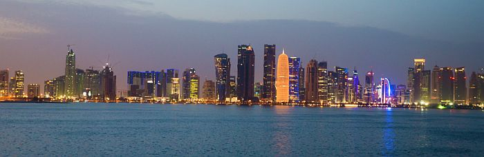

Turnir u Dohi je otvorenog tipa, sudjeluje 154 igrača, a tu je i nekoliko igrača sa ELO 2700+. Nama je posebno zanimljivo što nastupa i naš **[Ivan Šarić](http://ratings.fide.com/card.phtml?event=14508150 "Ivan Šarić - FIDE Chess Profile")** (2,5/4). *Qatar Masters Open 2014* igra se od 26. studenog do 4. prosinca  sa nagradnim fondom od 110.000$. Devet kola, švicarac.

Četvrti je dan turnira, vodeći na tablici je **Anish Giri** (4/4), a evo kako se danas (lako) obračunao sa svojim protivnikom:

```pgn
[Event "Qatar Masters Open"]
[Site "Doha"]
[Date "2014.11.29"]
[Round "4.1"]
[White "Giri, Anish"]
[Black "Oleksienko, Mikhailo"]
[Result "1-0"]
[BlackElo "2620"]
[WhiteElo "2776"]
[LiveChessVersion "1.4.4"]
[ECO "B12"]

1. e4 c6 2. d4 d5 3. e5 Bf5 4. h4 c5 5. dxc5 Nc6 6. Bb5 Qc7 7. Ne2 Qxe5 8. Bf4 Qxb2 9. Nbc3 Nf6 10. O-O Qb4
11. Rb1 Qxc5 12. Ba4 e5 13. Bxe5 Ng4 14. Bg3 O-O-O 15. Bxc6 Qxc6 16. Nb5 Bc5 17. Ned4 Qf6 18. Qf3 1-0
```

[Na službenoj stranici turnira](http://www.qatarmastersopen.com/ "Qatar Masters Open - 2014") možete pronaći više podataka, kao i [uživo pratiti](http://www.qatarmastersopen.com/live-games/ "Qatar Masters Open 2014 - Live") partije.
