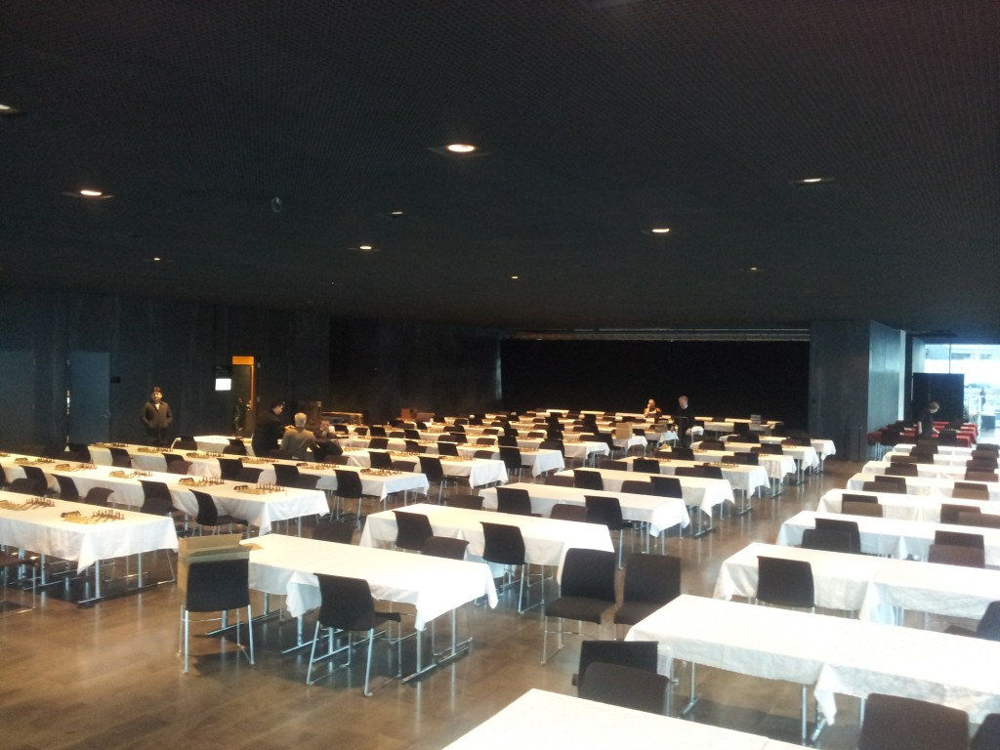

Sve je spremno za tradicionalni ***Reykjavik Open turnir*** koji će održavati od 19. do 27. veljače o.g.

Turnir se igra od 1964. godine, a zanimljivost je da se do 2008. održavao *svake druge godine*, a od 2009. *svake godine*, pa je ovo njegovo 28. izdanje. Prvo kolo igra se **danas u 15.00 h**.

Sudjeluje preko 200 igrača, a igra se po švicarskom sistemu. Iako je turnir otvoreni međunarodni, hrvatskih igrača nažalost nema. Dvorana je zasad prazna, ali spremna 🙂 (slika desno).

Možemo još spomenuti da je prvi pobjednik turnira bio [**Mikhail Tal**](http://en.wikipedia.org/wiki/Mikhail_Tal "Wiki (en): Mikhail Tal") – davne 1964. sudjelovalo je samo 14 igrača – a posljednji, prošlogodišnji pobjednik među 198 natjecatelja bio je **Fabiano Caruana** (nije prijavljen ove godine, barem zasad). Uostalom, koga zanima, lista pobjednika po godinama je [ovdje](http://www.reykjavikopen.com/history/ "Reykjavik Open - lista pobjednika po godinama"), a lista za ovu godinu prijavljenih igrača prema rejtingu (prvih 20) je prikazana niže. Kompletanu listu možete vidjeti [ovdje](http://chess-results.com/tnr72648.aspx?lan=1&zeilen=99999).

<table><tbody><tr><td>1</td><td></td><td>GM</td><td>Giri Anish</td><td>NED</td><td>2720</td><td></td><td></td><td>U18</td><td></td></tr><tr><td>2</td><td></td><td>GM</td><td>Vachier-Lagrave Maxime</td><td>FRA</td><td>2715</td><td></td><td></td><td></td><td></td></tr><tr><td>3</td><td></td><td>GM</td><td>Navara David</td><td>CZE</td><td>2710</td><td></td><td></td><td></td><td></td></tr><tr><td>4</td><td></td><td>GM</td><td>Cheparinov Ivan</td><td>BUL</td><td>2709</td><td></td><td></td><td></td><td></td></tr><tr><td>5</td><td></td><td>GM</td><td>Ding Liren</td><td>CHN</td><td>2709</td><td></td><td></td><td>U20</td><td></td></tr><tr><td>6</td><td></td><td>GM</td><td>Yu Yangyi</td><td>CHN</td><td>2688</td><td></td><td></td><td>U18</td><td></td></tr><tr><td>7</td><td></td><td>GM</td><td>So Wesley</td><td>PHI</td><td>2684</td><td></td><td></td><td>U20</td><td></td></tr><tr><td>8</td><td></td><td>GM</td><td>Eljanov Pavel</td><td>UKR</td><td>2678</td><td></td><td></td><td></td><td></td></tr><tr><td>9</td><td></td><td>GM</td><td>Bu Xiangzhi</td><td>CHN</td><td>2675</td><td></td><td></td><td></td><td></td></tr><tr><td>10</td><td></td><td>GM</td><td>Gajewski Grzegorz</td><td>POL</td><td>2644</td><td></td><td></td><td></td><td></td></tr><tr><td>11</td><td></td><td>GM</td><td>Sokolov Ivan</td><td>NED</td><td>2644</td><td></td><td></td><td></td><td></td></tr><tr><td>12</td><td></td><td>GM</td><td>Socko Bartosz</td><td>POL</td><td>2643</td><td></td><td></td><td></td><td></td></tr><tr><td>13</td><td></td><td>GM</td><td>Jones Gawain C B</td><td>ENG</td><td>2637</td><td></td><td></td><td></td><td></td></tr><tr><td>14</td><td></td><td>GM</td><td>Amin Bassem</td><td>EGY</td><td>2631</td><td></td><td></td><td></td><td></td></tr><tr><td>15</td><td></td><td>GM</td><td>Kuzubov Yuriy</td><td>UKR</td><td>2622</td><td></td><td></td><td></td><td></td></tr><tr><td>16</td><td></td><td>GM</td><td>L Ami Erwin</td><td>NED</td><td>2622</td><td></td><td></td><td></td><td></td></tr><tr><td>17</td><td></td><td>GM</td><td>Baklan Vladimir</td><td>UKR</td><td>2609</td><td></td><td></td><td></td><td></td></tr><tr><td>18</td><td></td><td>GM</td><td>Solak Dragan</td><td>TUR</td><td>2603</td><td></td><td></td><td></td><td></td></tr><tr><td>19</td><td></td><td>GM</td><td>Dziuba Marcin</td><td>POL</td><td>2602</td><td></td><td></td><td></td><td></td></tr><tr><td>20</td><td></td><td>GM</td><td>Ipatov Alexander</td><td>TUR</td><td>2569</td><td></td><td></td><td>U20</td><td></td></tr></tbody></table>

[Ovo](http://www.reykjavikopen.com/) je službena stranica turnira.
