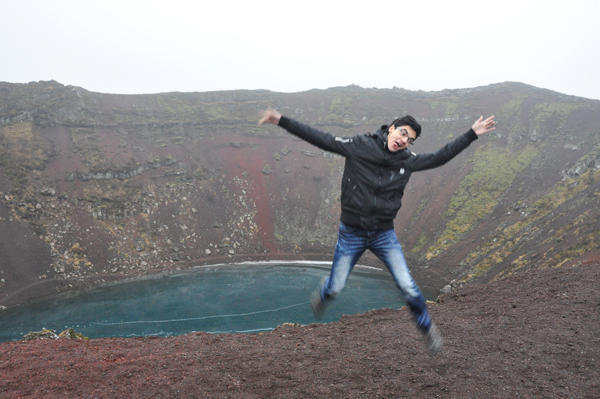

U iščekivanju važnijih vijesti sa jednog među..školskog turnira održanog u O.Š. Sveta Klara donosimo pregled događanja sa Reykjavik Open 2013.  
Poredak nakon šestog kola je:

<table><tbody><tr><td>Rk.</td><td>&nbsp;.</td><td>Ime</td><td>.</td><td>Rtg</td><td>Bod.</td><td>Rtg+/-</td></tr><tr><td>1</td><td>GM</td><td>Eljanov Pavel</td><td>UKR</td><td>2678</td><td>5.5</td><td>13.4</td></tr><tr><td>2</td><td>GM</td><td>Vachier-Lagrave Maxime</td><td>FRA</td><td>2715</td><td>5.0</td><td>7.0</td></tr><tr><td>3</td><td>GM</td><td>Giri Anish</td><td>NED</td><td>2722</td><td>5.0</td><td>5.3</td></tr><tr><td>4</td><td>GM</td><td>Yu Yangyi</td><td>CHN</td><td>2688</td><td>5.0</td><td>7.5</td></tr><tr><td>5</td><td>GM</td><td>So Wesley</td><td>PHI</td><td>2684</td><td>5.0</td><td>0.0</td></tr><tr><td>6</td><td>GM</td><td>Gajewski Grzegorz</td><td>POL</td><td>2644</td><td>5.0</td><td>6.5</td></tr><tr><td>7</td><td>GM</td><td>Jones Gawain C B</td><td>ENG</td><td>2637</td><td>5.0</td><td>3.4</td></tr><tr><td>8</td><td>GM</td><td>Halkias Stelios</td><td>GRE</td><td>2566</td><td>5.0</td><td>2.7</td></tr></tbody></table>

Na 9-36 mjestu se nalaze igrači sa po 4,5 boda, pa ih nećemo navoditi ovaj put 😉

Parovi sedmog kola su:

-   **Giri Anish** (3) – **Eljanov Pavel** (1)
-   **Gajewski Grzegorz** (6) – **Vachier-Lagrave Maxime** (2)
-   **Jones Gawain C B** (7) – **Yu Yangyi** (4)
-   **So Wesley**  (5) **– Halkias Stelios** (8) itd.

Između partija, šahisti obilaze znamenitosti i turističke atrakcije Islanda. Na slici ispod **Anish Giri** pozira ispred kretera 🙂

**Jeste li znali da…**

-   …Island ima *više od 800 toplih izvora*, više od bilo koje druge zemlje?
-   …je Island *osamnaesti najveći otok* na svijetu?
-   …je *jedna trećina lave* koja se u posljednjih 1000 godina pojavila na površini Zemlje sa Islanda?
