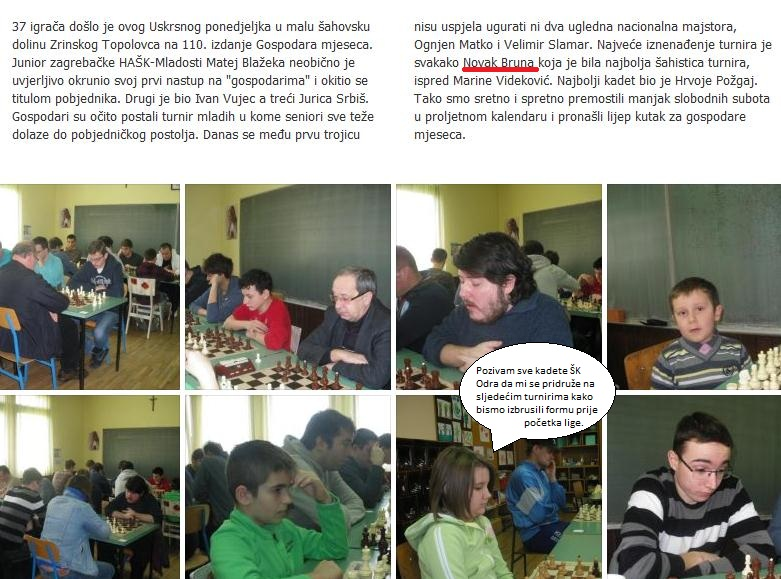

Članica *ŠK Odra* i polaznica šahovske škole **Novak Bruna** nastupila je prošlog vikenda u područnoj školi u Zrinskom Topolovcu, na tradicionalnom 110. izdanju *Gospodara mjeseca*. Igralo se na 7 minuta + 3 sek za potez. Sa 3,5 boda iz 9 partija bila je najbolja šahistica turnira.

Galeriju fotografija možete pogledati na [Facebook stranici](http://www.facebook.com/media/set/?set=a.463443820387341.1073741848.100001651808272&type=1 "Facebook ŠK Ivan Dvoržak") *ŠK Ivan Dvoržak*.

