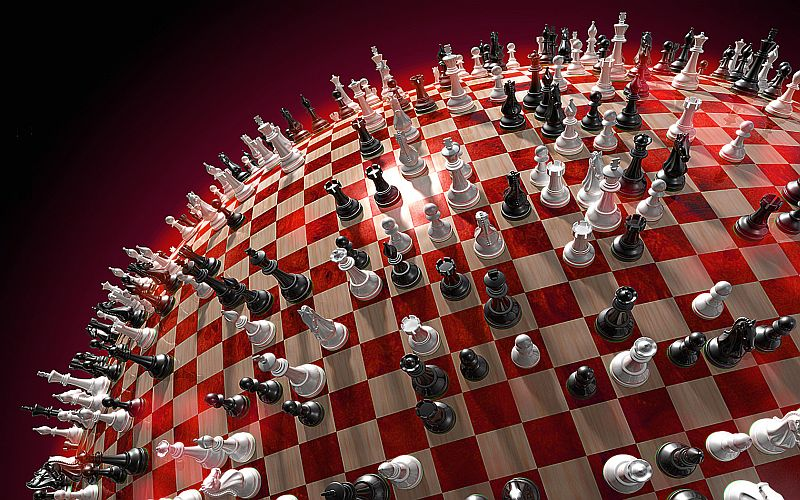

Jeste li znali …

… da postoji 169,518,829,100 ,544,000,000,000,000,000 mogućih kombinacija za prvih 10 poteza (cca 1.70 x 10 29 ak npr. neki profesor matematike tako lakše vizualizira  😉 )?

… da je “dvokorak” pješaka sa početne pozicije uveden u Španjolskoj 1280. godine?

… da su šahovsku ploču koja se preklapa izmislili svećenici kojima je bilo zabranjeno igrati šah? Sklopljena ploča nalikovala je na knjigu, pa su je mogli nositi sa sobom.

… da je službeno najduže odgađana rokada: *46. 0-0! (Bobotsor vs. Irkovin, 1966.g.)?*
