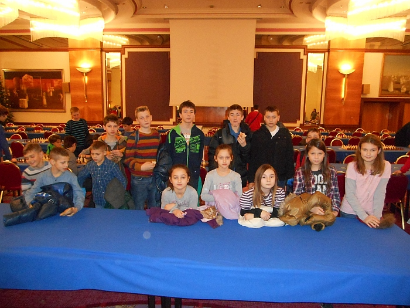
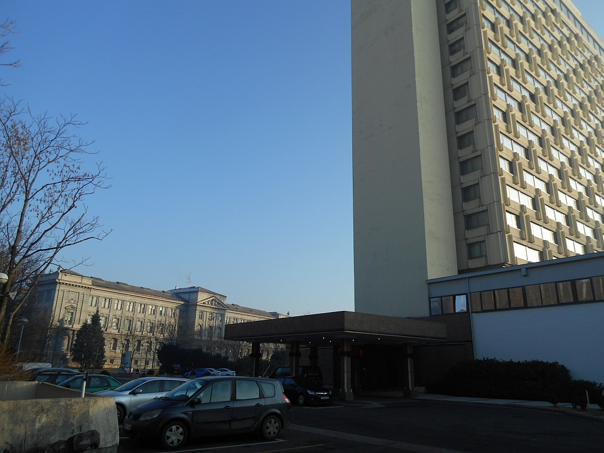
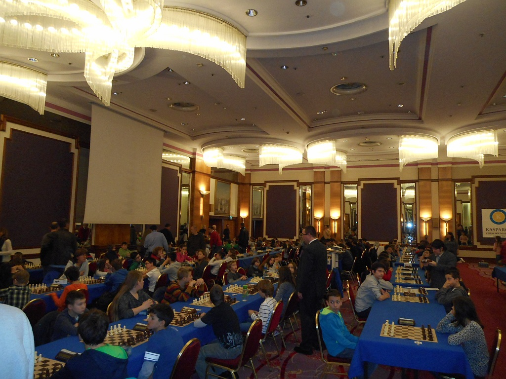
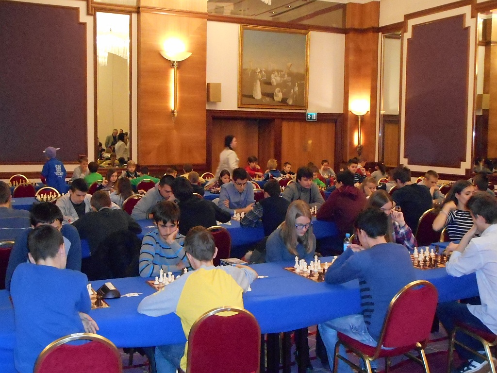
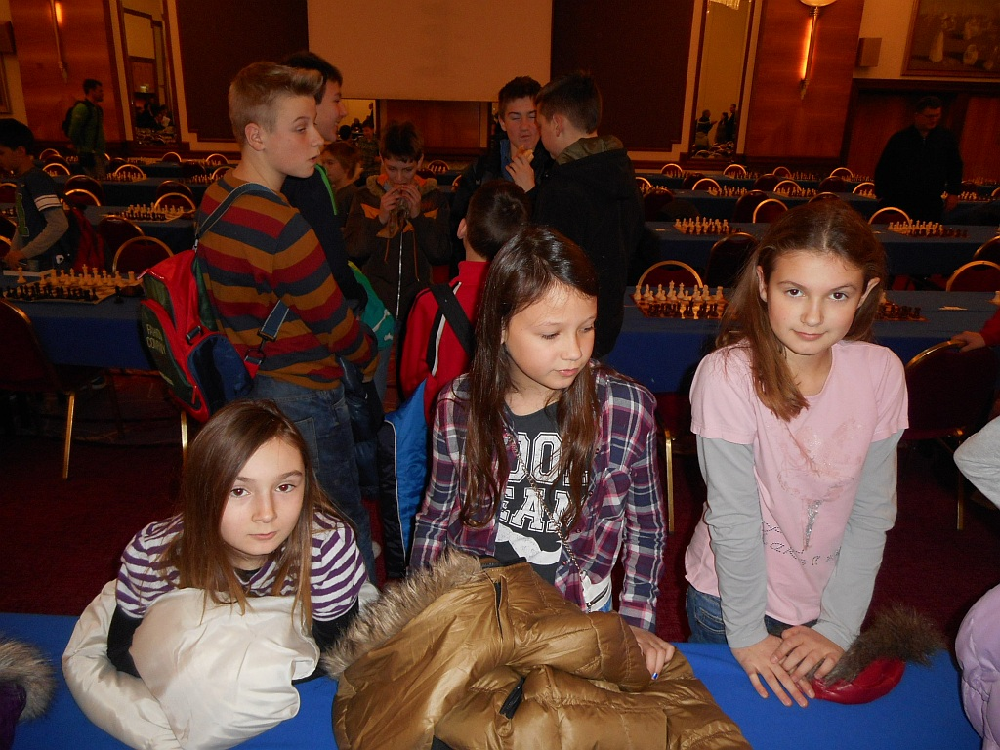
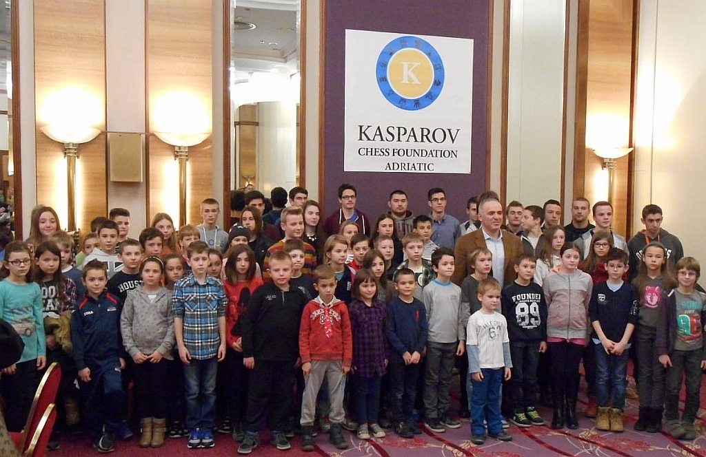
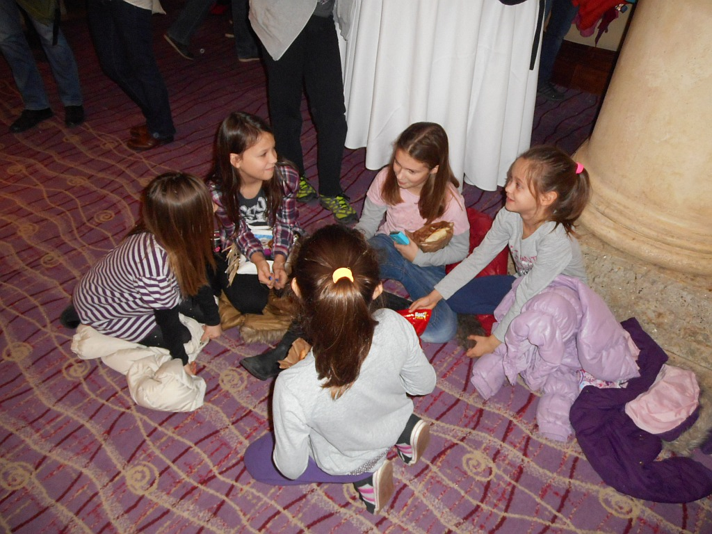

U nedjelju 27. prosinca 2015. u [hotelu Westin](http://www.westinzagreb.com/hr), pod pokroviteljstvom [KCFA](http://kasparovchessfoundation.org/), a u organizaciji [ŠAH KLUBA e4](http://www.sahklube4.hr/), odigran je **[Šahovski festival Zagreb 2015.](http://kcfa-zagreb.com/)** ŠK Odra imao je 14 predstavnika. U konkurenciji do 10 godina nastupili su Petar, Juraj, Antonio, Monika, Lucija, Katarina, Samanta i Ana, u konkurenciji do 12 Bruno, Vraneša, Kljujev, Ivan i Božo te u konkurenciji do 16 godina Filip. Očekivano, najbolje rezultate ostvarili su Ivan, Vraneša i Monika, a najvelikodušnija i najbolje volje bila je Ana, koja je svojim novim klupskim kolegicama podijelila nešto bodova. Svi su pitali za Luku, koji je nažalost propustio ovaj turnir zbog bolesti, a vjerujem da bi i on ostvario i više nego dobar rezultat s ovim tempom (10 + 5)! Drago mi je da je većina iskoristila priliku i odigrala ovaj turnir jer su se mnogi prvi put sreli s brzopoteznim pravilima (nemoguć potez – izgubljena partija), naučili kako se gledaju parovi po kolima, a uza sve to, što je i najvažnije, odigrali sedam partija. Mlađi igrači još igraju prebrzo (osim Monike, koja pravilno rasporedi vrijeme za razmišljanje), a stariji su u nekim partijama pokazivali nesigurnost u jednostavnim pozicijama, što je samo znak nedovoljno odigranih partija.  
U konkurenciji do 10 godina prvo mjesto osvojio je Leon Putar iz ŠK Podsused, u konkurenciji do 12 pobjedu je odnijela Tereza Dejanović iz ŠD Sisak, u konkurenciji do 16 Bojan Maksimović iz ŠŠ Skakač – Banja Luka te u konkurenciji do 20 godina Peter Urbanč iz ŠK Triglav Krško.  
Ostali rezultati u poveznicama:  
[Rezultati do 10.](http://chess-results.com/tnr200910.aspx?lan=1&art=1&turdet=YES&flag=30&wi=984) [Rezultati do 12.](http://chess-results.com/tnr200909.aspx?lan=1&art=1&turdet=YES&flag=30&wi=984) [Rezultati do 16.](http://chess-results.com/tnr200908.aspx?lan=1&art=1&turdet=YES&flag=30&wi=984) [Rezultati do 20.  
](http://chess-results.com/tnr200907.aspx?lan=1&art=1&turdet=YES&flag=30&wi=984)     
  
