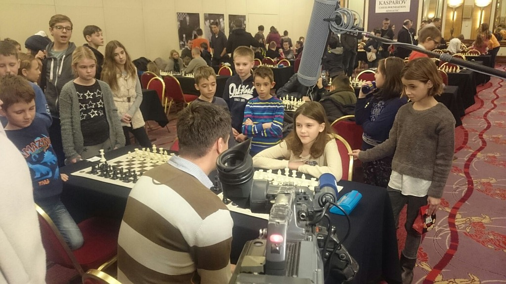
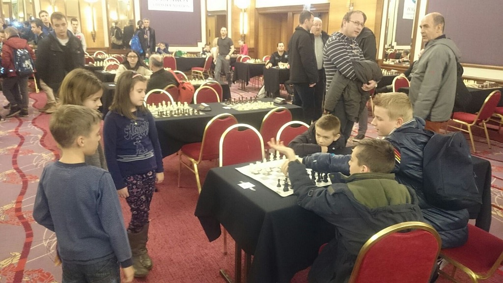
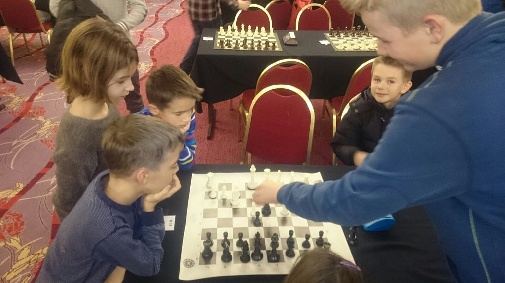
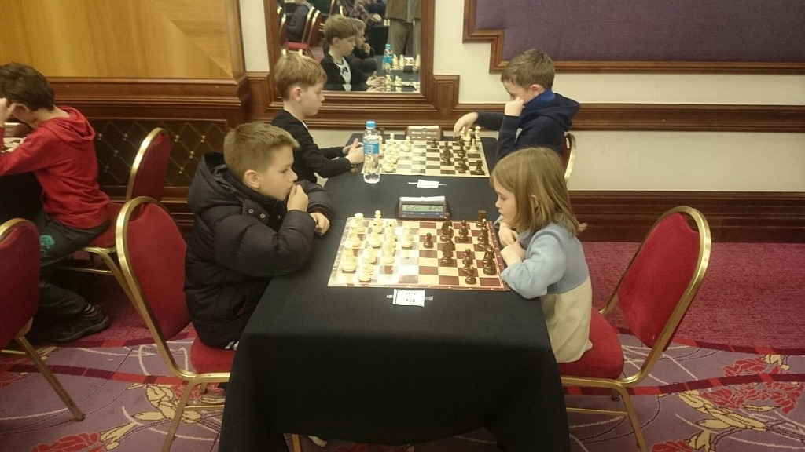
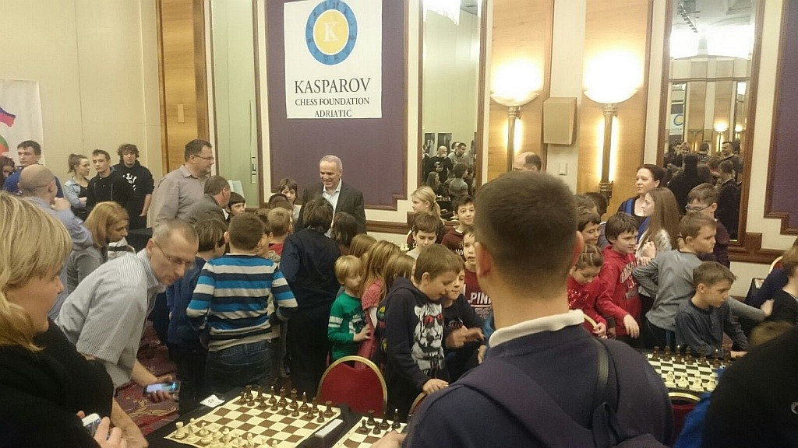

**Najava  
Turniri za mlade 27. prosinca 2016. u 12:30 sati**

U utorak nakon Božića igra se kadetski turnir u  Kristalnoj dvorani hotela „The Westin“,  
Ul. Izidora Kršnjavog 1  u Zagrebu. Prijave se primaju do 12 sati. Prethodne prijave mogu se poslati do  25. prosinca i tada je upisnina 50 kn, a na dan turnira 80 kn. Zainteresirani neka se jave na e-mail pa ćemo poslati zajedničku prijavu.

Turnir je podijeljen po dobnim skupinama.  
U9 – rođeni 2007. i mlađi (Filip, Lorusso, Luka M., Luka F., Josip, Dora, Hana)  
U11- rođeni 2005. i mlađi (Ana, Monika, Lucija, Anđela, Samanta, Katarina)  
U13 – rođeni 2003. i mlađi (Ivan, Kljujev, Vraneša, Božo, Bruno)

Turnir se igra na 10 minuta plus 5 sekundi po potezu. Na turnir je potrebno donijeti šahovsku garnituru i sat. [Prošle godine](/novosti/sahovski-festival-zagreb-2015/) nastupilo je četrnaest naših predstavnika, a ove godine nadam se i više…

darko

---

**Izvješće**  
Na turniru su svi zabilježili barem po jednu pobjedu! Najbolje rezultate postigli su Luka Matašić u konkurenciji do devet godina i Ivan Vraneša u konkurenciji do 13 godina. Vraneši je nedostajao samo bod iz posljednjega kola da bi se našao u vrhu tablice. Ivana Maravića, Katarinu i Anu u nastupu je spriječila bolest, a za ostale koji nisu došli, ne znam. Turnir su odigrali Luka i Filip Matašić, Luka Fiolić, Božo, Vraneša, Hana i Dora i čestitam im na nastupu!  
Turnir je posjetio i Kasparov, klincima je bilo dobro, a neki roditelji žalili su se da im je bilo naporno. Čim nauče da je bolje djecu ostaviti da se sami snalaze na turniru, bit će im lakše. 😉

     
[sahovski festival 2016 – U9 rezultati](/files/wp/2016/12/sahovski-festival-2016-U9-rezultati.xlsx)  
[sahovski festival 2016 – U13 rezultati](/files/wp/2016/12/sahovski-festival-2016-U13-rezultati.xlsx)
