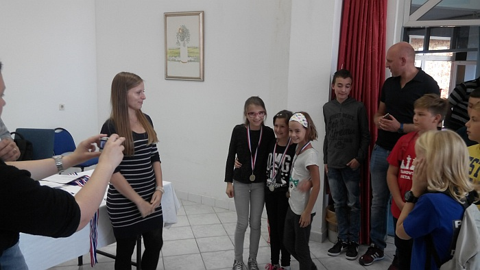
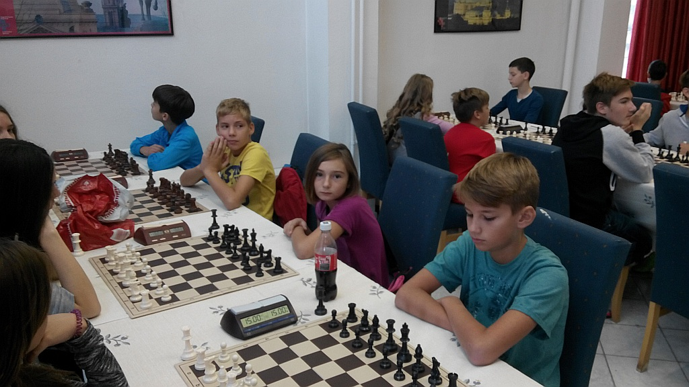
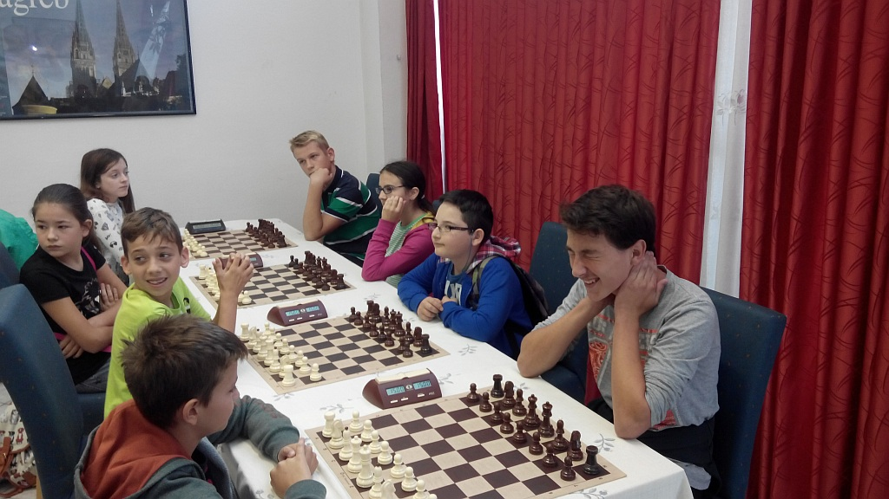
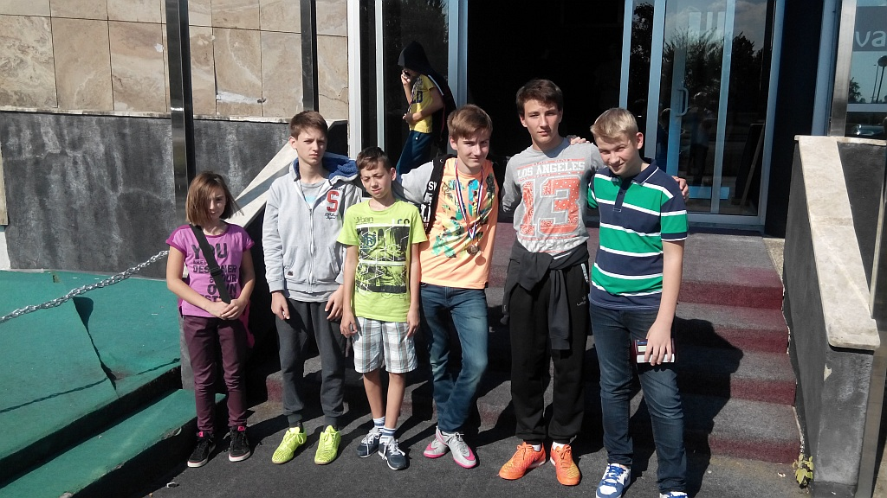
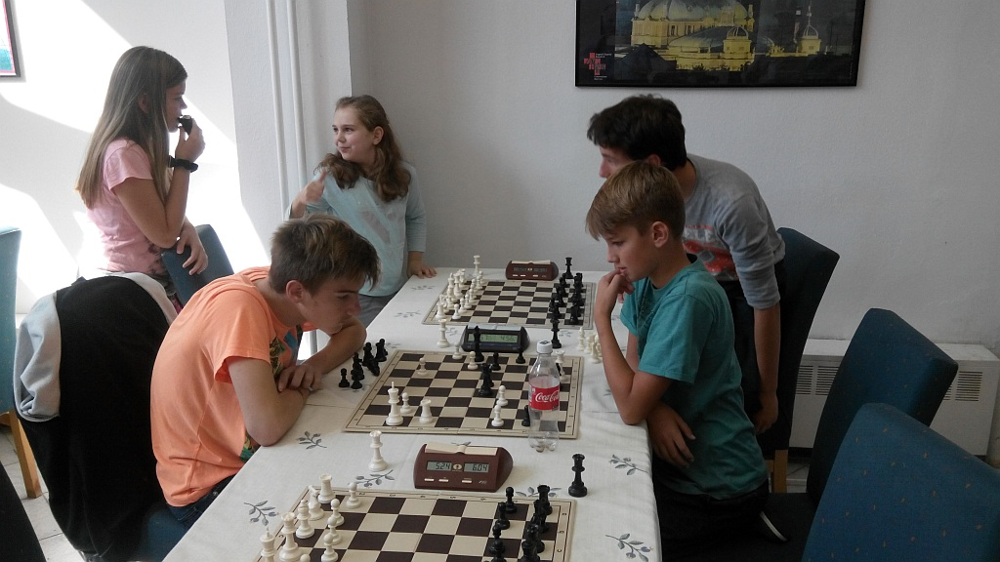
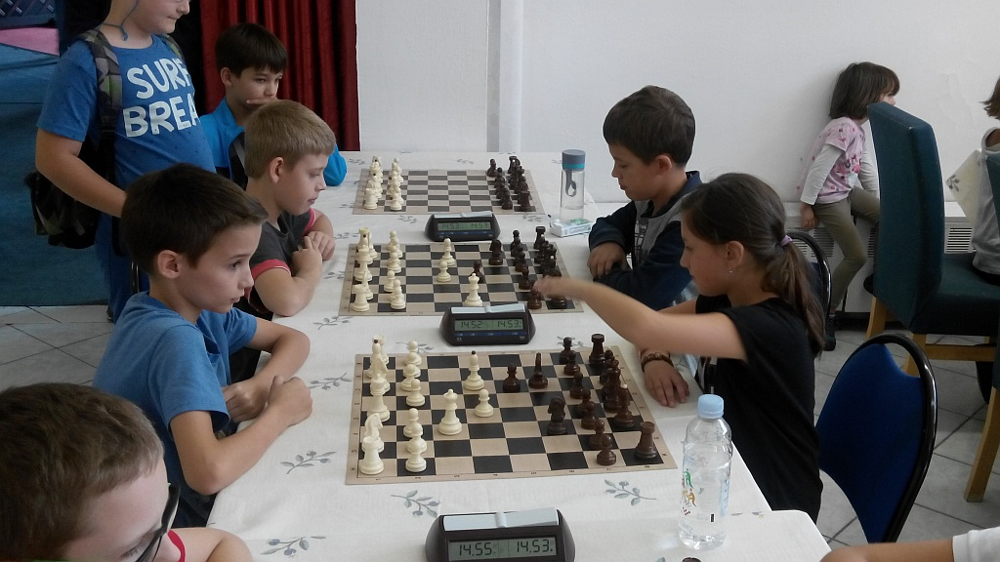
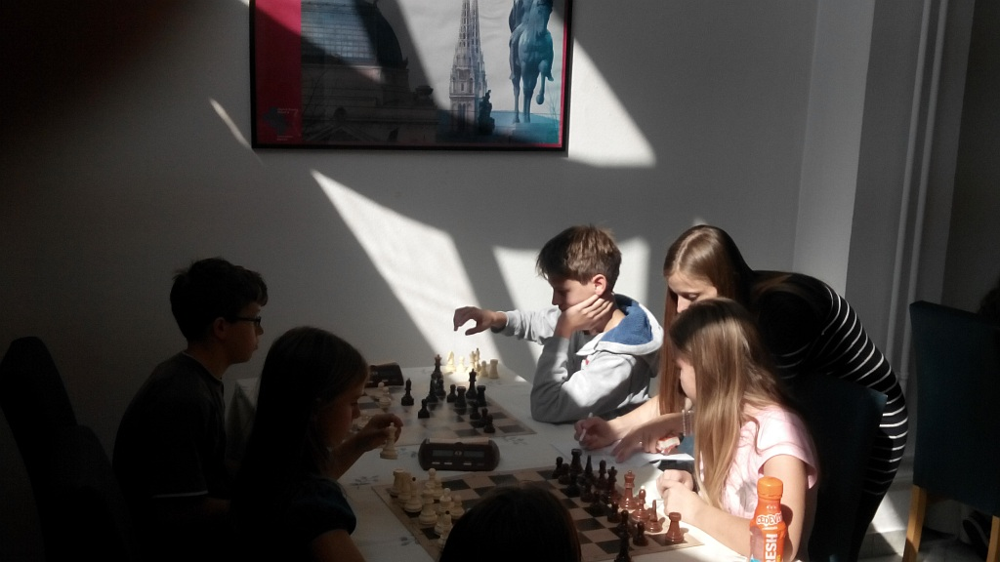
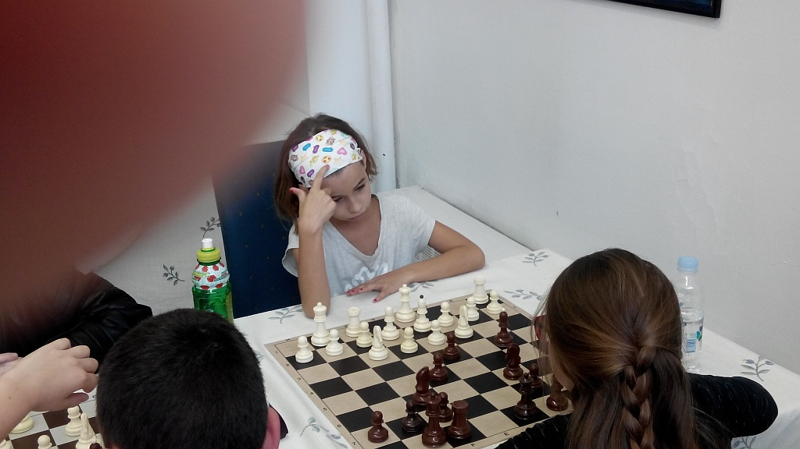
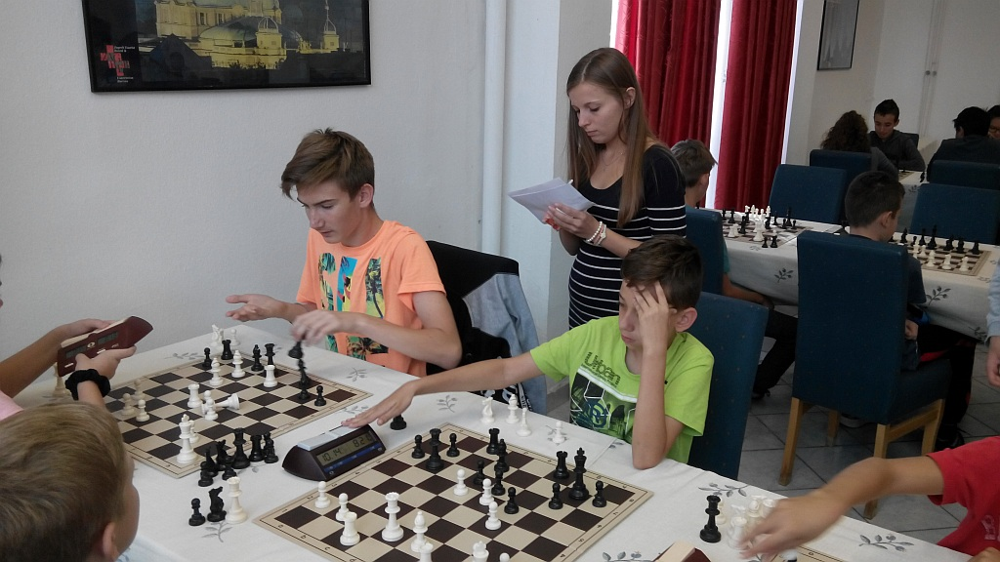

U organizaciji **Šahovskoga kluba Podsused** danas je u [hotelu Holiday](http://www.hotel-holiday.hr/hr/) odigran mjesečni turnir u šahu za kadete i kadetkinje do 10, 13 i  16 godina. Mi smo imali predstavnike u konkurenciji do 10 godina, Hanu i Doru, te u konkurenciji do 13 godina, Katarinu, Ivana, Vranešu, Brunu, Kljujeva i Božu. Turnir se igrao na 15 minuta bez dodatka, pet kola, švicarski sustav. U biti, najmarljiviji u klubu našli su vremena odigrati i ovaj turnir te upisati još poneku partiju u svoj kalendar. Naš trenutačno najjači kadet, Ivan Maravić okitio se brončanom medaljom, a ugodno je rezultatom iznenadio i Bruno. Dobio sam pohvale za Katarininu igru i napredak, što me posebno raduje jer je redovita na treninzima i to se mora vidjeti i u njezinoj igri. Nadam se da je i najmlađim članovima, Hani i Dori, bilo zabavno te da će još ćešće nastupati na šahovskim turnirima.

**Pobjednici su, u konkurenciji do 13 godina:**  
Kadeti  
1\. Lovro Novosel, ŠK Sveta Nedelja  
2\. Borna Franc, ŠK Samobor  
3\. **Ivan Maravić, ŠK Odra**  
Kadetkinje:  
1\. Marta Trgovac, ŠK Polet, Buševec  
2\. Sara Arlavi, ŠK Sveta Nedelja  
3\. Kaja Mahečić, ŠK Brestje, Sesvete  
**Pobjednici u konkurenciji do 10 godina:**  
Kadeti  
1\. Šimun Dumančić, ŠK Sljeme-Agroproteinka, Sesvete  
2\. David Rukavina, ŠK Brestje, Sesvete  
3. Patrik Marković, ŠK Brestje, Sesvete  
Kadetkinje  
1\. Mia Fauković, ŠK Samobor  
2\. **Dora Bačurin, ŠK Odra**  
3\. **Lucija Hana Kaić, ŠK odra**

Za prijevoz su se pobrinuli Vranešin i Katarinin tata te Hanina mama. Zahvaljujemo Darku Vraneši na fotografijama.  
      
