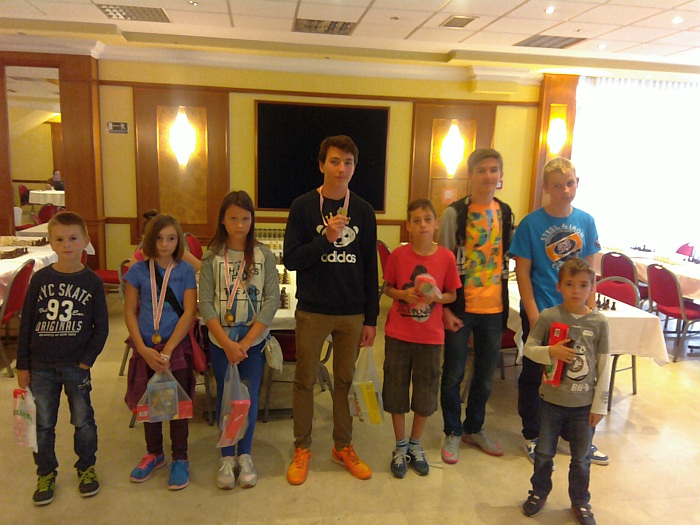
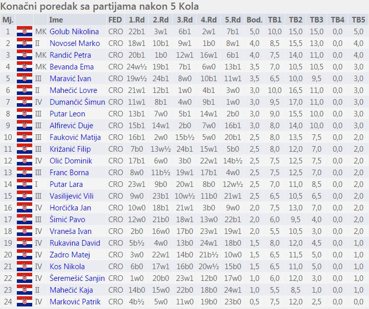
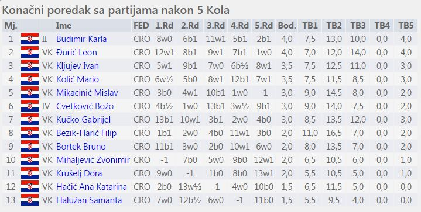
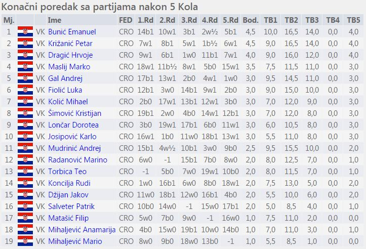

U nedjelju 25. rujna u Hotelu Antunović odigran je mjesečni kadetski turnir u organizaciji ŠK Brestje.  
Od naših kadeta (svi na slici!) nastupili su Luka, Katarina, Samanta, Kljujev, Božo, Ivan, Vraneša i Filip, komu je ovo prvi nastup na šahovskom turniru. Filipu sve čestitke na hrabrosti, a nadam se da će mu se na sljedećem turniru pridružiti i brat. Vraneša i Ivan na ovaj su turnir došli nakon što su istog dana odigrali meč za seniorsku ekipu. Kljujev je igrao na turniru do 15 godina i osvojio treće mjesto. Luka je malo podbacio, ali to je zato što ga je tata gledao. 🙂 Novost ovog turnira jest da se sada rezultati mogu naći na internetskoj stranici chess-results.com.  
Već u ovu subotu, u 10 sati, igra se sljedeći turnir pogodan za kadete, u hotelu Holiday na Jankomiru. Nadam se još većem odzivu naših članova, pogotovo onih koji su izostali s ovoga.  
                      
