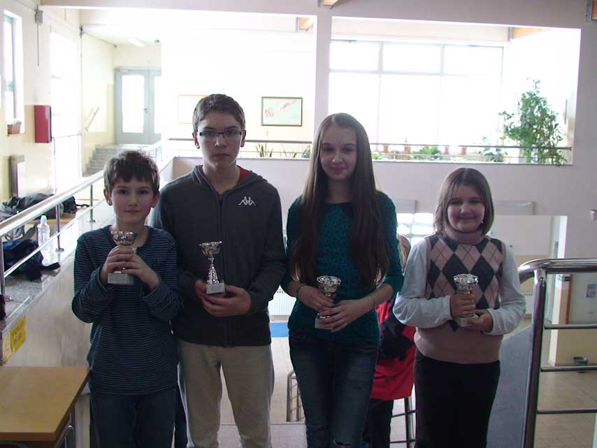

Mladi i perspektivni članovi našeg kluba i polaznici šahovske škole ovog vikenda nastupili su na međuškolskom šahovskom turniru u OŠ Sveta Klara i postigli zapažene rezultate. Ukupno je nastupilo 48 učenika i 20 učenica, iz pet osnovnih škola.

Na slici s lijeva na desno: **Maravić Ivan** (ŠK Odra), **Šćulac Zvonimir** (ŠŠ Dugave), **Marijanović Marija** (ŠŠ Dugave), **Novak Bruna** (ŠK Odra)  

Čestitamo pobjednicima i svim natjecateljima 🙂

[z\_Privremeni\_poredak](/files/wp/2013/02/z_Privremeni_poredak.xls)

[m\_Privremeni\_poredak](/files/wp/2013/02/m_Privremeni_poredak.xls)
