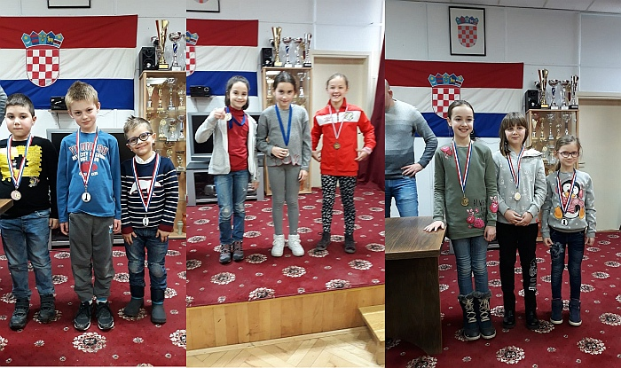
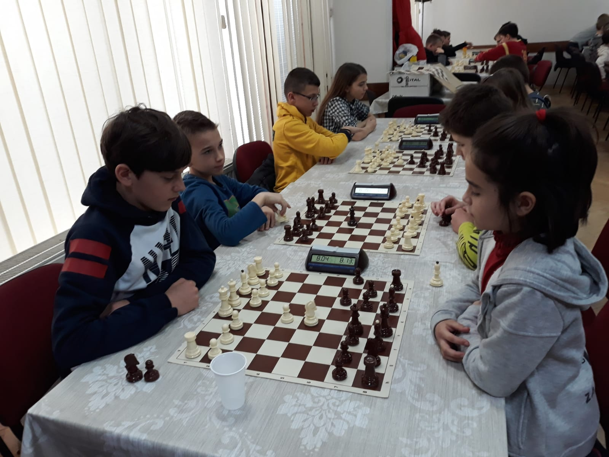
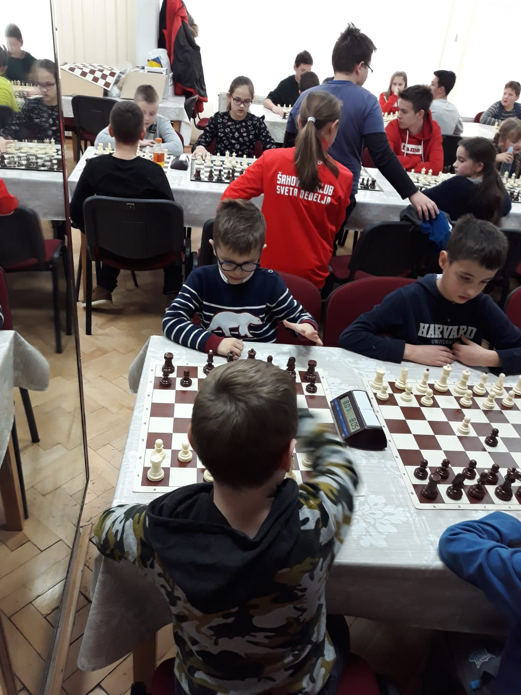
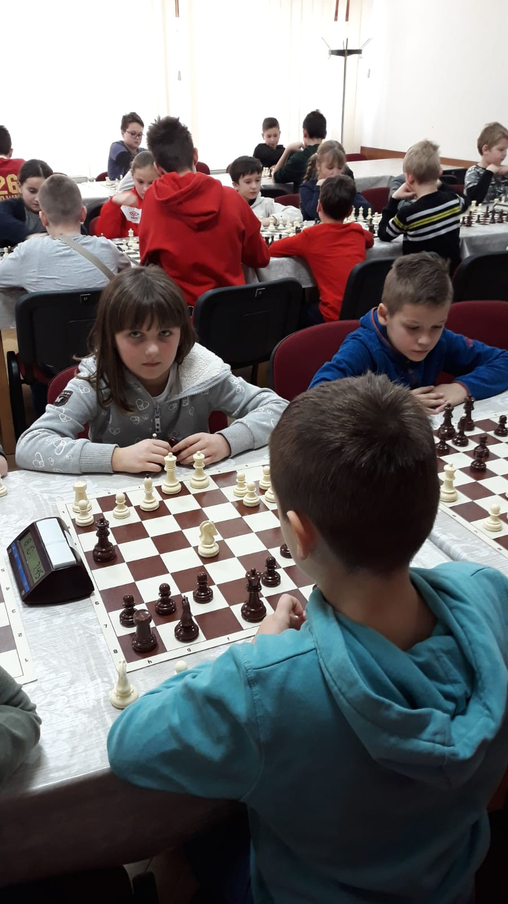
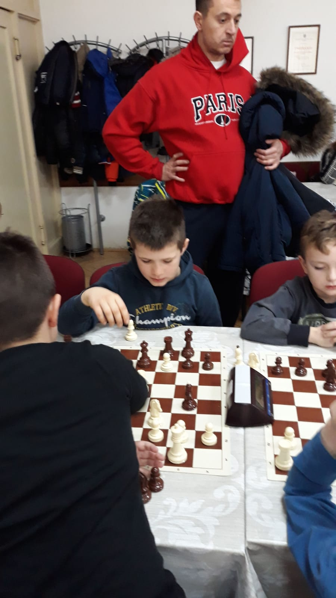

  
U organizaciji Šahovskog saveza Zagrebačke županije i ŠK Samobor odigran je mjesečni kadetski turnir u Samoboru. Turnir se igrao u Domu umirovljenika, a igrala su se tri turnira, U9, U12 i U15. Tempo igre bio je 8+3. Od naših članova nastupili su Slavko, Višeslav, Antonio, Botica i Flucija, kako iz praktičnih razloga zovemo Luciju Fiolić. Na prošlom turniru u Samoboru nastupilo je deset naših članova, ovaj puta manje, jer je velika većina danas igrala školske kvalifikacije u Zagrebu.  
**Višeslav je**, iako mu je tek šest godina, pomeo konkurenciju [do devet godina](http://chess-results.com/tnr412432.aspx?lan=13&art=4) i sa 5/6 i **osvojio prvo mjesto!** To mu je prva medalja. I odmah zlatnog sjaja!  
Veliko i ugodno iznenađenje priredila nam je i **Flucija** koja je **osvojila drugo mjesto** u istoj konkurenciji. Tek je počela igrati šah i vjerujem da će joj ovo biti veliki motiv da još više vježba i radi na šahu. I njoj je to prva medalja.  
**Botica je** u konkurenciji [do 12 godina](http://chess-results.com/tnr412433.aspx?lan=13&art=4), kao i njen brat, **uzela zlato**, ali od nje je to već očekivan rezultat.  
Bio je to izuzetno uspješan vikend za našu ekspediciju i šteta je što Slavko i Antonio nisu uspjeli uzeti neku medalju. Onda bismo imali 100% učinak. Ali vjerujem da će i oni vrlo brzo iskoristiti priliku na nekom od sljedećih turnira. Uz dobre vijesti sa školskih kvalifikacija, klinci bude nadu u još veće uspjehe u skoroj budućnosti.

   
