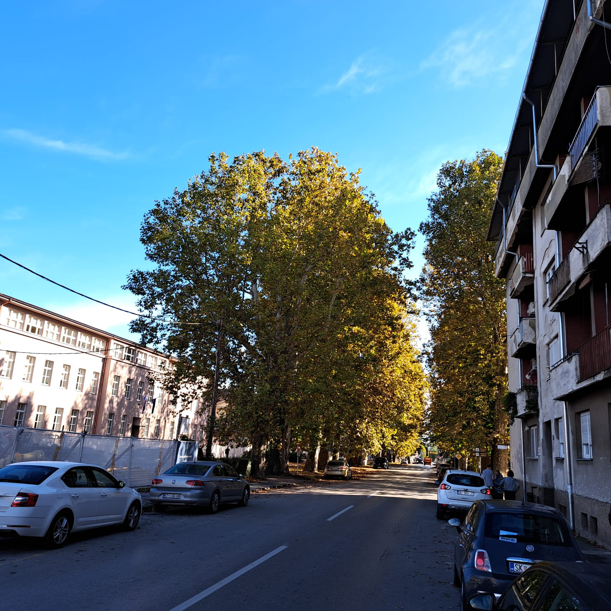

**Seniori, 11.kolo  
  
**

<table><tbody><tr><td>Pl.</td><td></td><td><strong>ŠD Sisak</strong></td><td>–</td><td></td><td><strong>ŠK Odra</strong></td><td><strong>2,5-3,5</strong></td></tr><tr><td>1.</td><td>IM</td><td>Antunac, Goran 2318</td><td>–</td><td>MK</td><td>Karlić, Zvjezdan 2094</td><td>1-0</td></tr><tr><td>2.</td><td>FM</td><td>Brigljević, Milan 2215</td><td>–</td><td>MK</td><td>Maravić, Ivan 2071</td><td>0-1</td></tr><tr><td>3.</td><td>MK</td><td>Prihoda, Leonardo 2083</td><td>–</td><td>MK</td><td>Maravić, Stjepan 2112</td><td>0-1</td></tr><tr><td>4.</td><td>NM</td><td>Galić, Kruno 2056</td><td>–</td><td>MK</td><td>Sliepčević, Mladen 2086</td><td>½–½</td></tr><tr><td>5.</td><td></td><td>Hadžić, Sabahet 2000</td><td>–</td><td>MK</td><td>Kovač, Hrvoje 2126</td><td>½–½</td></tr><tr><td>6.</td><td>MK</td><td>Perković, Ivan 1985</td><td>–</td><td>II</td><td>Vraneša, Ivan 1863</td><td>½–½</td></tr></tbody></table>

Pobijedili Sisak, [ostali u ligi](https://chess-results.com/tnr730961.aspx?lan=13&art=0), pojeli domaću životinju. Tako bi se mogao sažeti 29. listopada kada smo odigrali zadnje kolo. Došli smo sa znanjem da pobjedom u zadnjem kolu sigurno ostajemo u ligi. Sastav je bio isti kao i prošlo kolo kada smo pobijedili Oroslavje. Meč je počeo dobro, Hrvoje je taktikom osvojio pješaka, zatim i drugog. Prvi je završio Mladen koji je imao nešto bolju poziciju u završnici, ali nije ju uspio pretočiti u cijeli bod. Drugi je završio Ivan Maravić koji je odigrao prvu dobru partiju ove godine, pričekao je da njegov protivnik Brigljević oslabi polja, postavio figure na ta polja te osvojio materijal i pobijedio. Nakon njega je Zvjezdan, koji se vratio starim navikama i trošio previše vremena, izgubio materijal u već lošoj poziciji, a time i partiju. Ostale tri partije su trajale preko četiri sata te dovele napetost do maksimuma. Mladen je ostario koju godinu gledajući :). Na svu sreću, u sve tri partije smo bili dobiveni, a nakon što je Stjepko dobio i Hrvoje uspio ne pobijediti završnicu, Vraneša je, kao i prošlo kolo, donio ključnih pola boda te ostanka vrijednih dva meč boda. Nakon kola smo svi jeli meso i slušali dva Maravića kako treba igrati u situacijama ključnima za ekipu. Stariji Maravić je, na upit zašto je tek sada dobio, objasnio: “Da ste mi rekli ranije da moram dobiti – dobio bi.” Skromnosti nije bilo kraja.  
Sve u svemu, ovo je bila još jedna sezona u kojoj smo do zadnjega kola bili u teškoj borbi za ostanak, ali i pobijedili u njoj. Najbolji dojam je ostavio Darko koji je imao najbolji rejting performans u cijeloj ligi! Nažalost, odigrao je samo tri partije te se nadamo da će iduće godine češće sjedati za ploču. Iduća tri igrača koja valja istaknuti su Zvjezdan, Mladen i Hrvoje. Zvjezdan je na prvoj ploči završio na -1, ali po prikazanoj igri je mogao imati i kojih pola boda više. Mladen je odigrao skoro sve partije te postigao +2 rezultat, a počeo je i preuzimati više rizika u igri. Hrvoje je novi igrač i pokazao se kao pravo pojačanje, kako za meč, tako i za atmosferu nakon meča. Također, treba pohvaliti Vranešinu igru na jesen tijekom koje je donio ključne bodove ekipi. Ove godine su podbacili Maravići i Ivan Cvetković, ali taj dojam Maravići su popravili pobjedama u zadnjem kolu Za posljednju rečenicu ove sezone, sve pohvale kuharu na izvrsno pripremljenoj hrani!

##### 9\. ŠK Odra, Zagreb (RtgAvg:2072, TB1:10 / TB2:30,0)

<table><tbody><tr><td><strong>Pl.</strong></td><td></td><td><strong>Ime</strong></td><td><strong>1</strong></td><td><strong>2</strong></td><td><strong>3</strong></td><td><strong>4</strong></td><td><strong>5</strong></td><td><strong>6</strong></td><td><strong>7</strong></td><td><strong>8</strong></td><td><strong>9</strong></td><td><strong>10</strong></td><td><strong>11</strong></td><td><strong>Bod.</strong></td><td><strong>Partije</strong></td></tr><tr><td>1</td><td>MK</td><td>Karlić Zvjezdan</td><td>½</td><td></td><td>½</td><td></td><td></td><td>½</td><td>0</td><td>½</td><td></td><td>1</td><td>0</td><td>3,0</td><td>7</td></tr><tr><td>2</td><td>MK</td><td>Maravić Ivan</td><td></td><td>0</td><td>½</td><td>0</td><td></td><td>½</td><td>½</td><td>½</td><td>½</td><td>0</td><td>1</td><td>3,5</td><td>9</td></tr><tr><td>3</td><td>MK</td><td>Maravić Stjepan</td><td>0</td><td>½</td><td></td><td>0</td><td>½</td><td>0</td><td>½</td><td>0</td><td>½</td><td>0</td><td>1</td><td>3</td><td>10</td></tr><tr><td>4</td><td>MK</td><td>Sliepčević Mladen</td><td>½</td><td>½</td><td>1</td><td>½</td><td>½</td><td></td><td>½</td><td>1</td><td>0</td><td>1</td><td>½</td><td>6</td><td>10</td></tr><tr><td>5</td><td>MK</td><td>Vidaković Darko</td><td></td><td></td><td>1</td><td>1</td><td></td><td></td><td>1</td><td></td><td></td><td></td><td></td><td>3</td><td>3</td></tr><tr><td>6</td><td>MK</td><td>Cvetković Ivan</td><td>½</td><td></td><td></td><td></td><td>½</td><td>0</td><td>½</td><td>½</td><td>0</td><td></td><td></td><td>2</td><td>6</td></tr><tr><td>7</td><td>MK</td><td>Bačurin Juraj</td><td></td><td>½</td><td></td><td></td><td>½</td><td>0</td><td></td><td></td><td>½</td><td></td><td></td><td>1,5</td><td>4</td></tr><tr><td>8</td><td>MK</td><td>Kovač Hrvoje</td><td></td><td>1</td><td>1</td><td>0</td><td></td><td>½</td><td></td><td></td><td></td><td>1</td><td>½</td><td>4</td><td>6</td></tr><tr><td>9</td><td>II</td><td>Šutić Darko</td><td></td><td>0</td><td>½</td><td></td><td></td><td></td><td></td><td></td><td>0</td><td></td><td></td><td>0,5</td><td>3</td></tr><tr><td>10</td><td>II</td><td>Vraneša Ivan</td><td>½</td><td></td><td></td><td></td><td>0</td><td></td><td></td><td>1</td><td></td><td>½</td><td>½</td><td>2,5</td><td>5</td></tr><tr><td>11</td><td>IV</td><td>Kobali Borislav</td><td>0</td><td></td><td></td><td></td><td>1</td><td></td><td></td><td></td><td></td><td></td><td></td><td>1</td><td>2</td></tr><tr><td>12</td><td>III</td><td>Cvetković Božo</td><td></td><td></td><td></td><td>0</td><td></td><td></td><td></td><td></td><td></td><td></td><td></td><td>0</td><td>1</td></tr></tbody></table>
