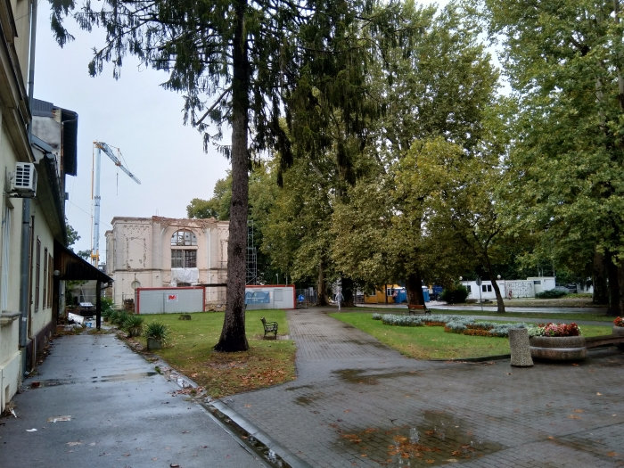

**Seniori, 7.kolo  
  
**  
Prošlu nedjelju smo proveli u Sisku. Nismo se proslavili igrom niti [rezultatom](https://chess-results.com/tnr886630.aspx?lan=13&art=3&rd=7). Stjepko je od početka partije krivo krenuo, nije se uspio razviti. Međutim, njegov protivnik mu je dao priliku prelaska u jednaku završnicu koju je onda ipak izgubio stavljanjem pješaka na krivu boju polja. Ivan je odigrao solidnih dvadesetak poteza, došao do pozicione prednosti koju nije konkretizirao i partija je otišla u remi. Cvetko je krivo izračunao protivničko uzimanje pješaka te je onda tako izgubio i drugoga, a time i partiju. Zvjezdan je odigrao dobru partiju, brzo je reducirao materijal te bez problema održao jednaku završnicu. Mladen je iz otvaranja došao do veoma solidne, ali igrom ne i previše bogate pozicije. Zakomplicirao je koliko god je mogao, međutim, njegov protivnik se jako dobro branio s malo vremena na satu te je partija završila podjelom boda. Darko je odigrao oštro otvaranje gdje je u jednom trenutku bio pod značajnim pritiskom te u potencijalnim problemima. Darkov mladi protivnik ne bira točan nastavak te za koji potez ostavlja pješaka, a time i bod. Tu partiju donosimo u cijelosti. Na kraju svega, zasluženo smo izgubili. Nadamo se kako ovu nedjelju nećemo kada ugošćujemo ŠK Ivanić.

<table><tbody><tr><td>Pl.</td><td></td><td><strong>ŠD Sisak</strong></td><td>–</td><td></td><td><strong>ŠK Odra</strong></td><td><strong>3,5-2,5</strong></td></tr><tr><td>1.</td><td>IM</td><td>Antunac, Goran 2325</td><td>–</td><td>MK</td><td>Karlić, Zvjezdan 2081</td><td>½–½</td></tr><tr><td>2.</td><td></td><td>Hadžić, Sabahet 2024</td><td>–</td><td>MK</td><td>Maravić, Ivan 2102</td><td>½–½</td></tr><tr><td>3.</td><td>NM</td><td>Galić, Kruno 2061</td><td>–</td><td>MK</td><td>Maravić, Stjepan 2108</td><td>1-0</td></tr><tr><td>4.</td><td>MK</td><td>Prihoda, Leonardo 2077</td><td>–</td><td>MK</td><td>Sliepčević, Mladen 2092</td><td>½–½</td></tr><tr><td>5.</td><td>I</td><td>Kapetanić, Josip 1989</td><td>–</td><td>MK</td><td>Vidaković, Darko 2126</td><td>0-1</td></tr><tr><td>6.</td><td>III</td><td>Vekić, Bruno 1785</td><td>–</td><td>MK</td><td>Cvetković, Ivan 1960</td><td>1-0</td></tr></tbody></table>

```pgn
[Event "III A liga - Sisak : Odra"]
[Site "sahovski-klub.com"]
[Date "2024.09.15"]
[Round "7"]
[White "I Kapetanić, Josip"]
[Black "MK Vidaković, Darko"]
[Result "0-1"]
[ECO "B40"]
[WhiteElo "1989"]
[BlackElo "2126"]
[PlyCount "122"]
1. e4 c5 2. Nf3 e6 3. d4 cxd4 4. Nxd4 Nc6 5. Nc3 Nf6 6. Be2 Bb4 7. Nxc6 bxc6 8. Bg5 Qa5 9. Bxf6 gxf6 10. Qd4 Rg8 11. O-O Qg5 12. g3 a5 13. Na4 h5 14. c3 Be7 15. Rad1 d6 16. Qb6 Bd7 17. Qb7 Rd8 18. Nb6 Qc5 19. Rd4 h4 20. Qc7 hxg3 21. hxg3 d5 22. Na4 Qd6 23. Qxd6 Bxd6 24. Rd2 Ke7 25. Nb6 Bc5 26. Nxd7 Rxg3+ 27. Kh2 Rg6 28. Nxf6 Kxf6 29. e5+ Kxe5 30. Rd3 Rdg8 31. Rf3 f5 32. Bd3 Bd6 33. Rh3 Rg2+ 34. Kh1 Bc5 35. Rf3 R2g4 36. Rh3 R8g7 37. b3 Kd6 38. Be2 Rg2 39. Rf3 Ke5 40. Bd3 Kf6 41. Bb1 Bd6 42. Rh3 R7g6 43. Bd3 e5 44. Ba6 Bc5 45. Bb7 Bxf2 46. Bxc6 Rg1+ 47. Rxg1 Rxg1+ 48. Kh2 Ra1 49. a4 d4 50. Bd5 e4 51. cxd4 Bxd4 52. Bc4 Ke5 53. Rg3 Ra2+ 54. Rg2 Rxg2+ 55. Kxg2 Be3 56. Kf1 Bd2 57. Ke2 Bc3 58. Ba6 f4 59. Bb7 f3+ 60. Ke3 Bd4+ 61. Kd2 e3+ 0-1
```
