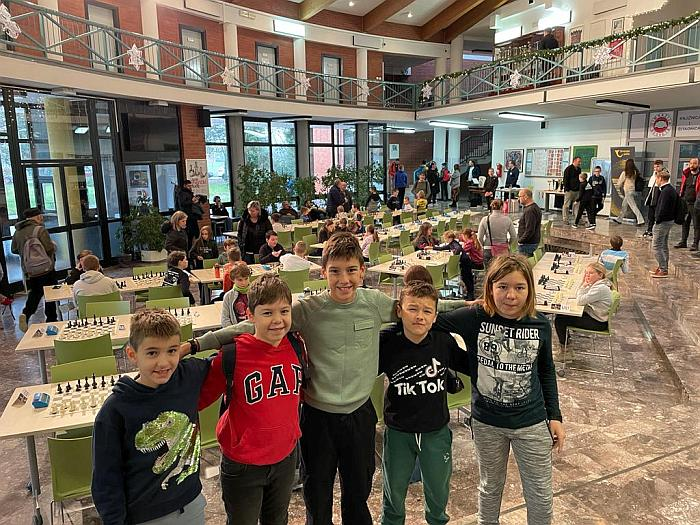
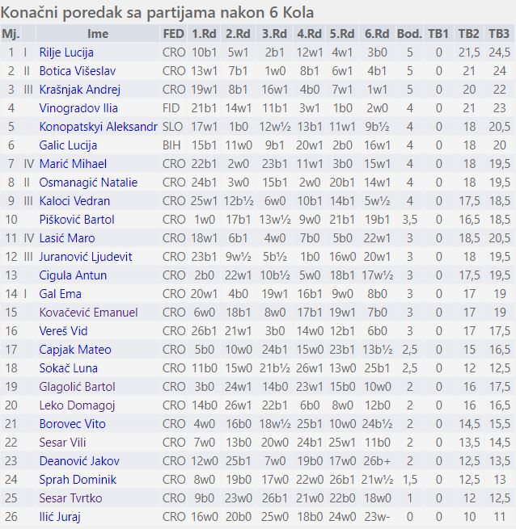
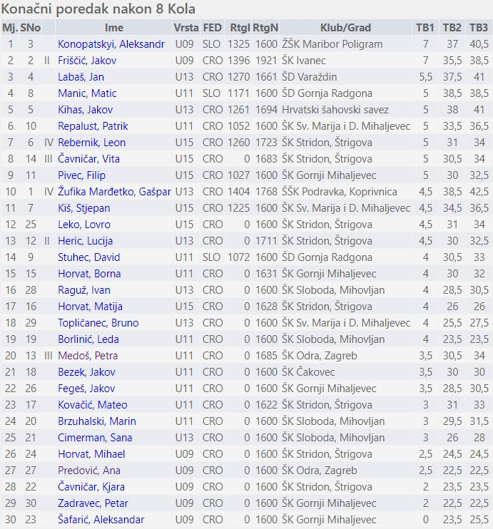

Vili, Emanuel, Domagoj, Bartol i Tvrtko nastupili su na sporopoteznom [kadetskom turniru](https://chess-results.com/tnr840431.aspx?lan=13&art=4) u Sesvetama, 10. i 11. prosinca 2023. Prijavljen je i Slavko, ali se nažalost razbolio na sam dan početka. Turnir se igrao na najbrži tempo za sporopotezne partije, 30+30. Dečki su zapisivali poteze (nadam se da neće zaboravit donijet partije u Klub na analizu 😀 ), a i Vili se prijavio u skupinu U11 iako se do Nove može švercati u mlađoj skupini. Bravo za Vilija. Turnir je bio prilično jak, svakako jači od Prvenstva Zagreba. Svatko je uspio ostvariti i poneku pobjedu, neki su igrali i međusobno sa (po mom mišljenju) iznenađujućim rezultatima. Najviše bodova (3) je osvojio Emanuel koji u zadnje vrijeme pomalo zaostaje za ekipom, ali je dobar taktičar. Bartol je i dalje najjači igrač, Domagoj se dobro izdigao jer je počeo ozbiljnije vježbati, a Vili i Tvrtko se još traže jer su pomalo neredoviti u vježbi. Ipak, sve u svemu, dobro napreduju. I ovaj turnir je tomu uvelike pomogao. Ovi dečki predstavljaju okosnicu i školskog i klupskog kadetskog tima i bitno da su razlike između njih što manje kako bi imali dobre sve četiri ploče za ekipna natjecanja. Petra i Ana zbog drugih obaveza nisu mogle nastupiti, ali su se potrudile i vikend ranije otišle na [rapid turnir](https://chess-results.com/tnr841257.aspx?lan=13&art=4&turdet=YES) u daleku Gornju Dubravu. Turnir se igrao u osam kola na tempo 10+5. I one su skupile respektabilnih 3,5 odnosno 2,5 boda i kažu da im je bilo super. Vjerojatno jer su bile u društvu Bože i Maravića koji su igrali [turnir seniora](https://chess-results.com/tnr840766.aspx?lan=13&art=0&turdet=YES) na tempo 7+3.  
Isti vikend kada su kadeti igrali turnir u Sesvetama, seniorska ekipa je igrala na brzopoteznom turniru [“Ekipno otvoreno prvenstvo Međimurja – 2023.”](https://chess-results.com/tnr856529.aspx?lan=13&turdet=YES) Ekipa je završila na petom mjestu od 16 prijavljenih ekipa sa 7 pobjeda, jednim nerješenim ishodom i tri poraza. Za seniorsku ekipu ŠK Odra igrali su Ivan Maravić, Stjepan Maravić, Mladen Sliepčević i Ivan Vraneša.  
Prosinac je pun šahovskih zbivanja pa je tako od četvrtka 14.12. do subote 16.12 održano i [Europsko prvenstvo u rapidu](https://chess-results.com/tnr835050.aspx?lan=13&art=4&fedb=CRO&flag=30) i [brzopoteznom šahu](https://chess-results.com/tnr835051.aspx?lan=13&art=4&fedb=CRO&turdet=YES&flag=30) u Zagrebu, na ZG velesajmu. Nekoliko naših članova (sadašnjih i budućih 🙂 ) nastupilo je na ova dva turnira, a velik dio partija prenosio se uživo na [chess.com portalu](https://chess24.com/en/watch/live-tournaments/european-rapid-championship-2023/1/1/11).

  
