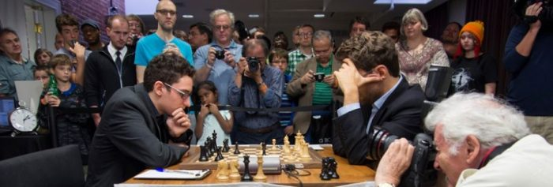

Treći *Sinquefield Cup* okupio je šahovsku elitu – **Magnus Carlsen** (Norway), **Levon Aronian** (Armenia), **Fabiano Caruana** (USA), **Hikaru Nakamura** (USA), **Veselin Topalov** (Bulgaria), **Maxime Vachier-Lagrave** (France), **Alexander Grischuk** (Russia), **Anish Giri** (Netherlands), **Viswanathan Anand** (India), **Wesley So** (USA), a počelo je da ne može zanimljivije – prvo kolo bez remija!

Rezultati prvog kola:

<table><tbody><tr><td>Giri, Anish</td><td>2793</td><td><div>1-0</div></td><td>Grischuk, Alexander</td><td>2771</td></tr><tr><td>So, Wesley</td><td>2779</td><td><div>0-1</div></td><td>Vachier-Lagrave, Maxime</td><td>2731</td></tr><tr><td>Aronian, Levon</td><td>2765</td><td><div>1-0</div></td><td>Caruana, Fabiano</td><td>2808</td></tr><tr><td>Carlsen, Magnus</td><td>2853</td><td><div>0-1</div></td><td>Topalov, Veselin</td><td>2816</td></tr><tr><td>Nakamura, Hikaru</td><td>2814</td><td><div>1-0</div></td><td>Anand, Viswanathan</td><td>2816</td></tr></tbody></table>



Partije uživo na sljedećim poveznicama:

 *[](http://www.chessdom.com/3rd-sinquefield-cup-2015-live/)*[Grandchesstour](http://grandchesstour.com/2015-sinquefield-cup-live)**   **i**  *[Chessdom](http://www.chessdom.com/3rd-sinquefield-cup-2015-live/)*  

```pgn
[Event "Sinquefield Cup 2015"]
[Site "www.sahovski-klub.com"]
[Date "2015.08.23"]
[Round "1"]
[White "GM Carlsen, Magnus 2853"]
[Black "GM Topalov, Veselin 2816"]
[Result "0-1"]
[PlyCount "80"]

1. e4 c5 2. Nf3 d6 3. Bb5+ Nd7 4. O-O Ngf6 5. Re1 a6 6. Bd3 b5 7. c4 g5 8. Nxg5
Ne5 9. Be2 bxc4 10. Na3 Rg8 11. Nxc4 Nxc4 12. d4 Nb6 13. Bh5 Nxh5 14. Qxh5 Rg7
15. Nxh7 Qd7 16. dxc5 dxc5 17. e5 Qc6 18. f3 Qg6 19. Nf6+ Kd8 20. Qxg6 Rxg6 21.
Ne4 Bb7 22. h4 Rc8 23. h5 Rg8 24. Bd2 Nc4 25. Bc3 Bh6 26. Rad1+ Ke8 27. Rd3 Bf4
28. Nf2 Bc6 29. Nh3 Bg3 30. Re2 Bb5 31. Rd1 Bc6 32. Nf2 Bxe5 33. Ng4 Bxc3 34.
bxc3 Kf8 35. Kf2 Rh8 36. Ne5 Nxe5 37. Rxe5 Be8 38. g4 f6 39. Re6 Bb5 40. Rde1
Rc7 0-1
```
