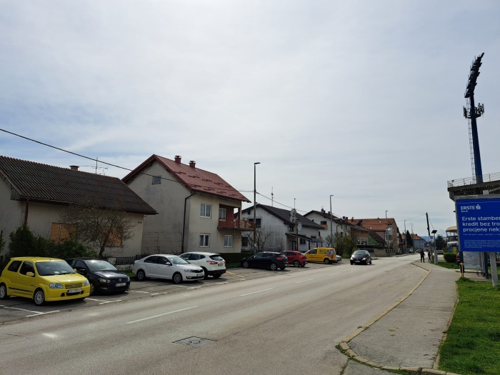
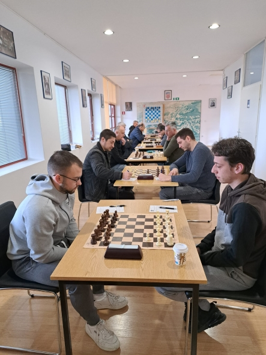

**Seniori, 5. kolo**  

<table><tbody><tr><td>Pl.</td><td></td><td><strong>ŠK Ban Jelačić</strong></td><td>–</td><td></td><td><strong>ŠK Odra</strong></td><td><strong>4,5-1,5</strong></td></tr><tr><td>1.</td><td>IM</td><td>Zelić, Zdravko 2271</td><td>–</td><td>MK</td><td>Maravić, Ivan 2091</td><td>1-0</td></tr><tr><td>2.</td><td>IM</td><td>Sindik, Ervin 2224</td><td>–</td><td>MK</td><td>Maravić, Stjepan 2116</td><td>1-0</td></tr><tr><td>3.</td><td>FM</td><td>Zelić, Branko 2238</td><td>–</td><td>MK</td><td>Sliepčević, Mladen 2081</td><td>½–½</td></tr><tr><td>4.</td><td>MK</td><td>Bertok, Mario Jr. 2143</td><td>–</td><td>MK</td><td>Vidaković, Darko 2116</td><td>0-1</td></tr><tr><td>5.</td><td>MK</td><td>Večera, Stjepan 2034</td><td>–</td><td>MK</td><td>Kovač, Hrvoje 2124</td><td>1-0</td></tr><tr><td>6.</td><td>II</td><td>Drenski, Davor 1999</td><td>–</td><td>III</td><td>Cvetković, Božo 1767</td><td>1-0</td></tr></tbody></table>

Nadigrani. Tako bi se u jednoj riječi mogao opisati [prošlotjedni meč](https://chess-results.com/tnr730961.aspx?lan=13&art=3&rd=4). Prvo je na drugoj ploči Stjepko nakon jako dobrog otvaranja krivo izračunao kombinaciju te ostao bez figure. Zatim je Božo nakon podjednakog otvaranja dopustio protivniku previše inicijative te ostao bez materijala. Ivan je jako blijedo igrao, ostavio pješaka u potezu, ali došao do kontraigre tijekom koje je u jednom trenutku mogao dati i vječni šah. Nije ga vidio i izgubio je. Mladen je na trećoj ploči cijelu partiju branio veomu neugodnu poziciju, trošivši jako puno vremena, ali je uz preciznu obranu uspio osvojiti pola boda. Hrvoje je upisao svoj prvi poraz u veoma kaotičnoj partiji, u jednom trenutku je imao dobitak koji nije uočio te je nakon toga zbog previše slabosti izgubio materijal, a time i partiju. Najdulje je igrao Darko, bila je to podjednaka partija, u kojoj je njegov protivnik Bertok odbio ponavljanje poteza. Ubrzo nakon toga Bertok je dozvolio dobitničku žrtvu figure koju Darko odigrava i zasluženo osvaja cijeli bod. Tako smo nakon jednog boljeg meča opet izgubili i pali na deseto mjesto, zabrinjavajuć je mali broj pojedinačnih pobjeda koje imamo (pet u četiri kola). Slijedi pauza od par tjedana, točnije do 16.4. kada ugošćujemo ŠK Gaj.
