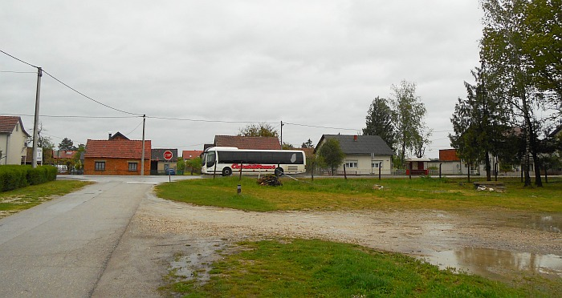
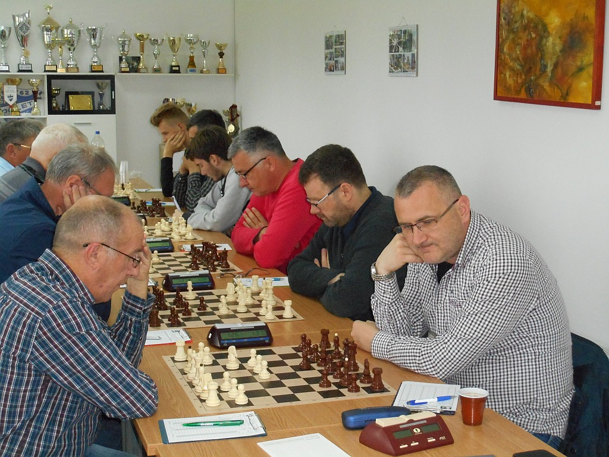
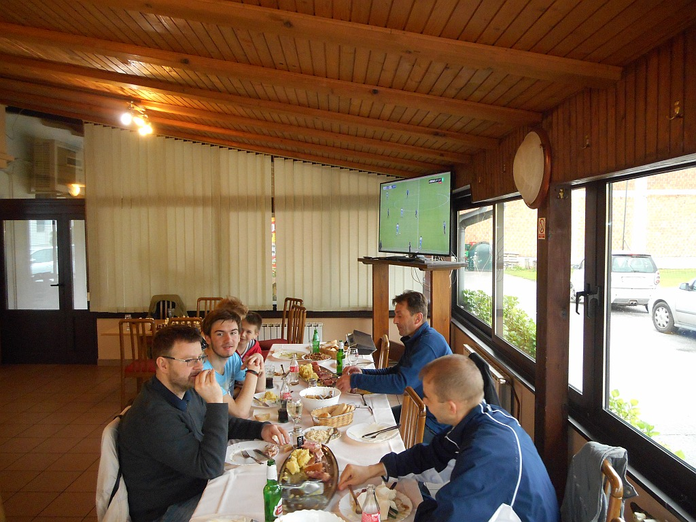

**Seniori, 6. kolo  
**

Po hladnom i kišnom vremenu, na gostovanju u Buševcu, uz malu pomoć domaćina, ekipa ŠK Odra upisala je drugu ovogodišnju pobjedu. Nakon manje od sata igre, Cvetko je prijateljski remizirao. Na četvrtoj ploči mladi Ivan je imao neke propuste koje protivnik nije iskoristio, igrao je do kraja i uspio dobiti pješačku završnicu. Zvjezdan je korektno žrtvovao, ali je ostao s malo vremena, neprecizno vodio napad i izgubio. Stipe je ušao u otvaranje koje slabo poznaje, u jednom trenutku vrlo loše stajao, ali njegov protivnik nije iskoristio ponuđeno, nego naprotiv, ušao u komplikacije u kojima je izgubio materijal. Darkov protivnik također je ostavljao pješake, ali je ipak uspio ostvariti rokadni napad. Ipak, i njemu je preostalo malo vremena i u vremenskom tjesnacu ostavio cijelu figuru. Darko je tako upisao prvu ovogodišnju pobjedu. Vraneša je odigrao danas možda i najkvalitetniju partiju, ali je također u vremenskom tjesnacu, slično kao Monika prošlo kolo, ostavio materijal. Završetak proljetnog dijela natjecanja  ostavio nas je na sredini [tablice](http://chess-results.com/tnr414083.aspx?lan=13&art=0). Liga se nastavlja u rujnu kada nam u goste dolazi ŠK Rugvica-Vrbani.

<table><tbody><tr><td></td><td></td><td>&nbsp;&nbsp;<strong>ŠK Buševec II</strong></td><td>–</td><td></td><td>&nbsp;&nbsp;<strong>ŠK Odra</strong></td><td><strong>2,5 : 3,5</strong></td></tr><tr><td>1.</td><td>MK</td><td><table><tbody><tr><td></td><td>Rožić, Marijan 2050</td></tr></tbody></table></td><td>–</td><td>MK</td><td><table><tbody><tr><td></td><td>Maravić, Stjepan 2109</td></tr></tbody></table></td><td>0 – 1</td></tr><tr><td>2.</td><td>MK</td><td><table><tbody><tr><td></td><td>Dejanović, Mladen 2051</td></tr></tbody></table></td><td>–</td><td>MK</td><td><table><tbody><tr><td></td><td>Karlić, Zvjezdan 2108</td></tr></tbody></table></td><td>1 – 0</td></tr><tr><td>3.</td><td>MK</td><td><table><tbody><tr><td></td><td>Hibner, Branko 2007</td></tr></tbody></table></td><td>–</td><td>MK</td><td><table><tbody><tr><td></td><td>Vidaković, Darko 2090</td></tr></tbody></table></td><td>0 – 1</td></tr><tr><td>4.</td><td>II</td><td><table><tbody><tr><td></td><td>Žgela, Joso 1847</td></tr></tbody></table></td><td>–</td><td>I</td><td><table><tbody><tr><td></td><td>Maravić, Ivan 1887</td></tr></tbody></table></td><td>0 – 1</td></tr><tr><td>5.</td><td>MK</td><td><table><tbody><tr><td></td><td>Čolić, Zdravko 1848</td></tr></tbody></table></td><td>–</td><td>MK</td><td><table><tbody><tr><td></td><td>Cvetković, Ivan 1947</td></tr></tbody></table></td><td>½ – ½</td></tr><tr><td>6.</td><td>NM</td><td><table><tbody><tr><td></td><td>Dejanović, Tereza 1825</td></tr></tbody></table></td><td>–</td><td>III</td><td><table><tbody><tr><td></td><td>Vraneša, Ivan 1618</td></tr></tbody></table></td><td>1 – 0</td></tr></tbody></table>

  ** **
