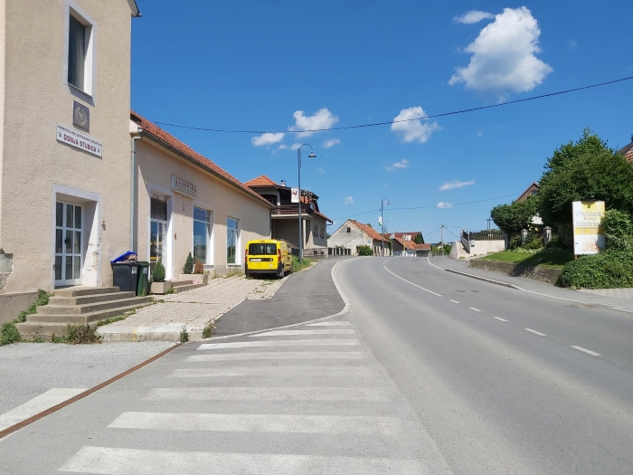

**Seniori – I. ekipa, 5.kolo  
  
**  
Prošle nedjelje smo se vratili pobjedničkim putevima i odnijeli [oba](https://chess-results.com/tnr1127780.aspx?lan=13&art=3&rd=5) meč boda iz Stubice. Meč je bio jako napet, čemu svjedoči činjenica da su sve partije završile nakon 13. Ovo je bio ovosezonski Cvetkov debi. Vidjelo se da jako malo igra te je par puta iz jednake topovske dolazio u izgubljenu. Međutim, pokazao je zavidnu razinu borbenosti te je spasio (pokazalo se kasnije) ključnih pola boda. Vraneša je odigrao pomalo neambiciozno otvaranje, ali nakon njega je polako gradio pozicionu prednost koja je dovela do osvajanja figure nakon čega je realizacija bila stvar vremena. Kada malo poradi na otvaranjima, mislim da možemo očekivati novoga majstorskog kandidata u Klubu! Stjepko je odigrao jednu jako dobru partiju gdje je postupno nadigravao protivnika do postizanja materijalne prednosti koju je lagano pretočio u pobjedu. Mladen je odigrao jednu mirnu i pozicionu partiju koja je obostranom preciznom igrom prešla u jednaku završnicu. Ivo je odigrao nekarakteristično loše, previđajući laganu taktiku u otvaranju te krivo postavljajući figure, na njegovu sreću, protivnik isto nije bio previše raspoložen te je promašivao prilike. Na ulasku u završnicu, Ivo osvaja pješaka te je i dobiven. Međutim, kako nam je pola boda bilo dosta za pobjedu, uzima remi. Ivan Maravić je zato odigrao karakteristično loše, tijekom partije je imao svoje prilike da bude puno bolji. Međutim, bira krivi nastavak gurajući pogrešnoga pješaka te na kraju pogrešno uzimajući kvalitetu. Nakon toga njegov mladi protivnik Mlinarić uvjerljivo realizira pozicionu prednost. Tu partiju donosimo u cjelosti. Zahvaljujemo domaćinima na gostoprimstvu te im želimo sreću u nastavku sezone, a mi se nadamo da ćemo pobijediti Karlovac u zadnjemu kolu polusezone.

<table><tbody><tr><td>Pl.</td><td></td><td><strong>ŠK Donja Stubica</strong></td><td>–</td><td></td><td><strong>ŠK Odra</strong></td><td><strong>2,5-3,5</strong></td></tr><tr><td>1.</td><td>MK</td><td>Mlinarić, Šimun 2107</td><td>–</td><td>MK</td><td>Maravić, Ivan 2097</td><td>1-0</td></tr><tr><td>2.</td><td>MK</td><td>Janković, Mirko 2075</td><td>–</td><td>MK</td><td>Sliepčević, Mladen 2092</td><td>½–½</td></tr><tr><td>3.</td><td>I</td><td>Novosel, Vladimir 2069</td><td>–</td><td>MK</td><td>Maravić, Stjepan 2096</td><td>0-1</td></tr><tr><td>4.</td><td>I</td><td>Novosel, Kristijan 2034</td><td>–</td><td>MK</td><td>Cvetković, Ivan 1953</td><td>½–½</td></tr><tr><td>5.</td><td>I</td><td>Mlinarić, Andrija 1922</td><td>–</td><td>II</td><td>Pahljina, Ivo 1951</td><td>½–½</td></tr><tr><td>6.</td><td>III</td><td>Kučko, Gabrijel 1851</td><td>–</td><td>II</td><td>Vraneša, Ivan 1898</td><td>0-1</td></tr></tbody></table>

```pgn
[Event "III A liga - Donja Stubica : Odra"]
[Site "sahovski-klub.com"]
[Date "2025.04.27"]
[Round "4"]
[White "MK Mlinarić, Šimun"]
[Black "MK Maravić, Ivan"]
[Result "1-0"]
[ECO "C29"]
[WhiteElo "2107"]
[BlackElo "2097"]
[PlyCount "99"]
1. e4 e5 2. Nc3 Nf6 3. f4 d5 4. fxe5 Nxe4 5. Qf3 f5 6. d3 Nxc3 7. bxc3 d4 8. Qg3
Nc6 9. Be2 Be6 10. Nf3 Qd7 11. O-O O-O-O 12. Bb2 Bc5 13. Kh1 Rhg8 14. cxd4 Nxd4
15. Nxd4 Bxd4 16. c3 Bb6 17. a4 a6 18. d4 g5 19. Rfd1 f4 20. Qe1 g4 21. Bd3 g3
22. Be4 Qe7 23. Qf1 Qh4 24. h3 f3 25. Bxf3 Rdf8 26. Kg1 Bd5 27. Rd3 Bc4 28. Qd1
Bxd3 29. Qxd3 Kb8 30. a5 Ba7 31. Rb1 c5 32. Ba3 Rg7 33. Bxc5 Bxc5 34. dxc5 Ka7
35. c6 Qf4 36. Qd6 Qe3+ 37. Kh1 Rxf3 38. c7 Rf8 39. Qb6+ Qxb6 40. axb6+ Ka8 41.
e6 Rc8 42. Re1 Re7 43. Kg1 a5 44. Re5 Rcxc7 45. bxc7 1-0
```

  
*IvanM*
