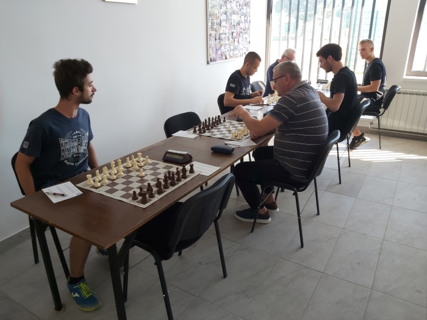

**IV. A liga, 4. kolo**  
Sunce nas je počastilo i ove nedjelje, zagrijavši do skoro trideset stupnjeva. Pa smo se u Dubravi sklonili od vrućine i odigrali 4. kolo [seniorske lige](https://chess-results.com/tnr549409.aspx?lan=13&art=0). Vodili smo 1-0 od početka jer naši protivnici nisu imali igrača na drugoj ploči. Nakon dva sata igre je Božo pobijedio nakon što je njegov protivnik grubo previdio u partiji koja je do tada bila podjednaka. Malo kasnije je Tin pobijedio, nekorektno je žrtvovao za napad, ali njegov iskusan protivnik nije vidio obranu i to je bilo 3-0 za nas. Nakon toga je Ivan Vraneša remizirao, bio je puno bolji/dobiven od 20. poteza pa sve do pješačke u kojoj se nije snašao u cajtnotu i remizirao. Ivan Maravić je uzeo pješaka u otvaranju te polako u završnici stiskao svog protivnika i mirno dobio. Zvjezdan je zadnji ostao, bio je pod pritiskom nakon otvaranja (vremenskim i pozicijskim), ali je počeo vuči dobre poteze te čak došao u dobivenu poziciju, ali zbog nedostatka vremena je ponavljao poteze i partija je završila remijem. Iduće kolo se igra u nedjelju kada smo domaćini ŠK Vrustun 1252.

<table><tbody><tr><td>Pl.</td><td></td><td><strong>ŠK Dubrava</strong></td><td>–</td><td></td><td><strong>ŠK Odra</strong></td><td><strong>1-5</strong></td></tr><tr><td>1.</td><td>I</td><td>Balen Teo 1947</td><td>–</td><td>MK</td><td>Karlić Zvjezdan 2096</td><td>½–½</td></tr><tr><td>2.</td><td></td><td>Bez igrača</td><td>–</td><td>MK</td><td>Maravić Stjepan 2138</td><td>0-1</td></tr><tr><td>3.</td><td>III</td><td>Damjanović Šimun 1713</td><td>–</td><td>I</td><td>Maravić Ivan 1925</td><td>0-1</td></tr><tr><td>4.</td><td>I</td><td>Sontag Bruno 1688</td><td>–</td><td>II</td><td>Vraneša Ivan 1664</td><td>½–½</td></tr><tr><td>5.</td><td>IV</td><td>Žuvić Ivan</td><td>–</td><td>VK</td><td>Furčić Tin 1631</td><td>0-1</td></tr><tr><td>6.</td><td>VK</td><td>Vuković Mirko</td><td>–</td><td>III</td><td>Cvetković Božo 1431</td><td>0-1</td></tr></tbody></table>
