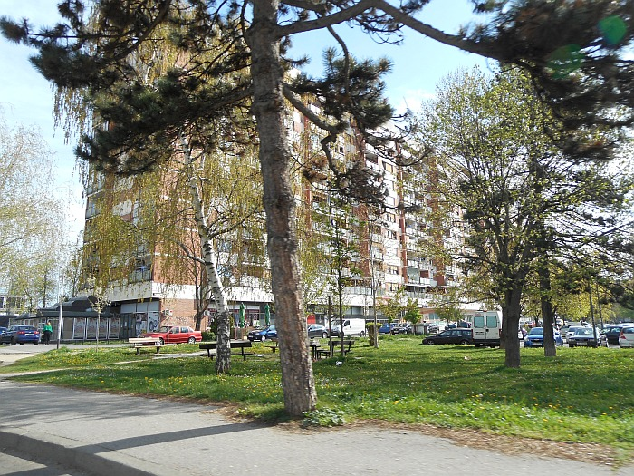
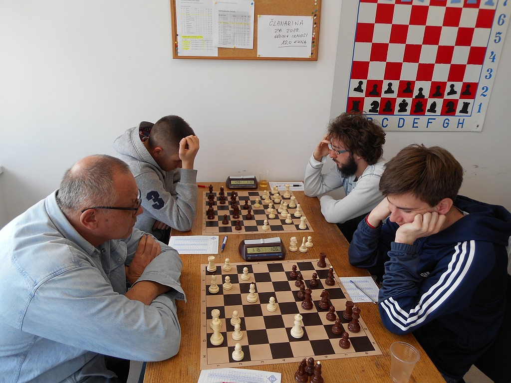

**Seniori, 4. kolo  
  
**Prvu pobjedu ove godine ubilježila je i seniorska ekipa ŠK Odra. Na gostovanju kod ŠK Dubrava sve je išlo na naš mlin. Stipe je poziciono žrtvovao kvalitet i uspio realizirati poziciju s boljim razvojem figura. Tin je odigrao čvrsto i remizirao. Darko i Jura su bili nadigrani, ali im se na kraju pružila prilika. Jura je previdio remizirati vječnim šahom te krivim potezom upao u matnu mrežu, dok je Darko sretnom taktikom uspio potpuno izjednačiti, ali je zaboravio na vrijeme i pao. Najdulje je igrao mladi Ivan. Protivnik mu je dopustio lijepu taktiku u završnici raznobojnih lovaca ,a Ivan je iskoristio ponuđenu priliku te donio presudan bod za ekipnu pobjedu. Sljedeće kolo domaćini smo ekipi ŠK Podsused.

<table><tbody><tr><td>Pl.</td><td></td><td>&nbsp;&nbsp;<strong>ŠK Dubrava, Zagreb</strong></td><td>–</td><td></td><td>&nbsp;&nbsp;<strong>ŠK Odra, Zagreb</strong></td><td><strong>2½:3½</strong></td></tr><tr><td>1.</td><td>MK</td><td><table><tbody><tr><td></td><td>Horvat, Damjan 2086</td></tr></tbody></table></td><td>–</td><td>MK</td><td><table><tbody><tr><td></td><td>Bačurin, Juraj 2034</td></tr></tbody></table></td><td>1 – 0</td></tr><tr><td>2.</td><td>MK</td><td><table><tbody><tr><td></td><td>Šunjić, Vitomir 2074</td></tr></tbody></table></td><td>–</td><td>MK</td><td><table><tbody><tr><td></td><td>Maravić, Stjepan 2114</td></tr></tbody></table></td><td>0 – 1</td></tr><tr><td>3.</td><td>MK</td><td><table><tbody><tr><td></td><td>Stipić, Bruno 2073</td></tr></tbody></table></td><td>–</td><td>MK</td><td><table><tbody><tr><td></td><td>Karlić, Zvjezdan 2110</td></tr></tbody></table></td><td>0 – 1</td></tr><tr><td>4.</td><td>MK</td><td><table><tbody><tr><td></td><td>Stojković, Josip 2042</td></tr></tbody></table></td><td>–</td><td>MK</td><td><table><tbody><tr><td></td><td>Vidaković, Darko 2103</td></tr></tbody></table></td><td>1 – 0</td></tr><tr><td>5.</td><td>III</td><td><table><tbody><tr><td></td><td>Jurković, Dinko 1745</td></tr></tbody></table></td><td>–</td><td>I</td><td><table><tbody><tr><td></td><td>Maravić, Ivan 1836</td></tr></tbody></table></td><td>0 – 1</td></tr><tr><td>6.</td><td>IV</td><td><table><tbody><tr><td></td><td>Damjanović, Šimun 1650</td></tr></tbody></table></td><td>–</td><td>VK</td><td><table><tbody><tr><td></td><td>Furčić, Tin 1634</td></tr></tbody></table></td><td>½ – ½</td></tr></tbody></table>

**

```pgn
[Event "D. Jurković vs I. Maravić"]
[SetUp "3"]
[FEN "8/8/6p1/5b1p/5PkB/6P1/2p5/2K5 b - - 0 77"]
77.  g5 78. fxg5 Bg6 79. Kd2 Kf3 0-1
```

  
**
