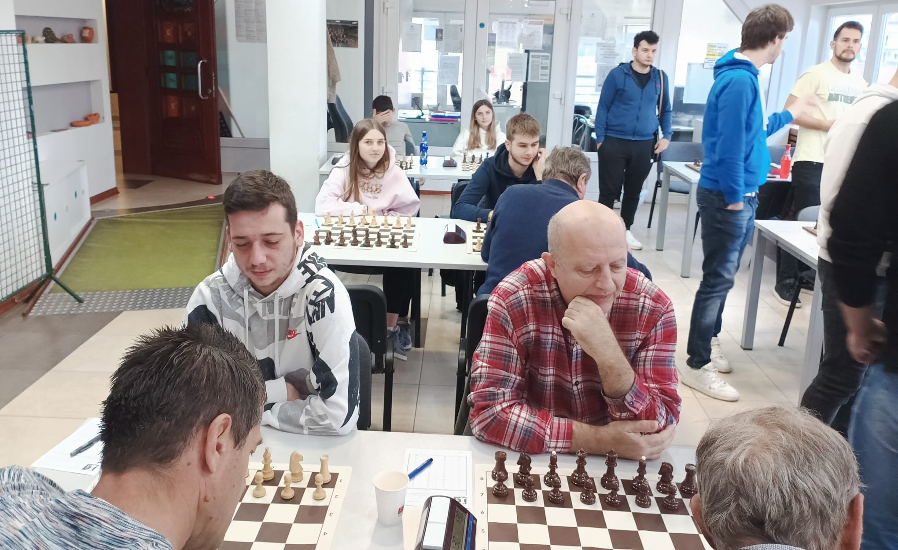

###### Seniori – II. ekipa, 9.kolo



**Prošle nedjelje, 12. listopada**, ekipa **ŠK Odra II** gostovala je kod **ŠK Dugo Selo II** i ostvarila **vrijednu pobjedu rezultatom 4:2** – drugu uzastopnu!

Ekipa je nastupila u sastavu: **Darko Šutić, Božo, Luka, Ivana, Lucija i Filip Horvat.**

Na **prvoj ploči**, Darko je odigrao solidnu partiju, no protivnik, pokazavši majstorsku snagu, uspio je preokrenuti i odnijeti pobjedu.

**Božo** je odigrao čvrstu i zrelu partiju. Protivnik je pokušao taktičku žrtvu figure u nadi za napadom, ali Božo je hladnokrvno odbio prijetnje i sigurno priveo partiju kraju – pobjedom! Njegovu partiju donosimo u prilogu.

**Luka** je upisao svoju **prvu ovosezonsku pobjedu**! Bravo za Luku! Odigrao je mirno i precizno, nadigrao protivnika i zasluženo osvojio bod.

**Ivana** je još jednom pokazala pouzdanost i rutinu – nova pobjeda i novi važan bod za ekipu.

**Lucija** polako hvata ritam seniorskog šaha. Uz još malo iskustva i dodatnih partija, vjerujemo da će uskoro redovito upisivati pobjede.

Na **šestoj ploči**, **Filip Horvat** je briljirao! Pokazao je odlično poznavanje otvaranja i čvrstu igru – pobjeda minijaturom!

Sve u svemu, još jedan **odličan dan za drugu ekipu ŠK Odre**. Čestitke svim igračima! 👏U idućem kolu, na domaćem terenu, dočekujemo ekipu **ŠK Novi Zagreb II** – idemo po treću pobjedu zaredom!

<table><tbody><tr><td>Pl.</td><td></td><td><strong>ŠK Dugo Selo II</strong></td><td>–</td><td></td><td><strong>ŠK Odra II</strong></td><td><b>2 – 4</b></td></tr><tr><td>1.</td><td>MK</td><td>Korov, Zvonko</td><td>–</td><td>II</td><td>Šutić, Darko</td><td>1-0</td></tr><tr><td>2.</td><td>III</td><td>Vujić, Velibor</td><td>–</td><td>III</td><td>Cvetković, Božo</td><td>0-1</td></tr><tr><td>3.</td><td>&nbsp;III</td><td>Sesan, Josip</td><td>–</td><td>IV</td><td>Fiolić, Luka</td><td>0-1</td></tr><tr><td>4.</td><td></td><td>Đorđević, Jan</td><td>–</td><td>&nbsp;II</td><td>Fiolić, Ivana</td><td>0-1</td></tr><tr><td>5.</td><td></td><td>Grgošić, Božidar</td><td>–</td><td>&nbsp;III</td><td>Fiolić, Lucija</td><td>1-0</td></tr><tr><td>6.</td><td></td><td>Mažar, Josip</td><td>–</td><td></td><td>Horvat, Filip</td><td>0-1</td></tr></tbody></table>

```pgn
[Event "5 A Liga Centar"]
[Site "Dugo Selo"]
[Date "12.10.2025."]
[Round "9"]
[White "Cvetković, Božo"]
[Black "Vujić, Velibor"]
[Result "1-0"]
[WhiteElo "1668"]
[BlackElo "1850"]
[Board "2"]

1. b3 d5 2. Bb2 c5 3. e3 a6 4. Nf3 Nc6 5. d4 Bg4 6. Be2 Bxf3 7. Bxf3 Nf6 8. O-O e6 9. Nd2 cxd4 10. exd4 Bd6 11. c4 O-O 12. cxd5 exd5 13. Be2 Rc8 14. Nf3 Re8 15. Rc1 Bf4 16. Rc2 Nb4 17. Rxc8 Qxc8 18. a3 Nc6 19. Bd3 h6 20. Re1 Ne4 21. g3 Bd6 22. Nd2 f5 23. f3 Rf8 24. fxe4 fxe4 25. Bf1 Qf5 26. Qe2 h5 27. Bg2 Qg5 28. Rf1 Rc8 29. Bh3 Rc7 30. Rf5 Qe7 31. Rxh5 Bxa3 32. Bxa3 Qxa3 33. Be6+ Kf8 34. Qf2+ Ke7 35. Qf7+ Kd6 36. Rxd5# 1-0
```
