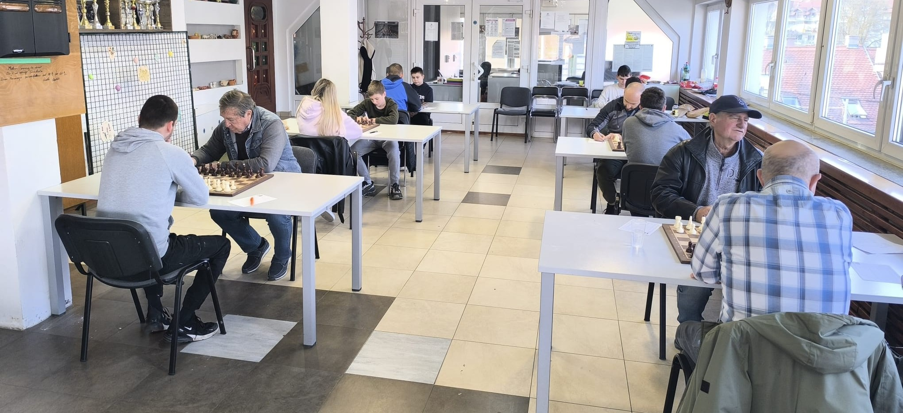

###### Seniori – II. ekipa, 2.kolo

  
Prošle nedjelje, **22\. ožujka**, druga ekipa ŠK Odre gostovala je kod ŠK Dugo Selo II te ostvarila vrijednu **[pobjedu](https://s2.chess-results.com/tnr1352599.aspx?lan=13&art=3&rd=2&SNode=S0) rezultatom 3,5:2,5**.

Ekipa je nastupila u sastavu: Darko Šutić, Božo, Tin, Lucija, Filip Horvat i Goran.

**Darko** je odigrao uzbudljivu i napetu partiju, no u ključnom trenutku došlo je do zabune oko ponavljanja pozicije tri puta, što je na kraju rezultiralo porazom.

**Božo** je odigrao vrlo lijepu stratešku partiju u kojoj je nadigrao svog protivnika. Njegovu partiju donosimo u prilogu.

**Tin** je vodio taktički izuzetno zahtjevnu i napetu borbu, u kojoj je tijekom cijele partije bilo mnogo prijetnji s obje strane. Vrlo zanimljivu partiju također donosimo u prilogu.

**Lucija** je sigurno nadigrala svog mlađeg protivnika te mu u završnici osvojila topa i mirno privela partiju kraju. Bravo za Luciju!

**Filip Horvat** odigrao je dobru partiju (uz nešto slabije otvaranje) te je došao do izjednačene topovske završnice, no nažalost je izgubio na vrijeme. Šteta za Filipa, ali vjerujemo da će to popraviti na nadolazećem Prvenstvu Hrvatske. Sretno!

**Goran** je odigrao solidnu partiju i nadigrao protivnika. Iako je u završnici imao dobitnu poziciju, timski je prihvatio remi i tako osigurao ekipi ključnih pola boda za ukupnu pobjedu.

**Sve u svemu**, čestitke cijeloj ekipi na važnoj pobjedi! U sljedećem kolu ŠK Odra II na domaćem terenu dočekuje ekipu ŠK Maksimir.

<table><tbody><tr><td>Pl.</td><td></td><td><strong>ŠK Dugo Selo II</strong></td><td>–</td><td></td><td><strong>ŠK Odra II</strong></td><td><b>2,5:3,5</b></td></tr><tr><td>1.</td><td>MK</td><td>Korov, Zvonko</td><td>–</td><td>II</td><td>Šutić, Darko</td><td>1-0</td></tr><tr><td>2.</td><td>III</td><td>Sesan, Josip</td><td>–</td><td>III</td><td>Cvetković, Božo</td><td>0-1</td></tr><tr><td>3.</td><td>III</td><td>Grgošić, Božidar</td><td>–</td><td>III</td><td>Furčić, Tin</td><td>0-1</td></tr><tr><td>4.</td><td>&nbsp;V</td><td>&nbsp;Mažar, Matija</td><td>–</td><td>III</td><td>Fiolić, Lucija</td><td>0-1</td></tr><tr><td>5.</td><td></td><td>Marić, Filip</td><td>–</td><td>&nbsp;V</td><td>Horvat, Filip</td><td>1-0</td></tr><tr><td>6.</td><td></td><td>Mažar, Josip</td><td>–</td><td>&nbsp;II</td><td>Fiolić, Goran</td><td>1/2-1/2</td></tr></tbody></table>

```pgn
[Event "5 B Liga Centar"]
[Site "Dugo Selo"]
[Date "22.03.2026."]
[Round "2"]
[White "Cvetković, Božo"]
[Black "Sesan, Josip"]
[Result "1-0"]
[WhiteElo "1698"]
[BlackElo "1809"]
[Board "2"]

1. b3 Nc6 2. Bb2 e5 3. e3 a6 4. Nf3 d6 5. Be2 Nf6 6. d3 Ne7 7. c4 b6 8. Nbd2 Bb7 9. Qc2 Ng6 10. O-O h5 11. Ng5 Ng4 12. Nge4 f5 13. Ng3 Qh4 14. h3 f4 15. Nf5 Qg5 16. e4 Nh6 17. Nf3 Qf6 18. d4 O-O-O 19. d5 Nxf5 20. exf5 Ne7 21. Bd3 Rg8 22. a4 g5 23. fxg6 Nxg6 24. a5 Nh4 25. Nxh4 Qxh4 26. Kh2 Bh6 27. axb6 cxb6 28. c5 Kb8 29. c6 Rc8 30. Bxa6 Bxa6 31. Rxa6 Rxg2+ 32. Kxg2 f3+ 33. Kxf3 Qxh3+ 34. Ke2 Qg4+ 35. f3 Qb4 36. Rfa1 Kc7 37. Ra7+ Kd8 38. Rd7+ Ke8 39. Qg6+ 1-0
```

```pgn
[Event "5 B Liga Centar"]
[Site "Dugo Selo"]
[Date "22.03.2026."]
[Round "2"]
[White "Grgošić, Božidar"]
[Black "Furčić, Tin"]
[Result "0-1"]
[WhiteElo "1824"]
[BlackElo "1793"]
[Board "3"]

1. e4 e5 2. f4 d5 3. exd5 exf4 4. Nf3 Nf6 5. Bc4 Nxd5 6. O-O Be6 7. d4 Ne3 8. Bb5+ c6 9. Bxe3 fxe3 10. Bd3 f5 11. Nc3 Bd6 12. Ne5 Qg5 13. Ne2 g6 14. Nf4 Bg8 15. Rf3 Bxe5 16. dxe5 Nd7 17. e6 Ne5 18. Rf1 Ng4 19. h3 h5 20. Qf3 Nf6 21. Qxe3 Rh7 22. Rad1 Re7 23. c4 Rxe6 24. Qd4 Re7 25. Rfe1 Kf7 26. Rxe7+ Kxe7 27. Re1+ Kf7 28. Qe5 Re8 29. Qc7+ Kf8 30. Qd6+ Kf7 31. Rxe8 Nxe8 32. Qe6+ Kg7 33. Nxh5+ Qxh5 34. Qxe8 Qd1+ 35. Bf1 Qd4+ 36. Kh1 Bxc4 37. Bxc4 Qxc4 38. Qd7+ Qf7 39. Qd4+ Qf6 40. Qxa7 Qxb2 41. a4 Kf6 42. Qc5 Qa1+ 43. Kh2 Qe5+ 0-1
```

IvanV
