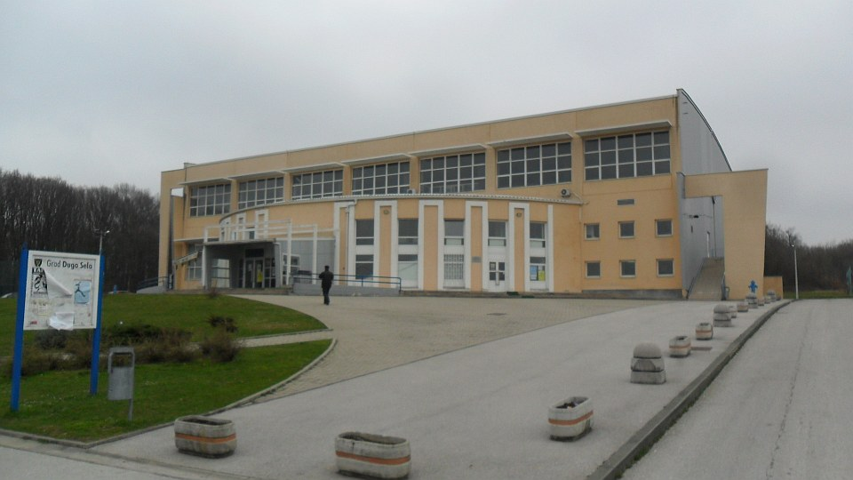
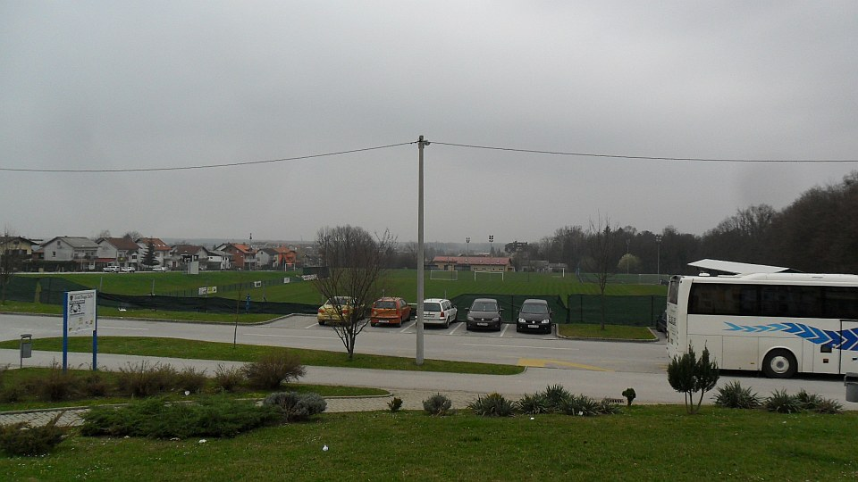

**Seniori, 2. kolo**

U novoj sportskoj dvorani u Dugom Selu odigrano je drugo kolo seniorske lige. Uvjerljivo je pobijedio ŠK Odra.Na prvoj i petoj ploči Ljubić i Darko brzo su kaznili nepripremljene napade protivnika. Stipe i Cvetko poveli su bijelima napade u igri damina pješaka, ali su se njihovi protivnici precizno branili i partije su otišle u remi. Danko je, nakon čudnih izmjena figura koje vjerojatno samo on razumije, postavio dosta agresivnu poziciju, pronašao krasnu žrtvu kvalitete za matni napad i efektno završio partiju. Jura je igrao oprezno i precizno, zadržavajući pritisak na protivničku poziciju. Njegov protivnik trošio je mnogo vremena, previdio i jednog pješaka te na kraju u teškoj poziciji prekoračio vrijeme za razmišljanje. Danas je nakon dugo vremena bilo lijepo gledati partije jer nije bilo šokova, grubih previda i neočekivanih preokreta. Ni u jednom trenutku ekipna pobjeda nije bila upitna. Osim što se nisu proslavili rezultatom,naši su domaćini zaboravili počastiti barem kavom, a inače simpatična ekipa ŠK Dugo Selo nažalost ima i suca Krapeca, koji se ponaša kao da sudi meč za prvaka svijeta. Sve i da mu netko objasni da je ovo amaterska liga,sumnjam da bi shvatio.  
Sljedeće kolo igra se 16. ožujka u Odri.

ŠK DUGO SELO – ŠK ODRA  1 : 5

1\. Ganić Martin – Ljubić Ivan 0:1  
2\. Filipović Tomislav – Maravić Stjepan 1/2  
3\. Korov Zvonko – Brajdić Danko 0:1  
4\. Materni Anton – Cvetković Ivan 1/2  
5\. Ćelepirović Vinko – Vidaković Darko 0:1  
6\. Jukić Dario – Bačurin Juraj 0:1

v.d.
